> **HISTORICAL SNAPSHOT — predates the current BioSTEAM CAPEX rerun. Pareto candidates and their charts are not current results; the source batch has been removed. Use the current F1 CAPEX schedule in results/report_figures/capex_breakdown_by_flow.csv and its method note.**

# Complete GreenHub figure atlas

All 266 source PNGs are copied unchanged. See portable_figure_index.csv for machine-readable provenance.

## 01_baseline

### Figure 1: 01_baseline__combined__01_grass_to_products

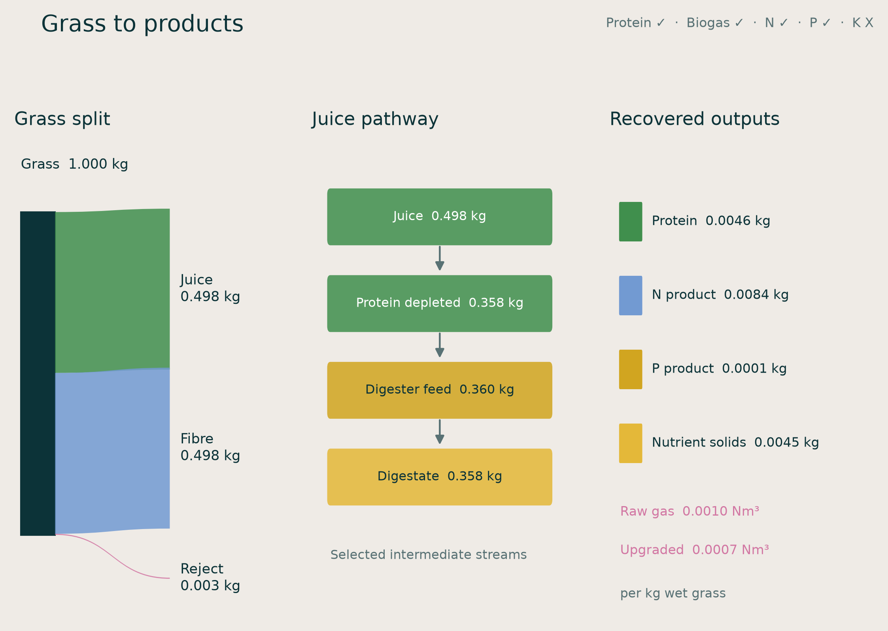

Mass-proportional grass split plus modeled downstream stream/product map

**Scenario:** F1 PR3 AD1 BG2 NR4 A reference; 0483640f1c194132b22e95fba0eaea1e; 1000 kg/h; 8760 h/year; zero savings/subsidy, benchmark product prices  
**Units:** kg/kg wet grass; dry Nm³/kg wet grass  
**Source:** Saved BioSTEAM decision reports and Greenhub/results/runs/{run_id}/streams.json; candidate economic overlay  
**Interpretation:** BioSTEAM process outputs; screening process assumptions. TEA includes partial recorded capital/OPEX, benchmark product prices, subsidy, tax and candidate savings/uplifts. Climate objective is electricity-only attributional burden, excludes heat and substitution credits. Technical ranking gate remains false because storage evidence is unresolved. Financial projections repeat nominal annual accounts for 20 years and are not complete forecasts or balance sheets. Front-end split closes exactly at 1 kg wet grass. Downstream columns show selected actual stream/product quantities, not a closed Sankey: process water, reagents, evaporation and side streams are omitted. Dry normal gas volume uses 273.15 K and 101325 Pa.

### Figure 2: 01_baseline__combined__02_material_and_products

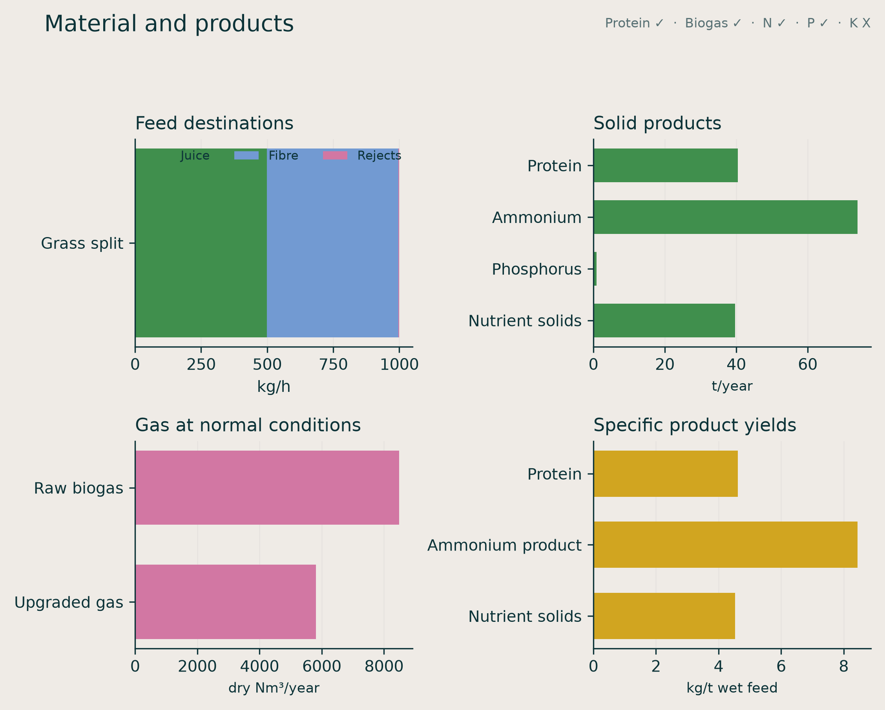

Front-end split, solid products, dry gas volumes and specific yields

**Scenario:** F1 PR3 AD1 BG2 NR4 A reference; 0483640f1c194132b22e95fba0eaea1e; 1000 kg/h; 8760 h/year; zero savings/subsidy, benchmark product prices  
**Units:** kg/h; t/year; dry Nm³/year; kg/t feed  
**Source:** Saved BioSTEAM decision reports and Greenhub/results/runs/{run_id}/streams.json; candidate economic overlay  
**Interpretation:** BioSTEAM process outputs; screening process assumptions. TEA includes partial recorded capital/OPEX, benchmark product prices, subsidy, tax and candidate savings/uplifts. Climate objective is electricity-only attributional burden, excludes heat and substitution credits. Technical ranking gate remains false because storage evidence is unresolved. Financial projections repeat nominal annual accounts for 20 years and are not complete forecasts or balance sheets. Raw and upgraded dry gas volumes independently normalized to 273.15 K and 101325 Pa; they are not saleable atmospheric m³. Product stream masses are not pure N/P/K.

### Figure 3: 01_baseline__combined__03_energy_and_climate

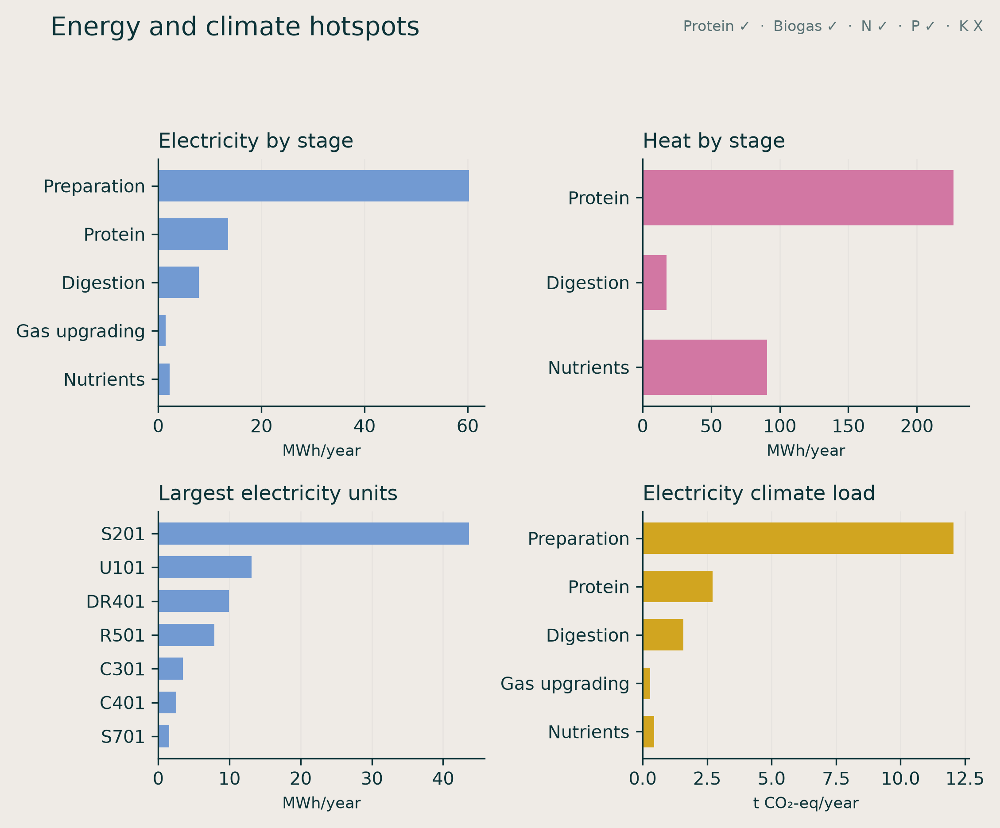

Stage and unit utility hotspots and included climate load

**Scenario:** F1 PR3 AD1 BG2 NR4 A reference; 0483640f1c194132b22e95fba0eaea1e; 1000 kg/h; 8760 h/year; zero savings/subsidy, benchmark product prices  
**Units:** MWh/year; t CO₂-eq/year  
**Source:** Saved BioSTEAM decision reports and Greenhub/results/runs/{run_id}/streams.json; candidate economic overlay  
**Interpretation:** BioSTEAM process outputs; screening process assumptions. TEA includes partial recorded capital/OPEX, benchmark product prices, subsidy, tax and candidate savings/uplifts. Climate objective is electricity-only attributional burden, excludes heat and substitution credits. Technical ranking gate remains false because storage evidence is unresolved. Financial projections repeat nominal annual accounts for 20 years and are not complete forecasts or balance sheets. Climate subplot is the partial electricity burden only, 0.20 kg CO2e/kWh; heat and other process burdens are not included.

### Figure 4: 01_baseline__combined__04_economic_accounts

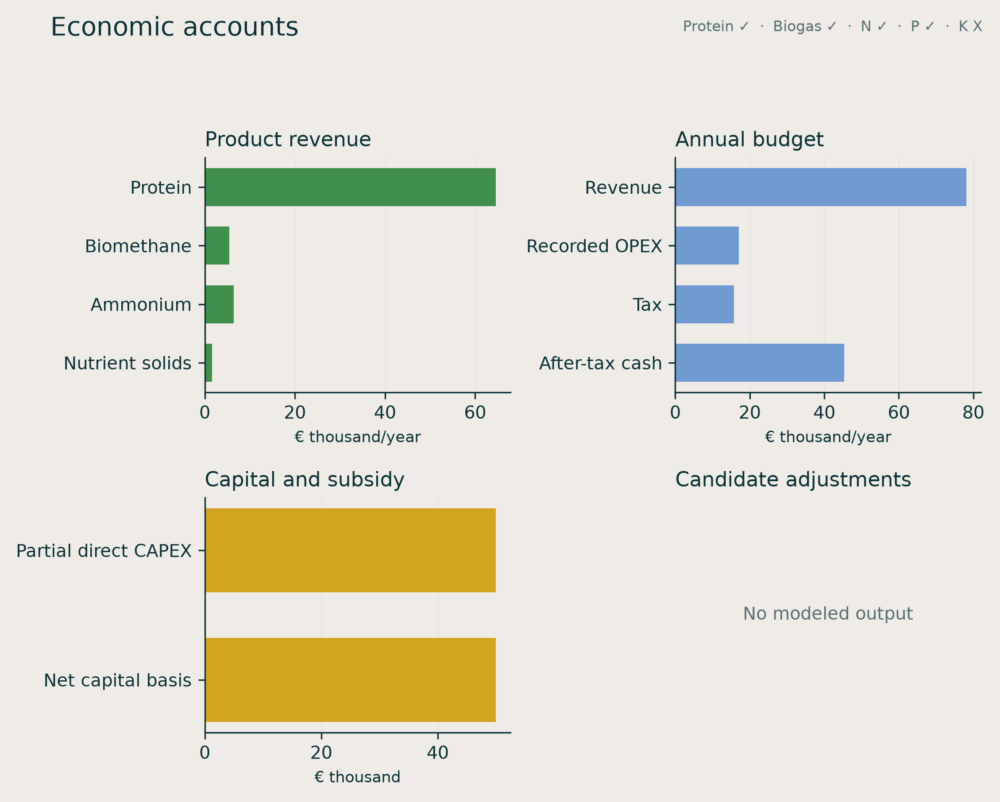

Product revenue, partial annual budget, capital subsidy and candidate overlays

**Scenario:** F1 PR3 AD1 BG2 NR4 A reference; 0483640f1c194132b22e95fba0eaea1e; 1000 kg/h; 8760 h/year; zero savings/subsidy, benchmark product prices  
**Units:** € thousand; € thousand/year  
**Source:** Saved BioSTEAM decision reports and Greenhub/results/runs/{run_id}/streams.json; candidate economic overlay  
**Interpretation:** BioSTEAM process outputs; screening process assumptions. TEA includes partial recorded capital/OPEX, benchmark product prices, subsidy, tax and candidate savings/uplifts. Climate objective is electricity-only attributional burden, excludes heat and substitution credits. Technical ranking gate remains false because storage evidence is unresolved. Financial projections repeat nominal annual accounts for 20 years and are not complete forecasts or balance sheets. Capital bar is one-time while other panels are annual. CAPEX/OPEX exclude uncalculated items; apparent profit is not a full TEA result.

### Figure 5: 01_baseline__combined__05_cashflow_and_product_revenue

Constant-account cash flow and cumulative product revenue over 20 years

**Scenario:** F1 PR3 AD1 BG2 NR4 A reference; 0483640f1c194132b22e95fba0eaea1e; 1000 kg/h; 8760 h/year; zero savings/subsidy, benchmark product prices  
**Units:** € thousand; € thousand/year  
**Source:** Saved BioSTEAM decision reports and Greenhub/results/runs/{run_id}/streams.json; candidate economic overlay  
**Interpretation:** BioSTEAM process outputs; screening process assumptions. TEA includes partial recorded capital/OPEX, benchmark product prices, subsidy, tax and candidate savings/uplifts. Climate objective is electricity-only attributional burden, excludes heat and substitution credits. Technical ranking gate remains false because storage evidence is unresolved. Financial projections repeat nominal annual accounts for 20 years and are not complete forecasts or balance sheets. Year 0 is subsidy-adjusted partial capital; years 1–20 repeat current after-tax operating cash and product revenues. No financing, working capital, replacements, inflation or terminal value. This is not a balance sheet.

### Figure 6: 01_baseline__combined__06_balance_and_evidence

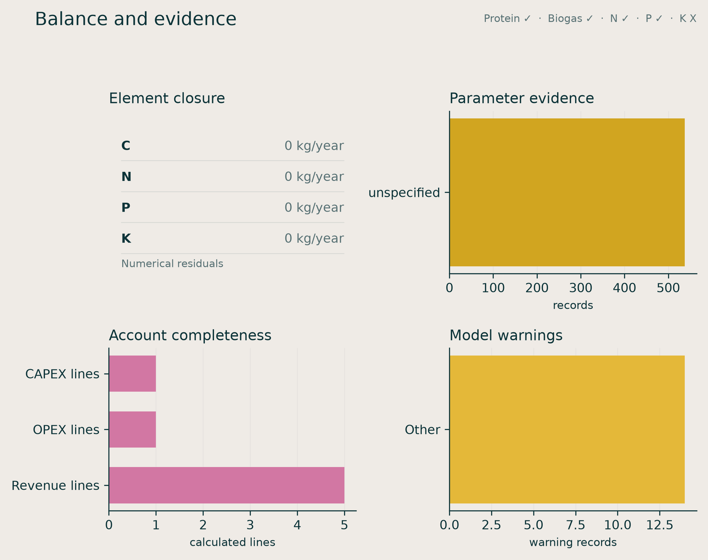

Numerical closure, evidence counts, calculated account lines and warnings

**Scenario:** F1 PR3 AD1 BG2 NR4 A reference; 0483640f1c194132b22e95fba0eaea1e; 1000 kg/h; 8760 h/year; zero savings/subsidy, benchmark product prices  
**Units:** kg/year; records  
**Source:** Saved BioSTEAM decision reports and Greenhub/results/runs/{run_id}/streams.json; candidate economic overlay  
**Interpretation:** BioSTEAM process outputs; screening process assumptions. TEA includes partial recorded capital/OPEX, benchmark product prices, subsidy, tax and candidate savings/uplifts. Climate objective is electricity-only attributional burden, excludes heat and substitution credits. Technical ranking gate remains false because storage evidence is unresolved. Financial projections repeat nominal annual accounts for 20 years and are not complete forecasts or balance sheets. Near-zero elemental residuals show arithmetic closure, not experimental validation. Technical ranking gate is false.

## 02_technical

### Figure 7: 02_technical__non_pef_frontier_process

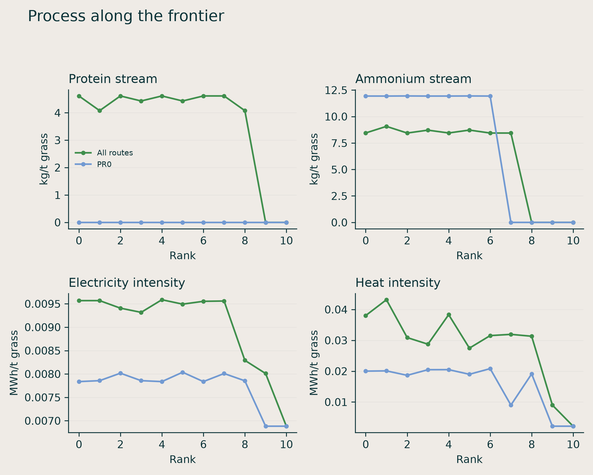

Product-stream and utility intensities across two independently selected F1 fronts

**Scenario:** F1 non-PEF saved BioSTEAM batch and selected exact reruns  
**Units:** kg/t; MWh/t  
**Source:** 22 exact selected non-PEF BioSTEAM reports  
**Interpretation:** Independent ranks need not share feed or technology; intensities divide saved annual quantities by each run’s wet feed. Missing products appear as zero trajectories only where a bypass is meaningful.

### Figure 8: 02_technical__non_pef_route_profiles

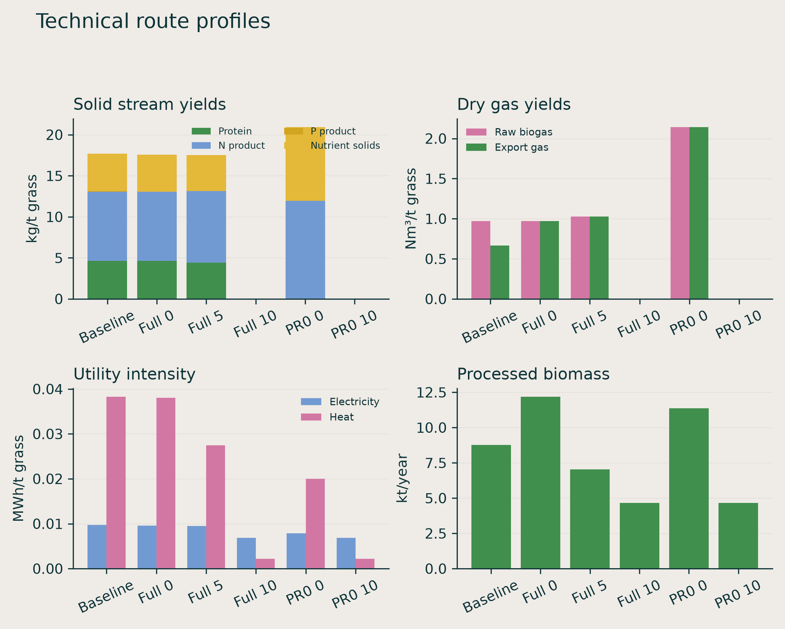

Feed-normalized solids, distinct raw/upgraded gas volumes, utility demand and annual feed for selected F1 routes

**Scenario:** F1 non-PEF saved BioSTEAM batch and selected exact reruns  
**Units:** kg/t; dry Nm³/t; MWh/t; kt/year  
**Source:** Exact F1 BioSTEAM reports and saved gas stream components  
**Interpretation:** Solid yields are reported stream mass, not pure nutrient mass. Export gas is raw for BG0 and upgraded for other BG routes. Gas volumes use dry ideal gas at 273.15 K and 101325 Pa. All routes use F1 without PEF.

## 03_tea

### Figure 9: 03_tea__non_pef_economic_accounts

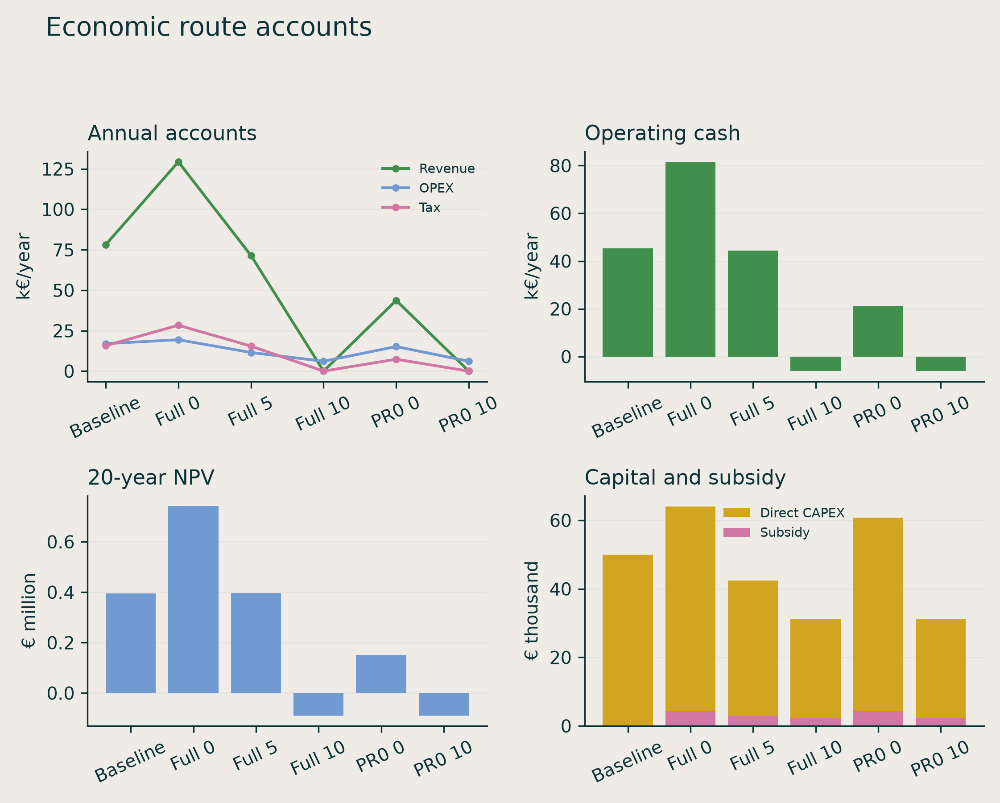

Partial BioSTEAM financial accounts and constant-account NPV for baseline and selected non-PEF candidates

**Scenario:** F1 non-PEF saved BioSTEAM batch and selected exact reruns  
**Units:** k€/year; € million; € thousand  
**Source:** Baseline screening report; exact non-PEF Pareto reports  
**Interpretation:** Baseline uses benchmark product prices with zero optimization savings/subsidy. Candidate cases retain sampled savings and subsidy. CAPEX/OPEX are incomplete; NPV repeats nominal annual cash for 20 years at 8%.

## 04_lca

### Figure 10: 04_lca__non_pef_attributional_burden

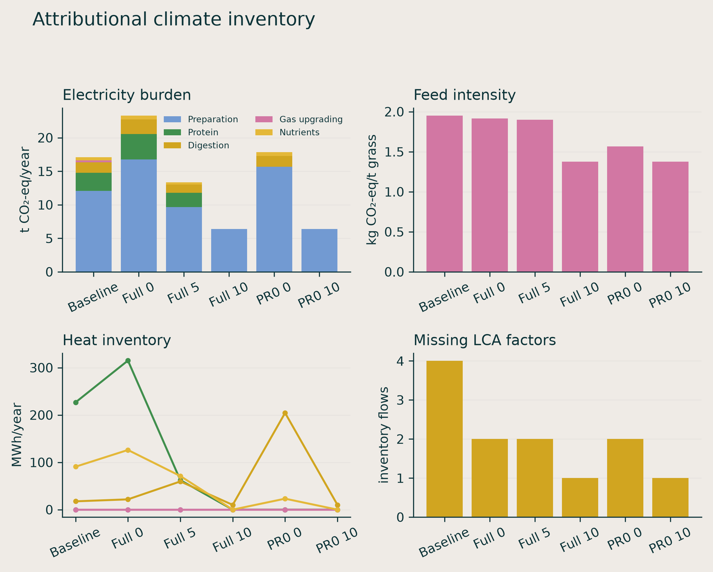

Electricity-only attributional burden and uncharacterized heat/inventory across selected non-PEF routes

**Scenario:** F1 non-PEF saved BioSTEAM batch and selected exact reruns  
**Units:** t CO₂-eq/year; kg CO₂-eq/t; MWh/year; inventory flows  
**Source:** Exact BioSTEAM reports; annual process pathway; LCA inventory  
**Interpretation:** The climate account applies the saved screening factor 0.20 kg CO₂e/kWh to modeled electricity. Heat and other inventory flows are shown separately and are not converted to CO₂e without factors. No offset or substitution credit is used.

### Figure 11: 04_lca__non_pef_climate_hotspot_matrix

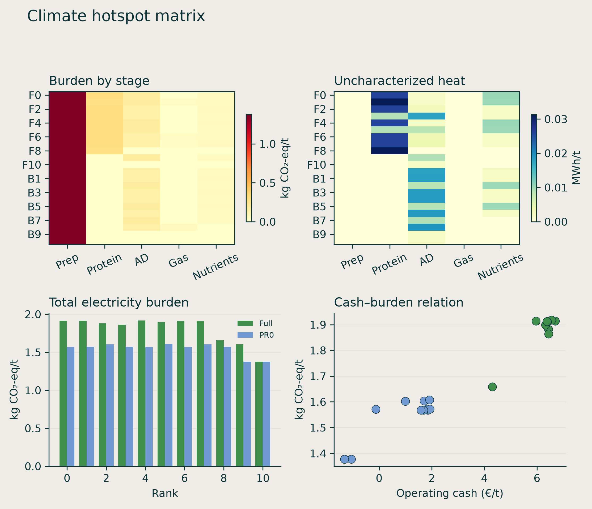

Stage attributional electricity burden and separately inventoried heat across 22 selected F1 routes

**Scenario:** F1 non-PEF saved BioSTEAM batch and selected exact reruns  
**Units:** kg CO₂-eq/t; MWh/t; €/t  
**Source:** 22 exact non-PEF BioSTEAM reports  
**Interpretation:** F denotes full-front rank and B protein-bypass rank. Electricity is characterized at 0.20 kg CO₂e/kWh; heat has no validated factor and is not added to burden.

### Figure 12: 04_lca__non_pef_electricity_factor_sensitivity

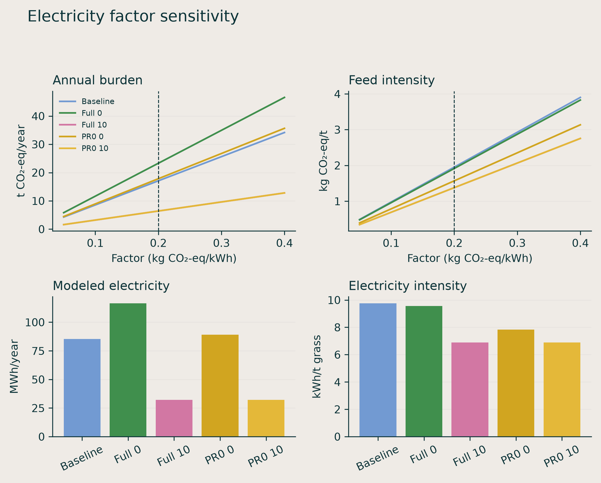

Deterministic attributional electricity factor scenarios on actual F1 utility inventories

**Scenario:** F1 non-PEF saved BioSTEAM batch and selected exact reruns  
**Units:** kg CO₂-eq/kWh; t CO₂-eq/year; kg CO₂-eq/t; MWh/year; kWh/t  
**Source:** Exact non-PEF BioSTEAM utility inventories  
**Interpretation:** Factor range 0.05–0.40 kg CO₂e/kWh is an explicit sensitivity sweep, not an empirical uncertainty distribution. Dashed line marks the saved screening factor 0.20. Heat and other missing LCA factors remain uncharacterized.

## 05_hotspots

### Figure 13: 05_hotspots__non_pef_utility_cost_hotspots

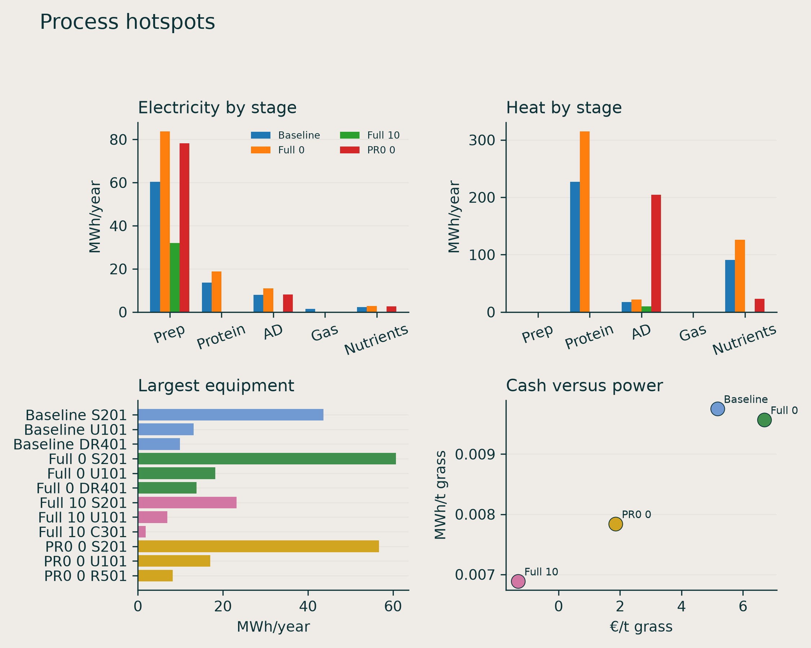

Stage and unit energy hotspots with feed-normalized economic relation

**Scenario:** F1 non-PEF saved BioSTEAM batch and selected exact reruns  
**Units:** MWh/year; €/t; MWh/t  
**Source:** Exact non-PEF BioSTEAM reports  
**Interpretation:** Only modeled utility demand is shown. No reagent series or empty reagent bars. Cash uses incomplete recorded OPEX/CAPEX and screening product prices.

## 06_scenario_comparison

### Figure 14: 06_scenario_comparison__biosteam_dense__frontier_financial_accounts

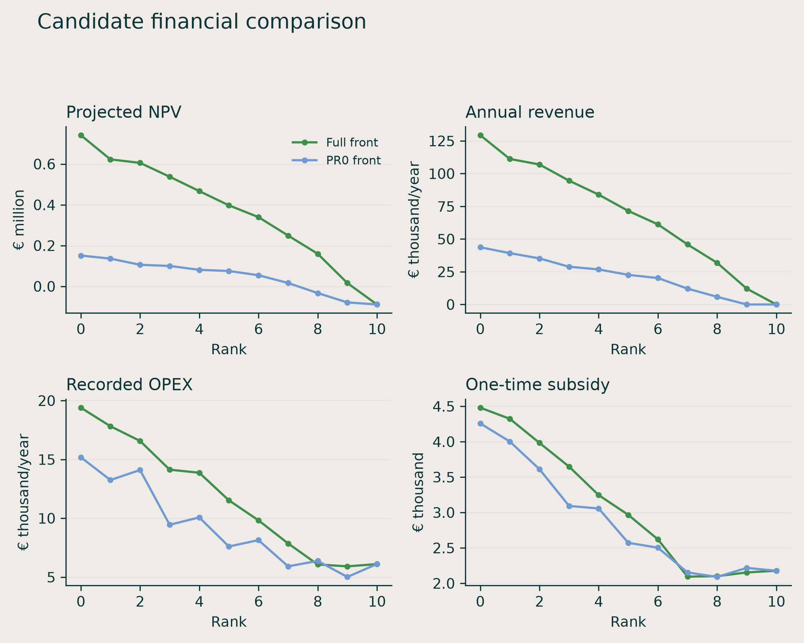

Projected NPV, revenue, recorded OPEX and subsidy across two independent frontiers

**Scenario:** Full and protein-bypass BioSTEAM screening fronts  
**Units:** € million; € thousand/year; € thousand  
**Source:** Saved BioSTEAM decision reports and Greenhub/results/runs/{run_id}/streams.json; candidate economic overlay  
**Interpretation:** BioSTEAM process outputs; screening process assumptions. TEA includes partial recorded capital/OPEX, benchmark product prices, subsidy, tax and candidate savings/uplifts. Climate objective is electricity-only attributional burden, excludes heat and substitution credits. Technical ranking gate remains false because storage evidence is unresolved. Financial projections repeat nominal annual accounts for 20 years and are not complete forecasts or balance sheets. These are partial financial accounts and nominal 20-year constant-account projections; independent front ranks have different throughput.

### Figure 15: 06_scenario_comparison__biosteam_dense__matched_protein_bypass_effects

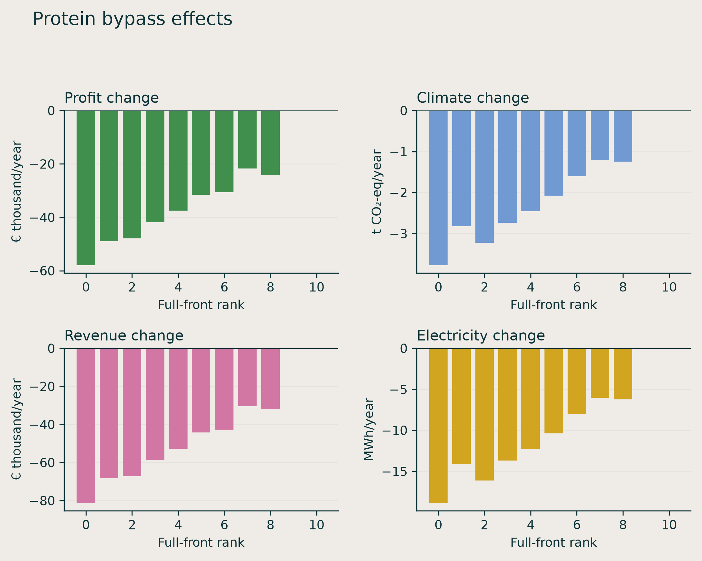

Paired PR0 minus original effects on profit, climate, revenue and electricity

**Scenario:** 11 matched full-front protein-bypass reruns  
**Units:** € thousand/year; t CO₂-eq/year; MWh/year  
**Source:** Saved BioSTEAM decision reports and Greenhub/results/runs/{run_id}/streams.json; candidate economic overlay  
**Interpretation:** BioSTEAM process outputs; screening process assumptions. TEA includes partial recorded capital/OPEX, benchmark product prices, subsidy, tax and candidate savings/uplifts. Climate objective is electricity-only attributional burden, excludes heat and substitution credits. Technical ranking gate remains false because storage evidence is unresolved. Financial projections repeat nominal annual accounts for 20 years and are not complete forecasts or balance sheets. Only protein recovery code changed per pair; route 10 was already PR0 and has zero change.

### Figure 16: 06_scenario_comparison__biosteam_dense__three_series_profit_climate

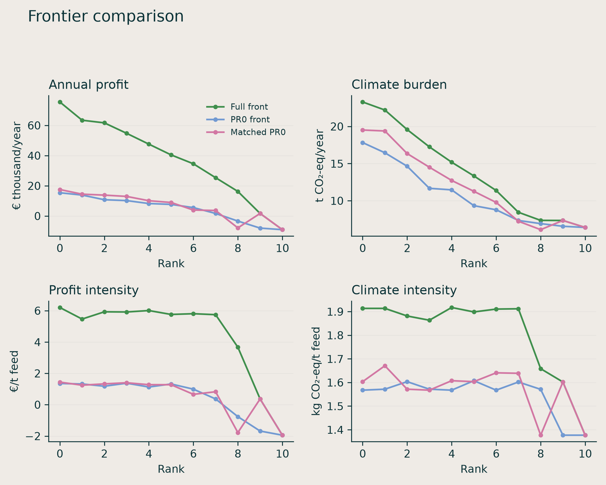

Profit and partial climate burden across full, independent PR0 and matched PR0 series

**Scenario:** Full/PR0 fronts and matched protein-bypass reruns  
**Units:** € thousand/year; t CO₂-eq/year; €/t; kg CO₂-eq/t  
**Source:** Saved BioSTEAM decision reports and Greenhub/results/runs/{run_id}/streams.json; candidate economic overlay  
**Interpretation:** BioSTEAM process outputs; screening process assumptions. TEA includes partial recorded capital/OPEX, benchmark product prices, subsidy, tax and candidate savings/uplifts. Climate objective is electricity-only attributional burden, excludes heat and substitution credits. Technical ranking gate remains false because storage evidence is unresolved. Financial projections repeat nominal annual accounts for 20 years and are not complete forecasts or balance sheets. Ranks in the independently optimized fronts are not matched technology or throughput pairs; matched PR0 retains the full-front rank identity.

### Figure 17: biosteam_matched_climate_change

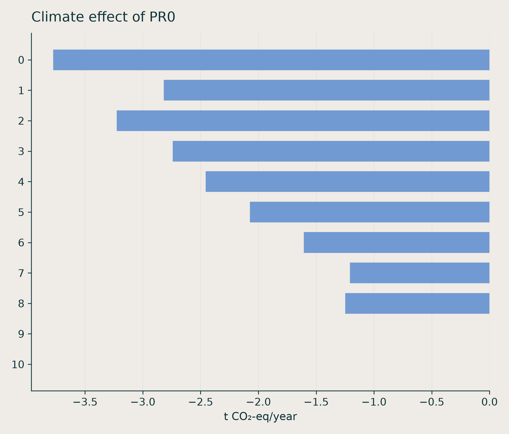

Change in partial attributional climate burden from bypassing protein

**Scenario:** Full-front ranks 0–10 rerun with PR0 only; same feed and candidate economics per pair  
**Units:** t CO₂-eq/year  
**Source:** Greenhub/results/actual_pareto_2000/decision_batches; biosteam_frontiers/rank_*.json  
**Interpretation:** BioSTEAM process simulation with screening process assumptions and partial attributional climate inventory. Economic objective adds unverified product-price benchmarks, partial recorded CAPEX/OPEX, candidate labour/logistics/energy savings, yield uplifts, subsidy and tax overlay. Not a complete TEA/LCA or investment-grade optimum. The climate objective excludes substitution credits; the saved selected runs account for electricity only. Feed throughput varies across sampled candidates. Selected reports have eligible_for_ranking=false because of unresolved storage blockers. Difference is PR0 minus original route; only protein recovery code changes within each pair.

### Figure 18: biosteam_matched_electricity_comparison

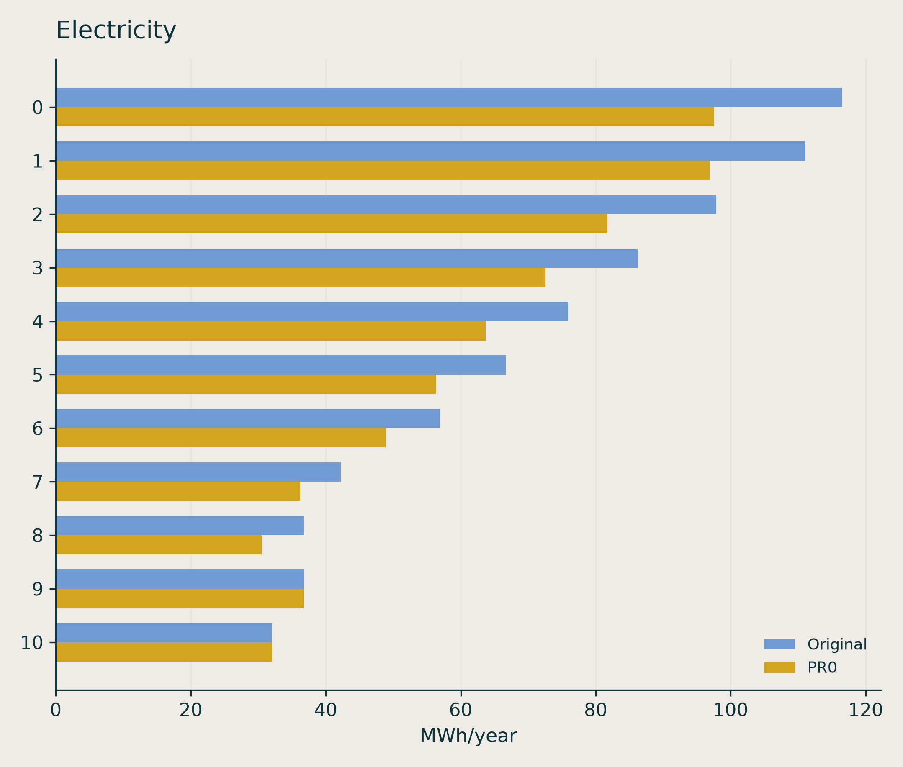

Paired original versus protein-bypass electricity

**Scenario:** Full-front ranks 0–10 rerun with PR0 only; same feed and candidate economics per pair  
**Units:** MWh/year  
**Source:** Greenhub/results/actual_pareto_2000/decision_batches; biosteam_frontiers/rank_*.json  
**Interpretation:** BioSTEAM process simulation with screening process assumptions and partial attributional climate inventory. Economic objective adds unverified product-price benchmarks, partial recorded CAPEX/OPEX, candidate labour/logistics/energy savings, yield uplifts, subsidy and tax overlay. Not a complete TEA/LCA or investment-grade optimum. The climate objective excludes substitution credits; the saved selected runs account for electricity only. Feed throughput varies across sampled candidates. Selected reports have eligible_for_ranking=false because of unresolved storage blockers. Pairs retain identical feed rate and sampled economic assumptions. Financial accounts remain incomplete.

### Figure 19: biosteam_matched_gas_comparison

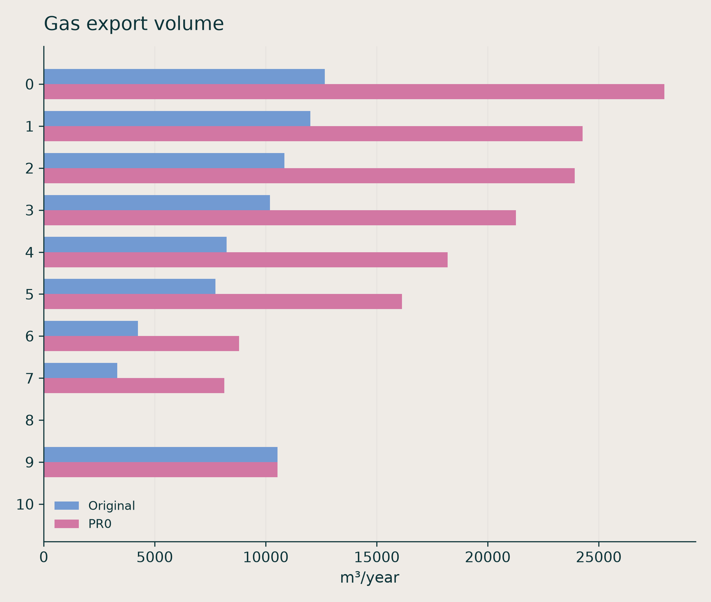

Paired original versus protein-bypass gas export volume

**Scenario:** Full-front ranks 0–10 rerun with PR0 only; same feed and candidate economics per pair  
**Units:** m³/year  
**Source:** Greenhub/results/actual_pareto_2000/decision_batches; biosteam_frontiers/rank_*.json  
**Interpretation:** BioSTEAM process simulation with screening process assumptions and partial attributional climate inventory. Economic objective adds unverified product-price benchmarks, partial recorded CAPEX/OPEX, candidate labour/logistics/energy savings, yield uplifts, subsidy and tax overlay. Not a complete TEA/LCA or investment-grade optimum. The climate objective excludes substitution credits; the saved selected runs account for electricity only. Feed throughput varies across sampled candidates. Selected reports have eligible_for_ranking=false because of unresolved storage blockers. Pairs retain identical feed rate and sampled economic assumptions. Financial accounts remain incomplete.

### Figure 20: biosteam_matched_npv_comparison

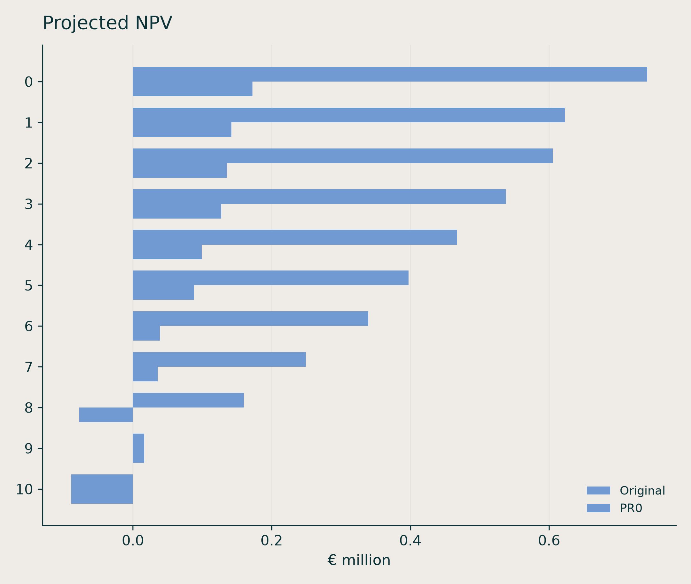

Paired original versus protein-bypass projected npv

**Scenario:** Full-front ranks 0–10 rerun with PR0 only; same feed and candidate economics per pair  
**Units:** € million  
**Source:** Greenhub/results/actual_pareto_2000/decision_batches; biosteam_frontiers/rank_*.json  
**Interpretation:** BioSTEAM process simulation with screening process assumptions and partial attributional climate inventory. Economic objective adds unverified product-price benchmarks, partial recorded CAPEX/OPEX, candidate labour/logistics/energy savings, yield uplifts, subsidy and tax overlay. Not a complete TEA/LCA or investment-grade optimum. The climate objective excludes substitution credits; the saved selected runs account for electricity only. Feed throughput varies across sampled candidates. Selected reports have eligible_for_ranking=false because of unresolved storage blockers. Pairs retain identical feed rate and sampled economic assumptions. Financial accounts remain incomplete.

### Figure 21: biosteam_matched_opex_comparison

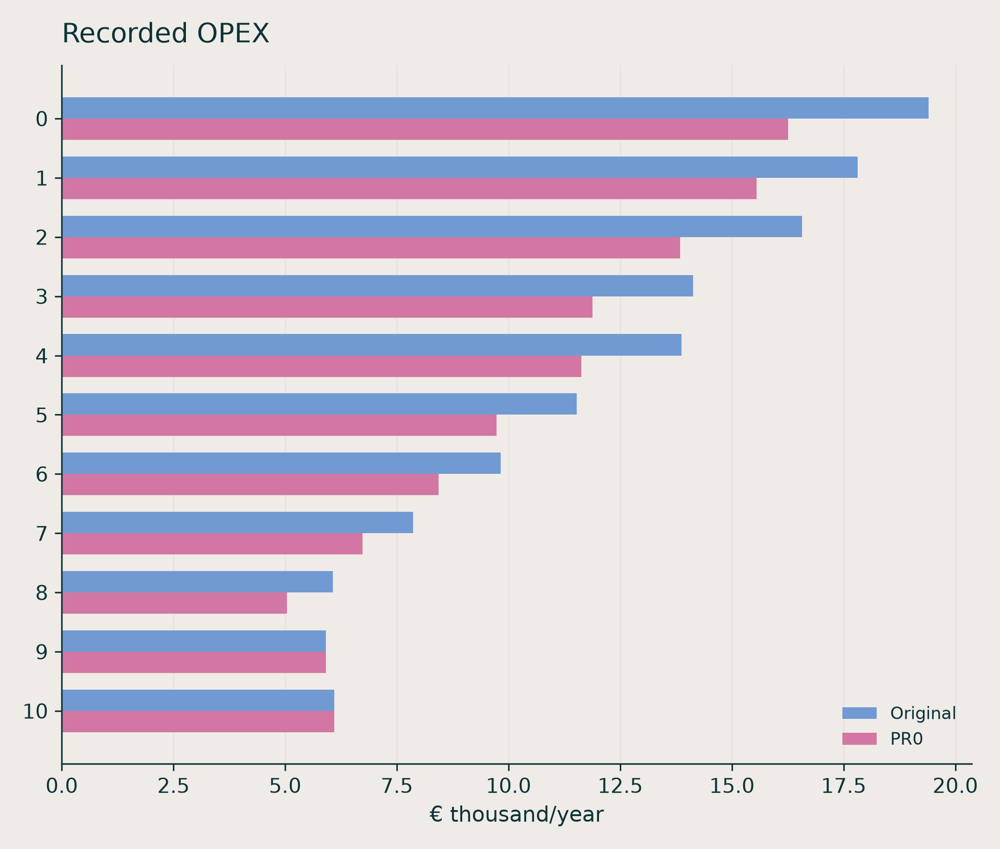

Paired original versus protein-bypass recorded opex

**Scenario:** Full-front ranks 0–10 rerun with PR0 only; same feed and candidate economics per pair  
**Units:** € thousand/year  
**Source:** Greenhub/results/actual_pareto_2000/decision_batches; biosteam_frontiers/rank_*.json  
**Interpretation:** BioSTEAM process simulation with screening process assumptions and partial attributional climate inventory. Economic objective adds unverified product-price benchmarks, partial recorded CAPEX/OPEX, candidate labour/logistics/energy savings, yield uplifts, subsidy and tax overlay. Not a complete TEA/LCA or investment-grade optimum. The climate objective excludes substitution credits; the saved selected runs account for electricity only. Feed throughput varies across sampled candidates. Selected reports have eligible_for_ranking=false because of unresolved storage blockers. Pairs retain identical feed rate and sampled economic assumptions. Financial accounts remain incomplete.

### Figure 22: biosteam_matched_pr0_outcomes

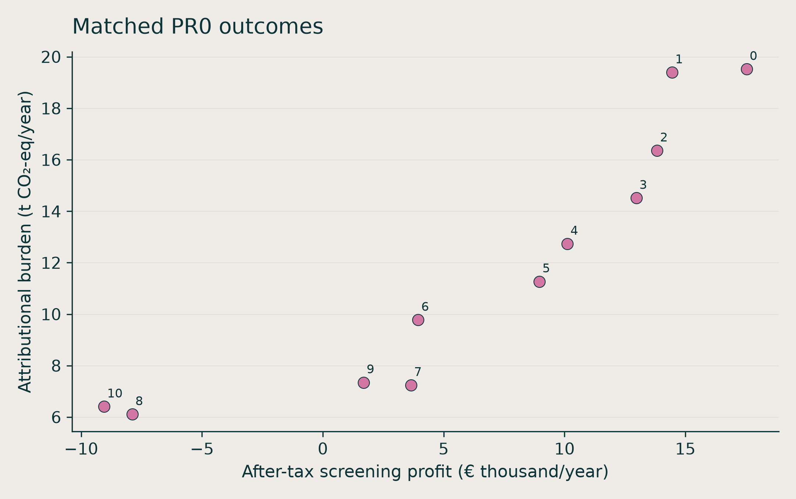

Matched protein-bypass outcomes retaining full-front rank labels

**Scenario:** Full-front ranks 0–10 rerun with PR0 only; same feed and candidate economics per pair  
**Units:** € thousand/year; t CO₂-eq/year  
**Source:** Greenhub/results/actual_pareto_2000/decision_batches; biosteam_frontiers/rank_*.json  
**Interpretation:** BioSTEAM process simulation with screening process assumptions and partial attributional climate inventory. Economic objective adds unverified product-price benchmarks, partial recorded CAPEX/OPEX, candidate labour/logistics/energy savings, yield uplifts, subsidy and tax overlay. Not a complete TEA/LCA or investment-grade optimum. The climate objective excludes substitution credits; the saved selected runs account for electricity only. Feed throughput varies across sampled candidates. Selected reports have eligible_for_ranking=false because of unresolved storage blockers. These 11 points are paired counterfactual reruns, not all necessarily nondominated.

### Figure 23: biosteam_matched_profit_change

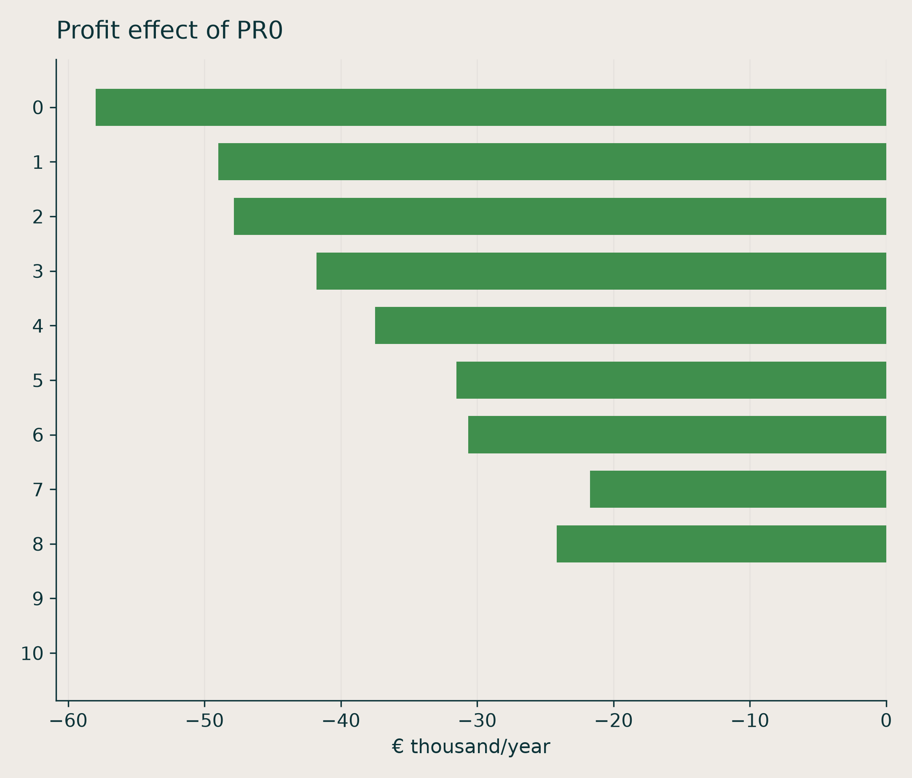

Change in after-tax screening profit from bypassing protein

**Scenario:** Full-front ranks 0–10 rerun with PR0 only; same feed and candidate economics per pair  
**Units:** € thousand/year  
**Source:** Greenhub/results/actual_pareto_2000/decision_batches; biosteam_frontiers/rank_*.json  
**Interpretation:** BioSTEAM process simulation with screening process assumptions and partial attributional climate inventory. Economic objective adds unverified product-price benchmarks, partial recorded CAPEX/OPEX, candidate labour/logistics/energy savings, yield uplifts, subsidy and tax overlay. Not a complete TEA/LCA or investment-grade optimum. The climate objective excludes substitution credits; the saved selected runs account for electricity only. Feed throughput varies across sampled candidates. Selected reports have eligible_for_ranking=false because of unresolved storage blockers. Difference is PR0 minus original route; only protein recovery code changes within each pair.

### Figure 24: biosteam_matched_protein_comparison

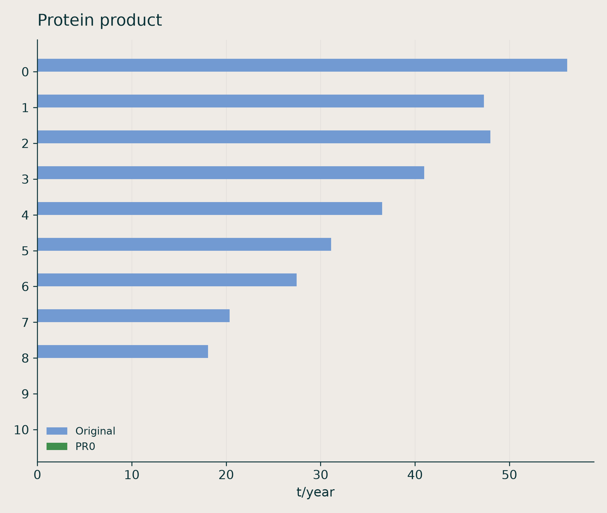

Paired original versus protein-bypass protein product

**Scenario:** Full-front ranks 0–10 rerun with PR0 only; same feed and candidate economics per pair  
**Units:** t/year  
**Source:** Greenhub/results/actual_pareto_2000/decision_batches; biosteam_frontiers/rank_*.json  
**Interpretation:** BioSTEAM process simulation with screening process assumptions and partial attributional climate inventory. Economic objective adds unverified product-price benchmarks, partial recorded CAPEX/OPEX, candidate labour/logistics/energy savings, yield uplifts, subsidy and tax overlay. Not a complete TEA/LCA or investment-grade optimum. The climate objective excludes substitution credits; the saved selected runs account for electricity only. Feed throughput varies across sampled candidates. Selected reports have eligible_for_ranking=false because of unresolved storage blockers. Pairs retain identical feed rate and sampled economic assumptions. Financial accounts remain incomplete.

### Figure 25: biosteam_matched_revenue_comparison

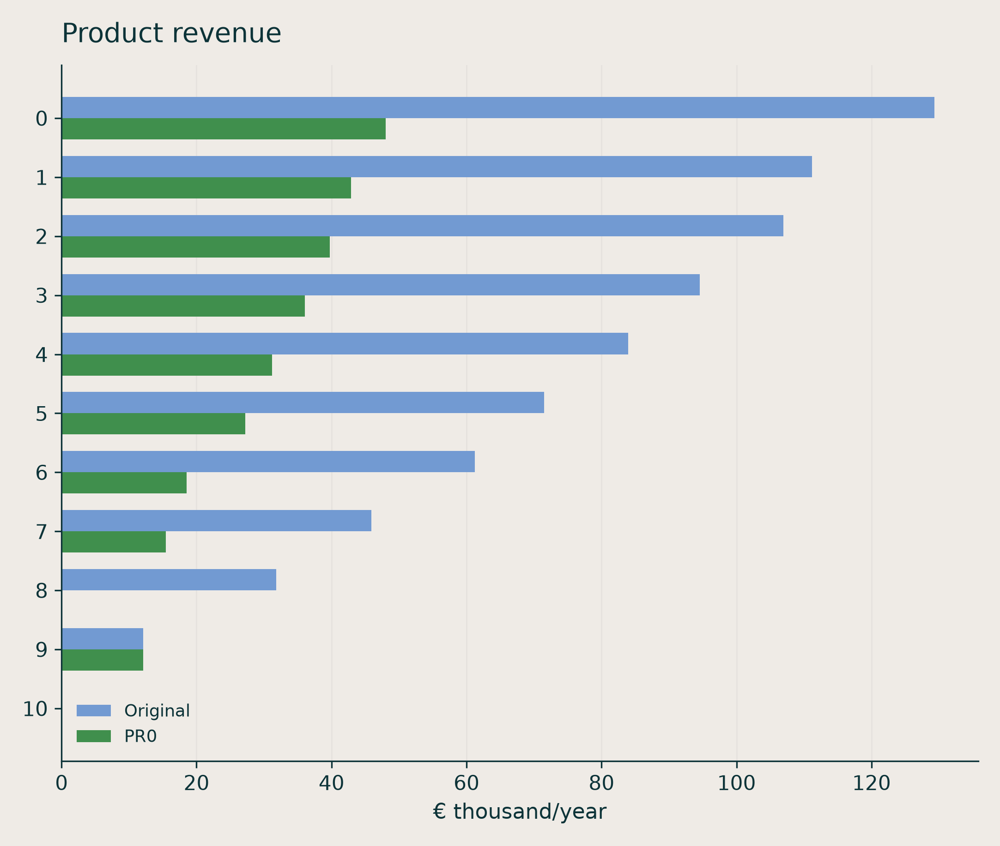

Paired original versus protein-bypass product revenue

**Scenario:** Full-front ranks 0–10 rerun with PR0 only; same feed and candidate economics per pair  
**Units:** € thousand/year  
**Source:** Greenhub/results/actual_pareto_2000/decision_batches; biosteam_frontiers/rank_*.json  
**Interpretation:** BioSTEAM process simulation with screening process assumptions and partial attributional climate inventory. Economic objective adds unverified product-price benchmarks, partial recorded CAPEX/OPEX, candidate labour/logistics/energy savings, yield uplifts, subsidy and tax overlay. Not a complete TEA/LCA or investment-grade optimum. The climate objective excludes substitution credits; the saved selected runs account for electricity only. Feed throughput varies across sampled candidates. Selected reports have eligible_for_ranking=false because of unresolved storage blockers. Pairs retain identical feed rate and sampled economic assumptions. Financial accounts remain incomplete.

## 07_optimization

### Figure 26: biosteam_all_capital_ranks

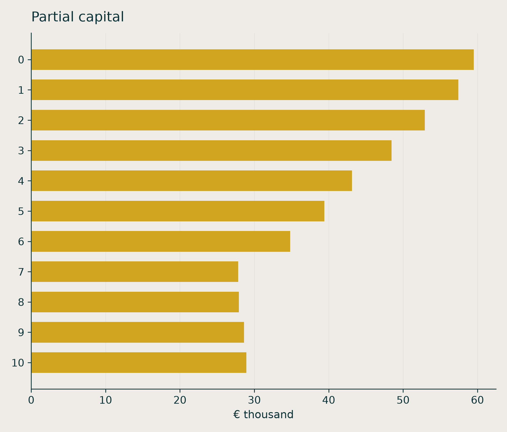

Partial capital among ranked candidates

**Scenario:** all backend batch; 2000 total simulations, seed 42; objective-eligible 1049  
**Units:** € thousand  
**Source:** Greenhub/results/actual_pareto_2000/decision_batches; biosteam_frontiers/rank_*.json  
**Interpretation:** BioSTEAM process simulation with screening process assumptions and partial attributional climate inventory. Economic objective adds unverified product-price benchmarks, partial recorded CAPEX/OPEX, candidate labour/logistics/energy savings, yield uplifts, subsidy and tax overlay. Not a complete TEA/LCA or investment-grade optimum. The climate objective excludes substitution credits; the saved selected runs account for electricity only. Feed throughput varies across sampled candidates. Selected reports have eligible_for_ranking=false because of unresolved storage blockers. 

### Figure 27: biosteam_all_climate_intensity

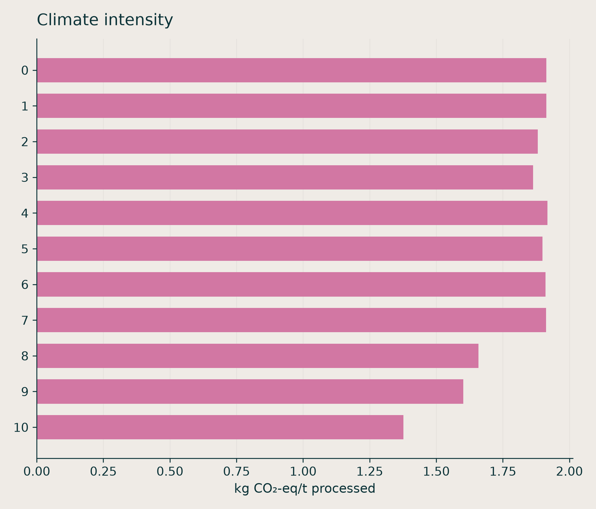

Partial attributional climate burden per wet tonne

**Scenario:** all backend batch; 2000 total simulations, seed 42; objective-eligible 1049  
**Units:** kg CO₂-eq/t processed  
**Source:** Greenhub/results/actual_pareto_2000/decision_batches; biosteam_frontiers/rank_*.json  
**Interpretation:** BioSTEAM process simulation with screening process assumptions and partial attributional climate inventory. Economic objective adds unverified product-price benchmarks, partial recorded CAPEX/OPEX, candidate labour/logistics/energy savings, yield uplifts, subsidy and tax overlay. Not a complete TEA/LCA or investment-grade optimum. The climate objective excludes substitution credits; the saved selected runs account for electricity only. Feed throughput varies across sampled candidates. Selected reports have eligible_for_ranking=false because of unresolved storage blockers. 

### Figure 28: biosteam_all_climate_ranks

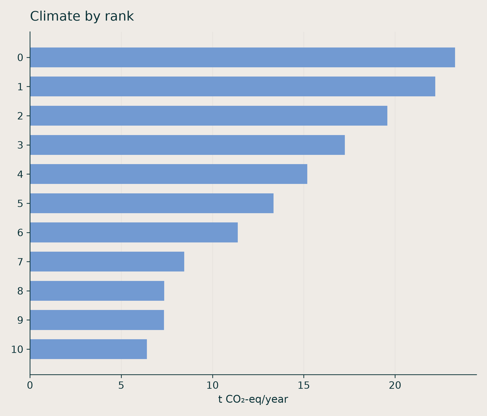

Partial attributional electricity burden by ranked candidate

**Scenario:** all backend batch; 2000 total simulations, seed 42; objective-eligible 1049  
**Units:** t CO₂-eq/year  
**Source:** Greenhub/results/actual_pareto_2000/decision_batches; biosteam_frontiers/rank_*.json  
**Interpretation:** BioSTEAM process simulation with screening process assumptions and partial attributional climate inventory. Economic objective adds unverified product-price benchmarks, partial recorded CAPEX/OPEX, candidate labour/logistics/energy savings, yield uplifts, subsidy and tax overlay. Not a complete TEA/LCA or investment-grade optimum. The climate objective excludes substitution credits; the saved selected runs account for electricity only. Feed throughput varies across sampled candidates. Selected reports have eligible_for_ranking=false because of unresolved storage blockers. 

### Figure 29: biosteam_all_energy_ranks

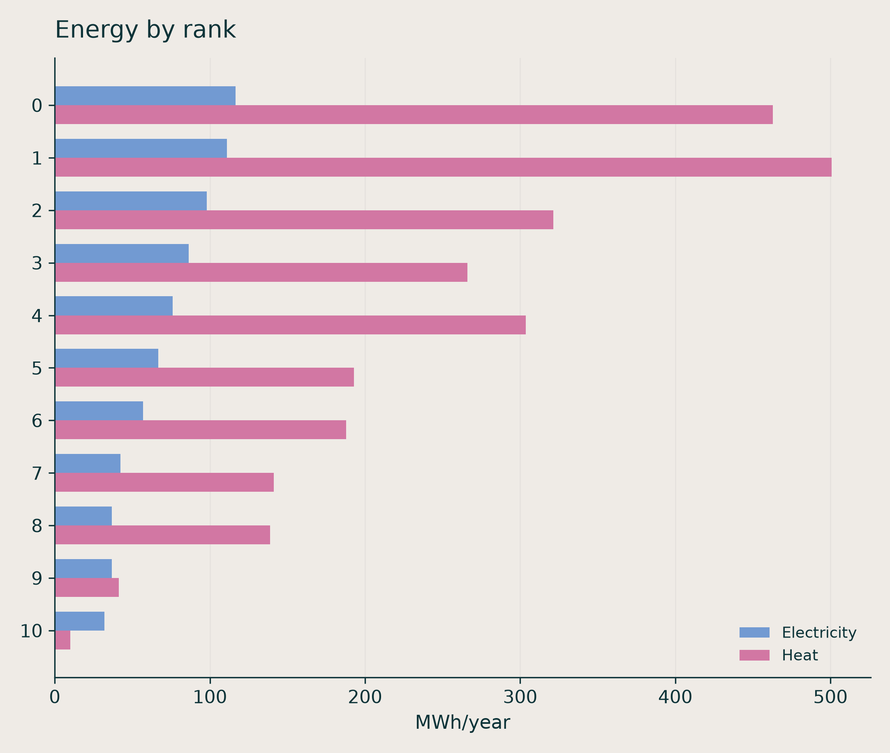

Annual electricity and heating demand across ranked candidates

**Scenario:** all backend batch; 2000 total simulations, seed 42; objective-eligible 1049  
**Units:** MWh/year  
**Source:** Greenhub/results/actual_pareto_2000/decision_batches; biosteam_frontiers/rank_*.json  
**Interpretation:** BioSTEAM process simulation with screening process assumptions and partial attributional climate inventory. Economic objective adds unverified product-price benchmarks, partial recorded CAPEX/OPEX, candidate labour/logistics/energy savings, yield uplifts, subsidy and tax overlay. Not a complete TEA/LCA or investment-grade optimum. The climate objective excludes substitution credits; the saved selected runs account for electricity only. Feed throughput varies across sampled candidates. Selected reports have eligible_for_ranking=false because of unresolved storage blockers. 

### Figure 30: biosteam_all_feed_ranks

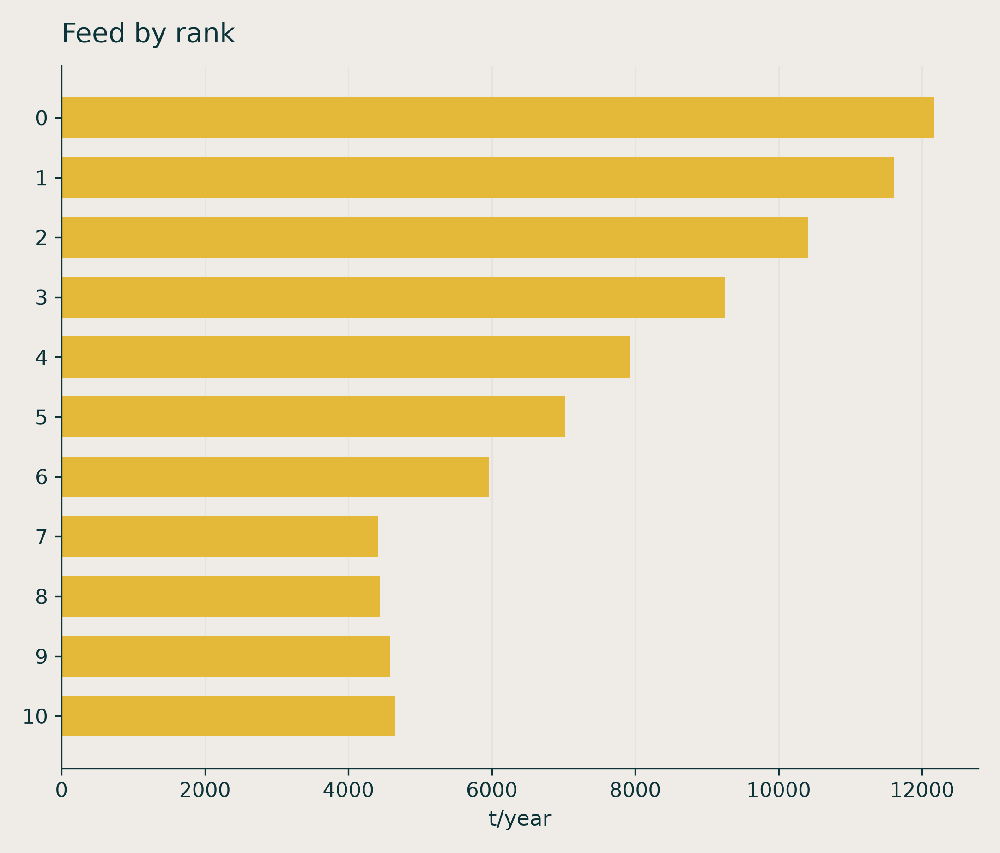

Simulated annual wet feed across ranks

**Scenario:** all backend batch; 2000 total simulations, seed 42; objective-eligible 1049  
**Units:** t/year  
**Source:** Greenhub/results/actual_pareto_2000/decision_batches; biosteam_frontiers/rank_*.json  
**Interpretation:** BioSTEAM process simulation with screening process assumptions and partial attributional climate inventory. Economic objective adds unverified product-price benchmarks, partial recorded CAPEX/OPEX, candidate labour/logistics/energy savings, yield uplifts, subsidy and tax overlay. Not a complete TEA/LCA or investment-grade optimum. The climate objective excludes substitution credits; the saved selected runs account for electricity only. Feed throughput varies across sampled candidates. Selected reports have eligible_for_ranking=false because of unresolved storage blockers. Ranks differ in throughput; use the accompanying intensity graphs before attributing differences to technology.

### Figure 31: biosteam_all_gas_ranks

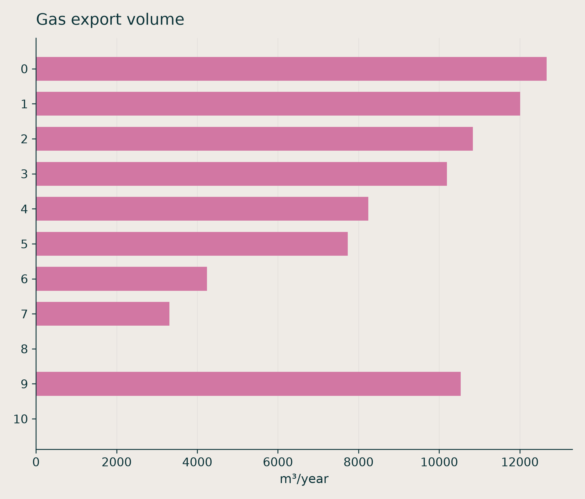

Revenue-account dry gas export at 293.15 K; raw for BG0 and upgraded for selected BG routes

**Scenario:** all backend batch; 2000 total simulations, seed 42; objective-eligible 1049  
**Units:** m³/year  
**Source:** Greenhub/results/actual_pareto_2000/decision_batches; biosteam_frontiers/rank_*.json  
**Interpretation:** BioSTEAM process simulation with screening process assumptions and partial attributional climate inventory. Economic objective adds unverified product-price benchmarks, partial recorded CAPEX/OPEX, candidate labour/logistics/energy savings, yield uplifts, subsidy and tax overlay. Not a complete TEA/LCA or investment-grade optimum. The climate objective excludes substitution credits; the saved selected runs account for electricity only. Feed throughput varies across sampled candidates. Selected reports have eligible_for_ranking=false because of unresolved storage blockers. 

### Figure 32: biosteam_all_kpi_heatmap

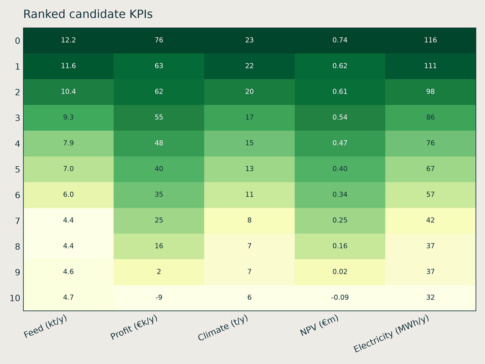

Feed, screening finance, partial climate and electricity for ranked cases

**Scenario:** all backend batch; 2000 total simulations, seed 42; objective-eligible 1049  
**Units:** Feed (kt/y); Profit (€k/y); Climate (t/y); NPV (€m); Electricity (MWh/y)  
**Source:** Greenhub/results/actual_pareto_2000/decision_batches; biosteam_frontiers/rank_*.json  
**Interpretation:** BioSTEAM process simulation with screening process assumptions and partial attributional climate inventory. Economic objective adds unverified product-price benchmarks, partial recorded CAPEX/OPEX, candidate labour/logistics/energy savings, yield uplifts, subsidy and tax overlay. Not a complete TEA/LCA or investment-grade optimum. The climate objective excludes substitution credits; the saved selected runs account for electricity only. Feed throughput varies across sampled candidates. Selected reports have eligible_for_ranking=false because of unresolved storage blockers. NPV is projected from subsidy-adjusted partial direct capital and constant after-tax operating cash; it is not the base TEA financial KPI. Cell colors normalize within each column.

### Figure 33: biosteam_all_labour_ranks

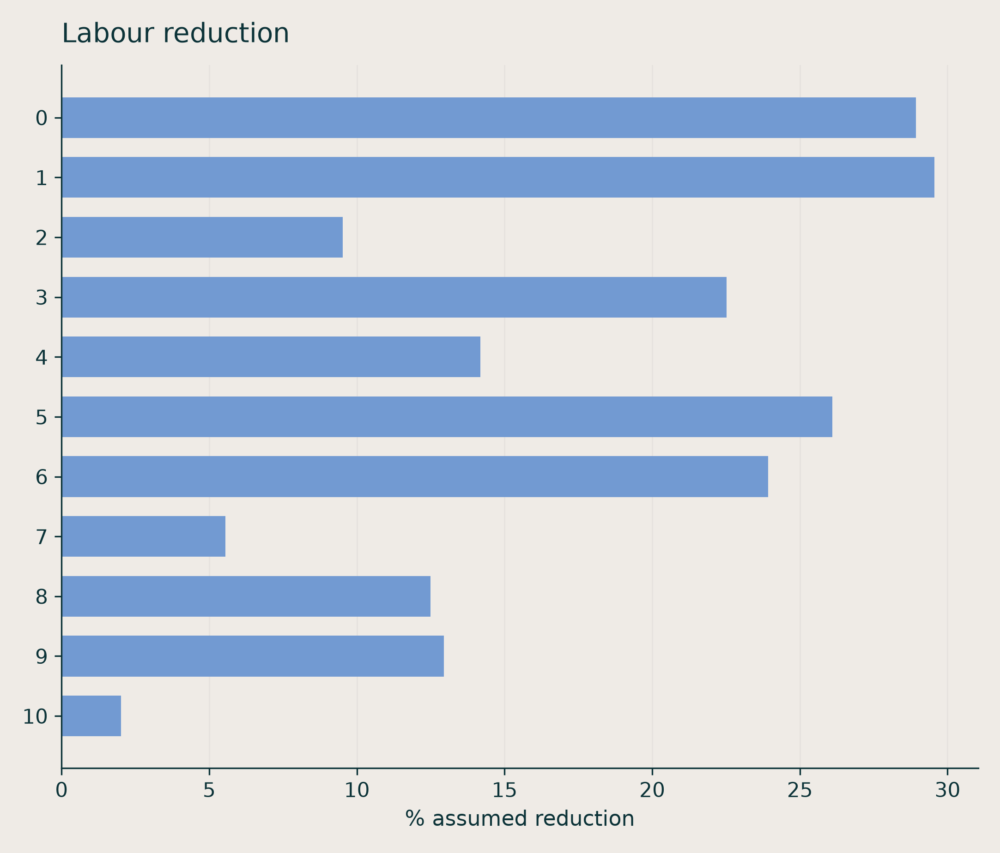

Sampled candidate labour-reduction overlay

**Scenario:** all backend batch; 2000 total simulations, seed 42; objective-eligible 1049  
**Units:** % assumed reduction  
**Source:** Greenhub/results/actual_pareto_2000/decision_batches; biosteam_frontiers/rank_*.json  
**Interpretation:** BioSTEAM process simulation with screening process assumptions and partial attributional climate inventory. Economic objective adds unverified product-price benchmarks, partial recorded CAPEX/OPEX, candidate labour/logistics/energy savings, yield uplifts, subsidy and tax overlay. Not a complete TEA/LCA or investment-grade optimum. The climate objective excludes substitution credits; the saved selected runs account for electricity only. Feed throughput varies across sampled candidates. Selected reports have eligible_for_ranking=false because of unresolved storage blockers. Reduction is an economic assumption, not a measured staffing outcome.

### Figure 34: biosteam_all_npv_ranks

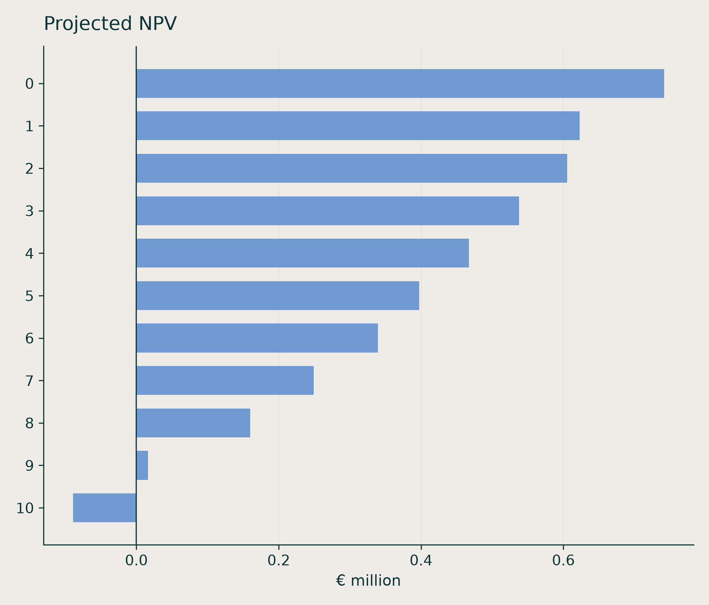

20-year constant-account NPV across ranked candidates

**Scenario:** all backend batch; 2000 total simulations, seed 42; objective-eligible 1049  
**Units:** € million  
**Source:** Greenhub/results/actual_pareto_2000/decision_batches; biosteam_frontiers/rank_*.json  
**Interpretation:** BioSTEAM process simulation with screening process assumptions and partial attributional climate inventory. Economic objective adds unverified product-price benchmarks, partial recorded CAPEX/OPEX, candidate labour/logistics/energy savings, yield uplifts, subsidy and tax overlay. Not a complete TEA/LCA or investment-grade optimum. The climate objective excludes substitution credits; the saved selected runs account for electricity only. Feed throughput varies across sampled candidates. Selected reports have eligible_for_ranking=false because of unresolved storage blockers. Partial-account projection; full installed CAPEX and OPEX are unavailable.

### Figure 35: biosteam_all_opex_ranks

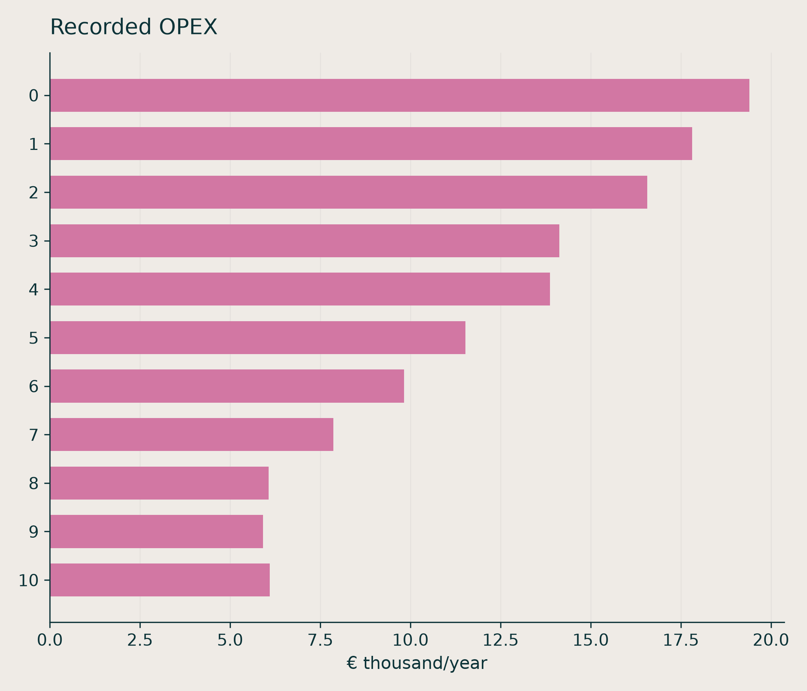

Recorded OPEX among ranked candidates

**Scenario:** all backend batch; 2000 total simulations, seed 42; objective-eligible 1049  
**Units:** € thousand/year  
**Source:** Greenhub/results/actual_pareto_2000/decision_batches; biosteam_frontiers/rank_*.json  
**Interpretation:** BioSTEAM process simulation with screening process assumptions and partial attributional climate inventory. Economic objective adds unverified product-price benchmarks, partial recorded CAPEX/OPEX, candidate labour/logistics/energy savings, yield uplifts, subsidy and tax overlay. Not a complete TEA/LCA or investment-grade optimum. The climate objective excludes substitution credits; the saved selected runs account for electricity only. Feed throughput varies across sampled candidates. Selected reports have eligible_for_ranking=false because of unresolved storage blockers. 

### Figure 36: biosteam_all_profit_intensity

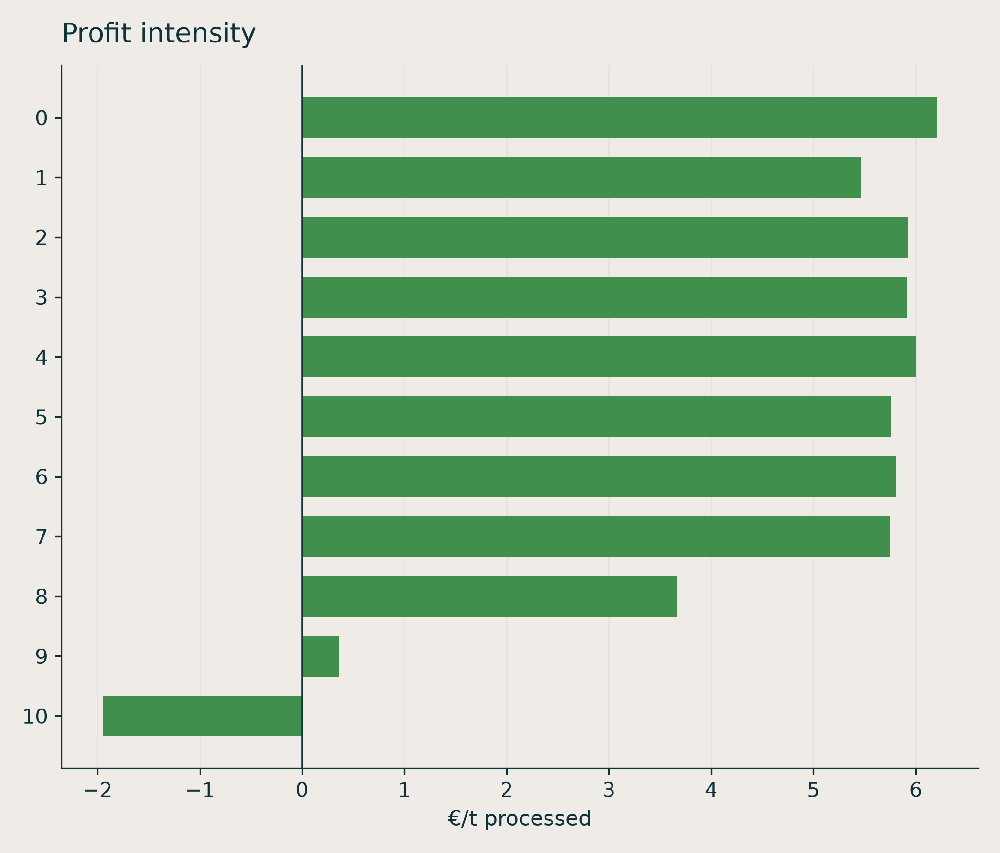

Annualized screening profit normalized to simulated wet feed

**Scenario:** all backend batch; 2000 total simulations, seed 42; objective-eligible 1049  
**Units:** €/t processed  
**Source:** Greenhub/results/actual_pareto_2000/decision_batches; biosteam_frontiers/rank_*.json  
**Interpretation:** BioSTEAM process simulation with screening process assumptions and partial attributional climate inventory. Economic objective adds unverified product-price benchmarks, partial recorded CAPEX/OPEX, candidate labour/logistics/energy savings, yield uplifts, subsidy and tax overlay. Not a complete TEA/LCA or investment-grade optimum. The climate objective excludes substitution credits; the saved selected runs account for electricity only. Feed throughput varies across sampled candidates. Selected reports have eligible_for_ranking=false because of unresolved storage blockers. 

### Figure 37: biosteam_all_profit_ranks

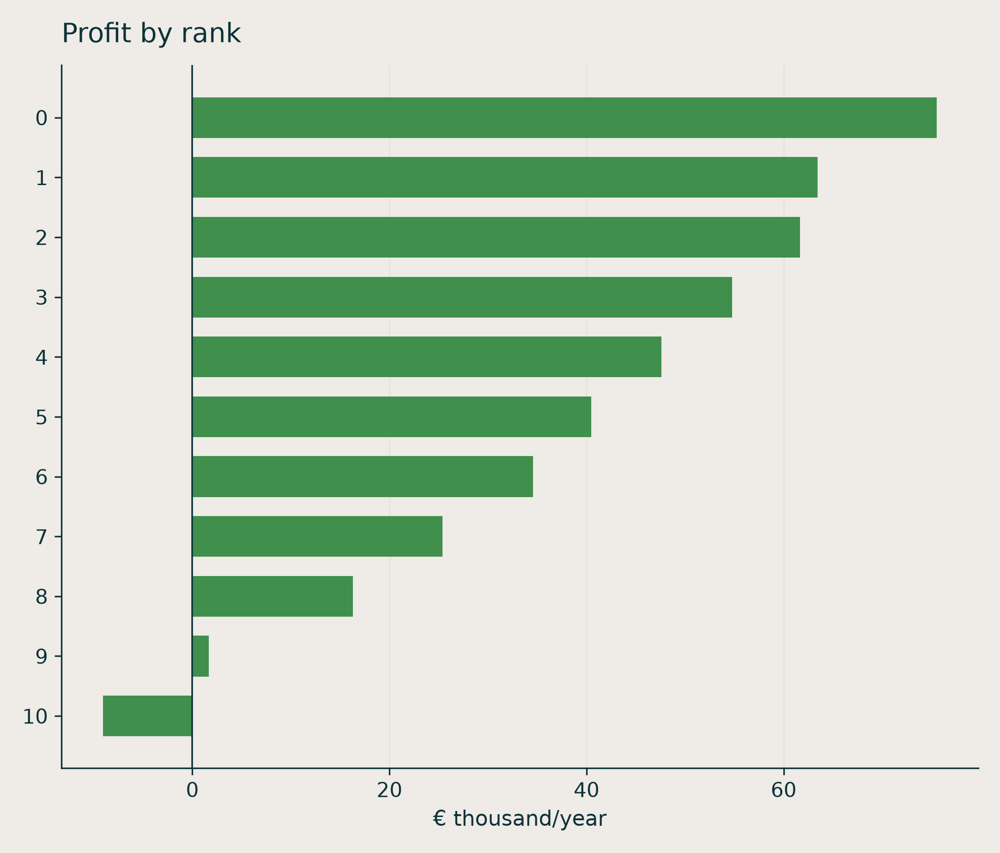

Backend candidate-adjusted screening profit

**Scenario:** all backend batch; 2000 total simulations, seed 42; objective-eligible 1049  
**Units:** € thousand/year  
**Source:** Greenhub/results/actual_pareto_2000/decision_batches; biosteam_frontiers/rank_*.json  
**Interpretation:** BioSTEAM process simulation with screening process assumptions and partial attributional climate inventory. Economic objective adds unverified product-price benchmarks, partial recorded CAPEX/OPEX, candidate labour/logistics/energy savings, yield uplifts, subsidy and tax overlay. Not a complete TEA/LCA or investment-grade optimum. The climate objective excludes substitution credits; the saved selected runs account for electricity only. Feed throughput varies across sampled candidates. Selected reports have eligible_for_ranking=false because of unresolved storage blockers. 

### Figure 38: biosteam_all_protein_ranks

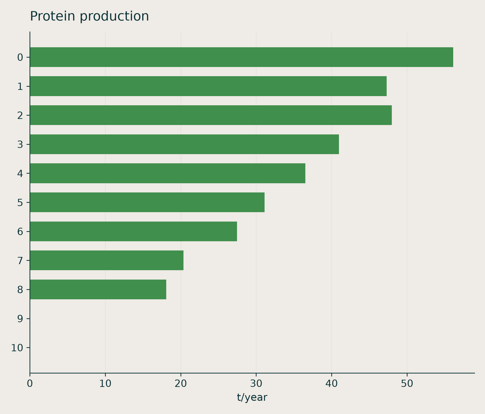

Modeled dry protein product by ranked case

**Scenario:** all backend batch; 2000 total simulations, seed 42; objective-eligible 1049  
**Units:** t/year  
**Source:** Greenhub/results/actual_pareto_2000/decision_batches; biosteam_frontiers/rank_*.json  
**Interpretation:** BioSTEAM process simulation with screening process assumptions and partial attributional climate inventory. Economic objective adds unverified product-price benchmarks, partial recorded CAPEX/OPEX, candidate labour/logistics/energy savings, yield uplifts, subsidy and tax overlay. Not a complete TEA/LCA or investment-grade optimum. The climate objective excludes substitution credits; the saved selected runs account for electricity only. Feed throughput varies across sampled candidates. Selected reports have eligible_for_ranking=false because of unresolved storage blockers. 

### Figure 39: biosteam_all_ranked_front

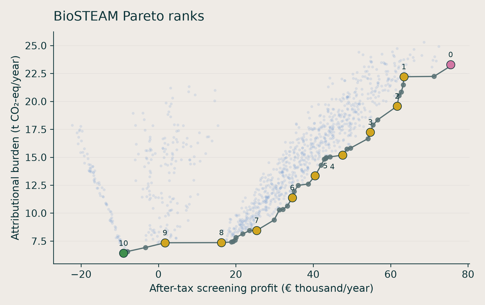

Backend-evaluated screening frontier with ranks 0–10

**Scenario:** all backend batch; 2000 total simulations, seed 42; objective-eligible 1049  
**Units:** € thousand/year; t CO₂-eq/year  
**Source:** Greenhub/results/actual_pareto_2000/decision_batches; biosteam_frontiers/rank_*.json  
**Interpretation:** BioSTEAM process simulation with screening process assumptions and partial attributional climate inventory. Economic objective adds unverified product-price benchmarks, partial recorded CAPEX/OPEX, candidate labour/logistics/energy savings, yield uplifts, subsidy and tax overlay. Not a complete TEA/LCA or investment-grade optimum. The climate objective excludes substitution credits; the saved selected runs account for electricity only. Feed throughput varies across sampled candidates. Selected reports have eligible_for_ranking=false because of unresolved storage blockers. Rank 0 has highest after-tax screening profit; rank 10 lowest partial attributional climate burden. PR0 front is recomputed from existing BioSTEAM runs.

### Figure 40: biosteam_all_revenue_ranks

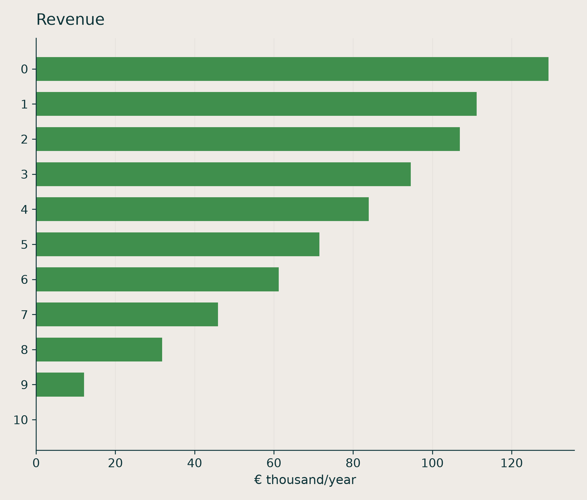

Revenue among ranked candidates

**Scenario:** all backend batch; 2000 total simulations, seed 42; objective-eligible 1049  
**Units:** € thousand/year  
**Source:** Greenhub/results/actual_pareto_2000/decision_batches; biosteam_frontiers/rank_*.json  
**Interpretation:** BioSTEAM process simulation with screening process assumptions and partial attributional climate inventory. Economic objective adds unverified product-price benchmarks, partial recorded CAPEX/OPEX, candidate labour/logistics/energy savings, yield uplifts, subsidy and tax overlay. Not a complete TEA/LCA or investment-grade optimum. The climate objective excludes substitution credits; the saved selected runs account for electricity only. Feed throughput varies across sampled candidates. Selected reports have eligible_for_ranking=false because of unresolved storage blockers. 

### Figure 41: biosteam_all_route_matrix

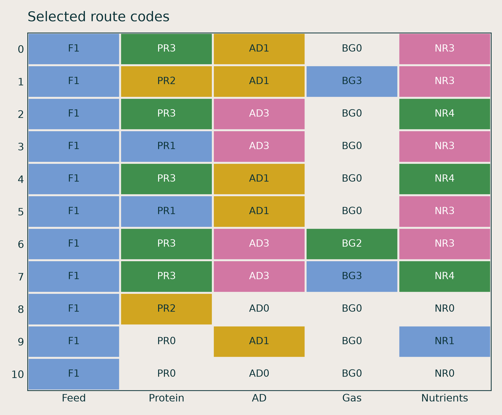

Actual route configuration codes for ranked candidates

**Scenario:** all backend batch; 2000 total simulations, seed 42; objective-eligible 1049  
**Units:** route code  
**Source:** Greenhub/results/actual_pareto_2000/decision_batches; biosteam_frontiers/rank_*.json  
**Interpretation:** BioSTEAM process simulation with screening process assumptions and partial attributional climate inventory. Economic objective adds unverified product-price benchmarks, partial recorded CAPEX/OPEX, candidate labour/logistics/energy savings, yield uplifts, subsidy and tax overlay. Not a complete TEA/LCA or investment-grade optimum. The climate objective excludes substitution credits; the saved selected runs account for electricity only. Feed throughput varies across sampled candidates. Selected reports have eligible_for_ranking=false because of unresolved storage blockers. Cell color identifies route code; colors are categorical and carry no performance order.

### Figure 42: biosteam_all_stage_energy_heatmap

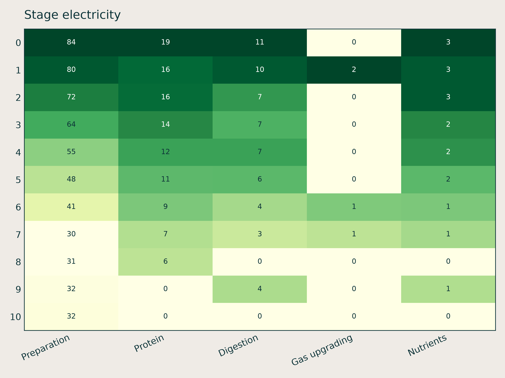

Simulated electricity by process stage across ranked candidates

**Scenario:** all backend batch; 2000 total simulations, seed 42; objective-eligible 1049  
**Units:** MWh/year  
**Source:** Greenhub/results/actual_pareto_2000/decision_batches; biosteam_frontiers/rank_*.json  
**Interpretation:** BioSTEAM process simulation with screening process assumptions and partial attributional climate inventory. Economic objective adds unverified product-price benchmarks, partial recorded CAPEX/OPEX, candidate labour/logistics/energy savings, yield uplifts, subsidy and tax overlay. Not a complete TEA/LCA or investment-grade optimum. The climate objective excludes substitution credits; the saved selected runs account for electricity only. Feed throughput varies across sampled candidates. Selected reports have eligible_for_ranking=false because of unresolved storage blockers. Cell values in MWh/year. Cell colors normalize within each column.

### Figure 43: biosteam_all_subsidy_ranks

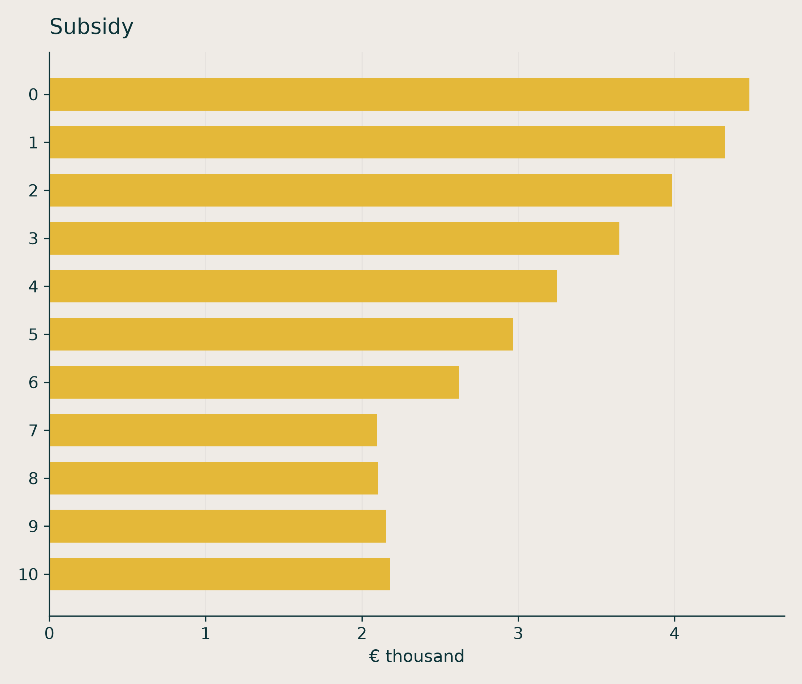

Subsidy among ranked candidates

**Scenario:** all backend batch; 2000 total simulations, seed 42; objective-eligible 1049  
**Units:** € thousand  
**Source:** Greenhub/results/actual_pareto_2000/decision_batches; biosteam_frontiers/rank_*.json  
**Interpretation:** BioSTEAM process simulation with screening process assumptions and partial attributional climate inventory. Economic objective adds unverified product-price benchmarks, partial recorded CAPEX/OPEX, candidate labour/logistics/energy savings, yield uplifts, subsidy and tax overlay. Not a complete TEA/LCA or investment-grade optimum. The climate objective excludes substitution credits; the saved selected runs account for electricity only. Feed throughput varies across sampled candidates. Selected reports have eligible_for_ranking=false because of unresolved storage blockers. 

### Figure 44: 07_optimization__non_pef_pareto_dashboard

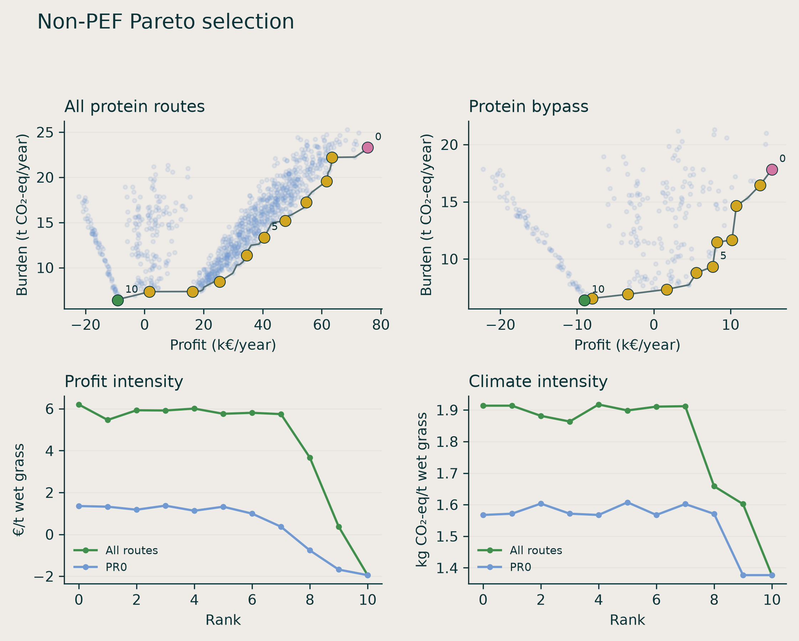

Non-PEF screening fronts with selected ranks and feed-normalized objectives

**Scenario:** F1 non-PEF saved BioSTEAM batch and selected exact reruns  
**Units:** k€/year; t CO₂-eq/year; €/t; kg CO₂-eq/t  
**Source:** C:\my\Spaak\Greenhub\Model\Greenhub\results\actual_pareto_2000\decision_batches\eed439a280ad488aa235a19b0efc32af.json  
**Interpretation:** Rank 0 is economic endpoint (rose); rank 10 is environmental endpoint (green). Electricity-only attributional burden at 0.20 kg CO₂e/kWh. Throughput varies; front is screening-level.

### Figure 45: biosteam_protein_bypass_capital_ranks

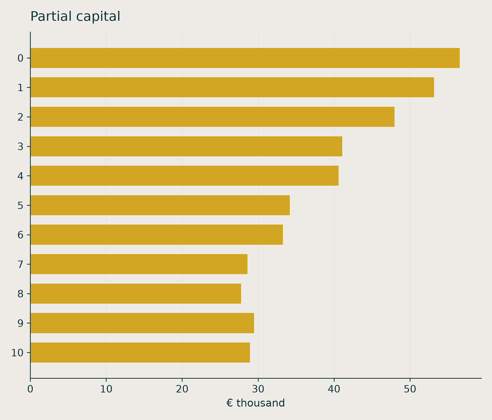

Partial capital among ranked candidates

**Scenario:** protein_bypass backend batch; 2000 total simulations, seed 42; objective-eligible 247  
**Units:** € thousand  
**Source:** Greenhub/results/actual_pareto_2000/decision_batches; biosteam_frontiers/rank_*.json  
**Interpretation:** BioSTEAM process simulation with screening process assumptions and partial attributional climate inventory. Economic objective adds unverified product-price benchmarks, partial recorded CAPEX/OPEX, candidate labour/logistics/energy savings, yield uplifts, subsidy and tax overlay. Not a complete TEA/LCA or investment-grade optimum. The climate objective excludes substitution credits; the saved selected runs account for electricity only. Feed throughput varies across sampled candidates. Selected reports have eligible_for_ranking=false because of unresolved storage blockers. 

### Figure 46: biosteam_protein_bypass_climate_intensity

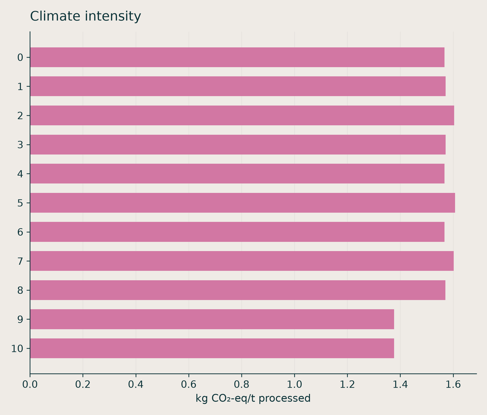

Partial attributional climate burden per wet tonne

**Scenario:** protein_bypass backend batch; 2000 total simulations, seed 42; objective-eligible 247  
**Units:** kg CO₂-eq/t processed  
**Source:** Greenhub/results/actual_pareto_2000/decision_batches; biosteam_frontiers/rank_*.json  
**Interpretation:** BioSTEAM process simulation with screening process assumptions and partial attributional climate inventory. Economic objective adds unverified product-price benchmarks, partial recorded CAPEX/OPEX, candidate labour/logistics/energy savings, yield uplifts, subsidy and tax overlay. Not a complete TEA/LCA or investment-grade optimum. The climate objective excludes substitution credits; the saved selected runs account for electricity only. Feed throughput varies across sampled candidates. Selected reports have eligible_for_ranking=false because of unresolved storage blockers. 

### Figure 47: biosteam_protein_bypass_climate_ranks

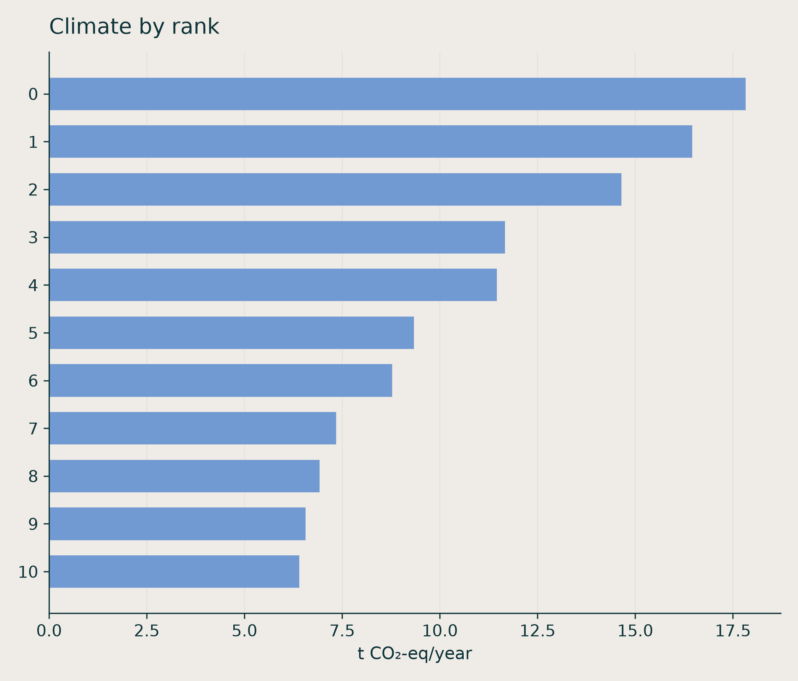

Partial attributional electricity burden by ranked candidate

**Scenario:** protein_bypass backend batch; 2000 total simulations, seed 42; objective-eligible 247  
**Units:** t CO₂-eq/year  
**Source:** Greenhub/results/actual_pareto_2000/decision_batches; biosteam_frontiers/rank_*.json  
**Interpretation:** BioSTEAM process simulation with screening process assumptions and partial attributional climate inventory. Economic objective adds unverified product-price benchmarks, partial recorded CAPEX/OPEX, candidate labour/logistics/energy savings, yield uplifts, subsidy and tax overlay. Not a complete TEA/LCA or investment-grade optimum. The climate objective excludes substitution credits; the saved selected runs account for electricity only. Feed throughput varies across sampled candidates. Selected reports have eligible_for_ranking=false because of unresolved storage blockers. 

### Figure 48: biosteam_protein_bypass_energy_ranks

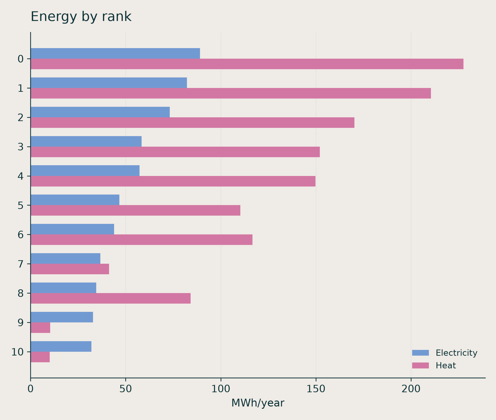

Annual electricity and heating demand across ranked candidates

**Scenario:** protein_bypass backend batch; 2000 total simulations, seed 42; objective-eligible 247  
**Units:** MWh/year  
**Source:** Greenhub/results/actual_pareto_2000/decision_batches; biosteam_frontiers/rank_*.json  
**Interpretation:** BioSTEAM process simulation with screening process assumptions and partial attributional climate inventory. Economic objective adds unverified product-price benchmarks, partial recorded CAPEX/OPEX, candidate labour/logistics/energy savings, yield uplifts, subsidy and tax overlay. Not a complete TEA/LCA or investment-grade optimum. The climate objective excludes substitution credits; the saved selected runs account for electricity only. Feed throughput varies across sampled candidates. Selected reports have eligible_for_ranking=false because of unresolved storage blockers. 

### Figure 49: biosteam_protein_bypass_feed_ranks

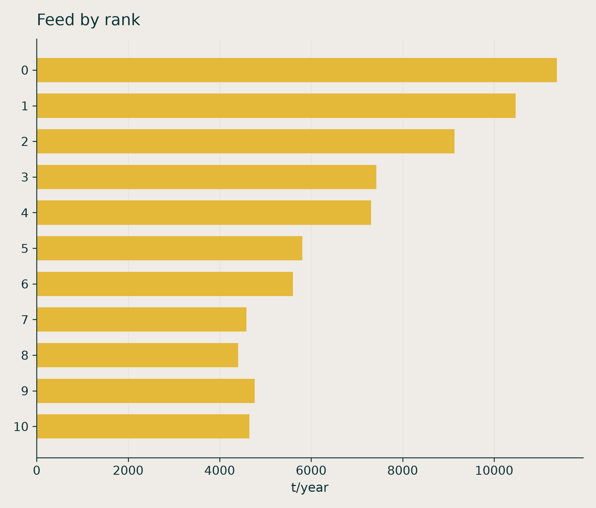

Simulated annual wet feed across ranks

**Scenario:** protein_bypass backend batch; 2000 total simulations, seed 42; objective-eligible 247  
**Units:** t/year  
**Source:** Greenhub/results/actual_pareto_2000/decision_batches; biosteam_frontiers/rank_*.json  
**Interpretation:** BioSTEAM process simulation with screening process assumptions and partial attributional climate inventory. Economic objective adds unverified product-price benchmarks, partial recorded CAPEX/OPEX, candidate labour/logistics/energy savings, yield uplifts, subsidy and tax overlay. Not a complete TEA/LCA or investment-grade optimum. The climate objective excludes substitution credits; the saved selected runs account for electricity only. Feed throughput varies across sampled candidates. Selected reports have eligible_for_ranking=false because of unresolved storage blockers. Ranks differ in throughput; use the accompanying intensity graphs before attributing differences to technology.

### Figure 50: biosteam_protein_bypass_gas_ranks

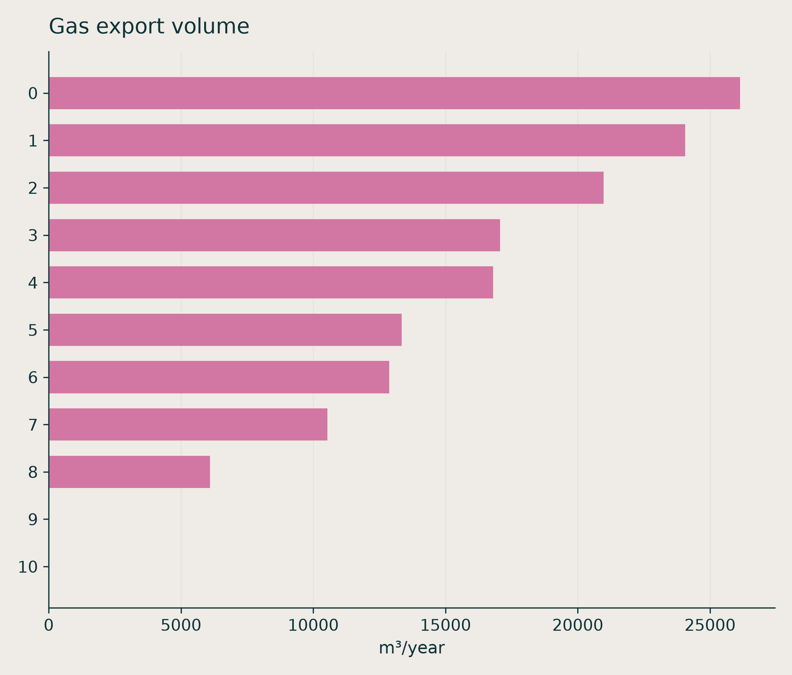

Revenue-account dry gas export at 293.15 K; raw for BG0 and upgraded for selected BG routes

**Scenario:** protein_bypass backend batch; 2000 total simulations, seed 42; objective-eligible 247  
**Units:** m³/year  
**Source:** Greenhub/results/actual_pareto_2000/decision_batches; biosteam_frontiers/rank_*.json  
**Interpretation:** BioSTEAM process simulation with screening process assumptions and partial attributional climate inventory. Economic objective adds unverified product-price benchmarks, partial recorded CAPEX/OPEX, candidate labour/logistics/energy savings, yield uplifts, subsidy and tax overlay. Not a complete TEA/LCA or investment-grade optimum. The climate objective excludes substitution credits; the saved selected runs account for electricity only. Feed throughput varies across sampled candidates. Selected reports have eligible_for_ranking=false because of unresolved storage blockers. 

### Figure 51: biosteam_protein_bypass_kpi_heatmap

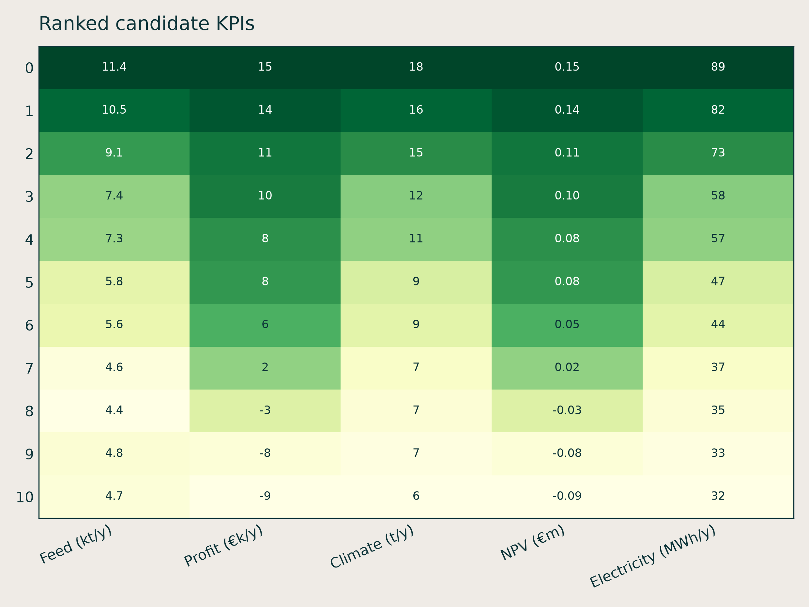

Feed, screening finance, partial climate and electricity for ranked cases

**Scenario:** protein_bypass backend batch; 2000 total simulations, seed 42; objective-eligible 247  
**Units:** Feed (kt/y); Profit (€k/y); Climate (t/y); NPV (€m); Electricity (MWh/y)  
**Source:** Greenhub/results/actual_pareto_2000/decision_batches; biosteam_frontiers/rank_*.json  
**Interpretation:** BioSTEAM process simulation with screening process assumptions and partial attributional climate inventory. Economic objective adds unverified product-price benchmarks, partial recorded CAPEX/OPEX, candidate labour/logistics/energy savings, yield uplifts, subsidy and tax overlay. Not a complete TEA/LCA or investment-grade optimum. The climate objective excludes substitution credits; the saved selected runs account for electricity only. Feed throughput varies across sampled candidates. Selected reports have eligible_for_ranking=false because of unresolved storage blockers. NPV is projected from subsidy-adjusted partial direct capital and constant after-tax operating cash; it is not the base TEA financial KPI. Cell colors normalize within each column.

### Figure 52: biosteam_protein_bypass_labour_ranks

Sampled candidate labour-reduction overlay

**Scenario:** protein_bypass backend batch; 2000 total simulations, seed 42; objective-eligible 247  
**Units:** % assumed reduction  
**Source:** Greenhub/results/actual_pareto_2000/decision_batches; biosteam_frontiers/rank_*.json  
**Interpretation:** BioSTEAM process simulation with screening process assumptions and partial attributional climate inventory. Economic objective adds unverified product-price benchmarks, partial recorded CAPEX/OPEX, candidate labour/logistics/energy savings, yield uplifts, subsidy and tax overlay. Not a complete TEA/LCA or investment-grade optimum. The climate objective excludes substitution credits; the saved selected runs account for electricity only. Feed throughput varies across sampled candidates. Selected reports have eligible_for_ranking=false because of unresolved storage blockers. Reduction is an economic assumption, not a measured staffing outcome.

### Figure 53: biosteam_protein_bypass_npv_ranks

20-year constant-account NPV across ranked candidates

**Scenario:** protein_bypass backend batch; 2000 total simulations, seed 42; objective-eligible 247  
**Units:** € million  
**Source:** Greenhub/results/actual_pareto_2000/decision_batches; biosteam_frontiers/rank_*.json  
**Interpretation:** BioSTEAM process simulation with screening process assumptions and partial attributional climate inventory. Economic objective adds unverified product-price benchmarks, partial recorded CAPEX/OPEX, candidate labour/logistics/energy savings, yield uplifts, subsidy and tax overlay. Not a complete TEA/LCA or investment-grade optimum. The climate objective excludes substitution credits; the saved selected runs account for electricity only. Feed throughput varies across sampled candidates. Selected reports have eligible_for_ranking=false because of unresolved storage blockers. Partial-account projection; full installed CAPEX and OPEX are unavailable.

### Figure 54: biosteam_protein_bypass_opex_ranks

Recorded OPEX among ranked candidates

**Scenario:** protein_bypass backend batch; 2000 total simulations, seed 42; objective-eligible 247  
**Units:** € thousand/year  
**Source:** Greenhub/results/actual_pareto_2000/decision_batches; biosteam_frontiers/rank_*.json  
**Interpretation:** BioSTEAM process simulation with screening process assumptions and partial attributional climate inventory. Economic objective adds unverified product-price benchmarks, partial recorded CAPEX/OPEX, candidate labour/logistics/energy savings, yield uplifts, subsidy and tax overlay. Not a complete TEA/LCA or investment-grade optimum. The climate objective excludes substitution credits; the saved selected runs account for electricity only. Feed throughput varies across sampled candidates. Selected reports have eligible_for_ranking=false because of unresolved storage blockers. 

### Figure 55: biosteam_protein_bypass_profit_intensity

Annualized screening profit normalized to simulated wet feed

**Scenario:** protein_bypass backend batch; 2000 total simulations, seed 42; objective-eligible 247  
**Units:** €/t processed  
**Source:** Greenhub/results/actual_pareto_2000/decision_batches; biosteam_frontiers/rank_*.json  
**Interpretation:** BioSTEAM process simulation with screening process assumptions and partial attributional climate inventory. Economic objective adds unverified product-price benchmarks, partial recorded CAPEX/OPEX, candidate labour/logistics/energy savings, yield uplifts, subsidy and tax overlay. Not a complete TEA/LCA or investment-grade optimum. The climate objective excludes substitution credits; the saved selected runs account for electricity only. Feed throughput varies across sampled candidates. Selected reports have eligible_for_ranking=false because of unresolved storage blockers. 

### Figure 56: biosteam_protein_bypass_profit_ranks

Backend candidate-adjusted screening profit

**Scenario:** protein_bypass backend batch; 2000 total simulations, seed 42; objective-eligible 247  
**Units:** € thousand/year  
**Source:** Greenhub/results/actual_pareto_2000/decision_batches; biosteam_frontiers/rank_*.json  
**Interpretation:** BioSTEAM process simulation with screening process assumptions and partial attributional climate inventory. Economic objective adds unverified product-price benchmarks, partial recorded CAPEX/OPEX, candidate labour/logistics/energy savings, yield uplifts, subsidy and tax overlay. Not a complete TEA/LCA or investment-grade optimum. The climate objective excludes substitution credits; the saved selected runs account for electricity only. Feed throughput varies across sampled candidates. Selected reports have eligible_for_ranking=false because of unresolved storage blockers. 

### Figure 57: biosteam_protein_bypass_protein_ranks

Modeled dry protein product by ranked case

**Scenario:** protein_bypass backend batch; 2000 total simulations, seed 42; objective-eligible 247  
**Units:** t/year  
**Source:** Greenhub/results/actual_pareto_2000/decision_batches; biosteam_frontiers/rank_*.json  
**Interpretation:** BioSTEAM process simulation with screening process assumptions and partial attributional climate inventory. Economic objective adds unverified product-price benchmarks, partial recorded CAPEX/OPEX, candidate labour/logistics/energy savings, yield uplifts, subsidy and tax overlay. Not a complete TEA/LCA or investment-grade optimum. The climate objective excludes substitution credits; the saved selected runs account for electricity only. Feed throughput varies across sampled candidates. Selected reports have eligible_for_ranking=false because of unresolved storage blockers. 

### Figure 58: biosteam_protein_bypass_ranked_front

Backend-evaluated screening frontier with ranks 0–10

**Scenario:** protein_bypass backend batch; 2000 total simulations, seed 42; objective-eligible 247  
**Units:** € thousand/year; t CO₂-eq/year  
**Source:** Greenhub/results/actual_pareto_2000/decision_batches; biosteam_frontiers/rank_*.json  
**Interpretation:** BioSTEAM process simulation with screening process assumptions and partial attributional climate inventory. Economic objective adds unverified product-price benchmarks, partial recorded CAPEX/OPEX, candidate labour/logistics/energy savings, yield uplifts, subsidy and tax overlay. Not a complete TEA/LCA or investment-grade optimum. The climate objective excludes substitution credits; the saved selected runs account for electricity only. Feed throughput varies across sampled candidates. Selected reports have eligible_for_ranking=false because of unresolved storage blockers. Rank 0 has highest after-tax screening profit; rank 10 lowest partial attributional climate burden. PR0 front is recomputed from existing BioSTEAM runs.

### Figure 59: biosteam_protein_bypass_revenue_ranks

Revenue among ranked candidates

**Scenario:** protein_bypass backend batch; 2000 total simulations, seed 42; objective-eligible 247  
**Units:** € thousand/year  
**Source:** Greenhub/results/actual_pareto_2000/decision_batches; biosteam_frontiers/rank_*.json  
**Interpretation:** BioSTEAM process simulation with screening process assumptions and partial attributional climate inventory. Economic objective adds unverified product-price benchmarks, partial recorded CAPEX/OPEX, candidate labour/logistics/energy savings, yield uplifts, subsidy and tax overlay. Not a complete TEA/LCA or investment-grade optimum. The climate objective excludes substitution credits; the saved selected runs account for electricity only. Feed throughput varies across sampled candidates. Selected reports have eligible_for_ranking=false because of unresolved storage blockers. 

### Figure 60: biosteam_protein_bypass_route_matrix

Actual route configuration codes for ranked candidates

**Scenario:** protein_bypass backend batch; 2000 total simulations, seed 42; objective-eligible 247  
**Units:** route code  
**Source:** Greenhub/results/actual_pareto_2000/decision_batches; biosteam_frontiers/rank_*.json  
**Interpretation:** BioSTEAM process simulation with screening process assumptions and partial attributional climate inventory. Economic objective adds unverified product-price benchmarks, partial recorded CAPEX/OPEX, candidate labour/logistics/energy savings, yield uplifts, subsidy and tax overlay. Not a complete TEA/LCA or investment-grade optimum. The climate objective excludes substitution credits; the saved selected runs account for electricity only. Feed throughput varies across sampled candidates. Selected reports have eligible_for_ranking=false because of unresolved storage blockers. Cell color identifies route code; colors are categorical and carry no performance order.

### Figure 61: biosteam_protein_bypass_stage_energy_heatmap

Simulated electricity by process stage across ranked candidates

**Scenario:** protein_bypass backend batch; 2000 total simulations, seed 42; objective-eligible 247  
**Units:** MWh/year  
**Source:** Greenhub/results/actual_pareto_2000/decision_batches; biosteam_frontiers/rank_*.json  
**Interpretation:** BioSTEAM process simulation with screening process assumptions and partial attributional climate inventory. Economic objective adds unverified product-price benchmarks, partial recorded CAPEX/OPEX, candidate labour/logistics/energy savings, yield uplifts, subsidy and tax overlay. Not a complete TEA/LCA or investment-grade optimum. The climate objective excludes substitution credits; the saved selected runs account for electricity only. Feed throughput varies across sampled candidates. Selected reports have eligible_for_ranking=false because of unresolved storage blockers. Cell values in MWh/year. Cell colors normalize within each column.

### Figure 62: biosteam_protein_bypass_subsidy_ranks

Subsidy among ranked candidates

**Scenario:** protein_bypass backend batch; 2000 total simulations, seed 42; objective-eligible 247  
**Units:** € thousand  
**Source:** Greenhub/results/actual_pareto_2000/decision_batches; biosteam_frontiers/rank_*.json  
**Interpretation:** BioSTEAM process simulation with screening process assumptions and partial attributional climate inventory. Economic objective adds unverified product-price benchmarks, partial recorded CAPEX/OPEX, candidate labour/logistics/energy savings, yield uplifts, subsidy and tax overlay. Not a complete TEA/LCA or investment-grade optimum. The climate objective excludes substitution credits; the saved selected runs account for electricity only. Feed throughput varies across sampled candidates. Selected reports have eligible_for_ranking=false because of unresolved storage blockers. 

## 08_candidate_comparison

### Figure 63: 08_candidate_comparison__biosteam__all__rank_00__combined__01_grass_to_products

Mass-proportional grass split plus modeled downstream stream/product map

**Scenario:** all rank 0; 1bb3f182da164633a673cb57007ce90d; 1389.6 kg/h; 8760 h/year  
**Units:** kg/kg wet grass; dry Nm³/kg wet grass  
**Source:** Saved BioSTEAM decision reports and Greenhub/results/runs/{run_id}/streams.json; candidate economic overlay  
**Interpretation:** BioSTEAM process outputs; screening process assumptions. TEA includes partial recorded capital/OPEX, benchmark product prices, subsidy, tax and candidate savings/uplifts. Climate objective is electricity-only attributional burden, excludes heat and substitution credits. Technical ranking gate remains false because storage evidence is unresolved. Financial projections repeat nominal annual accounts for 20 years and are not complete forecasts or balance sheets. Front-end split closes exactly at 1 kg wet grass. Downstream columns show selected actual stream/product quantities, not a closed Sankey: process water, reagents, evaporation and side streams are omitted. Dry normal gas volume uses 273.15 K and 101325 Pa.

### Figure 64: 08_candidate_comparison__biosteam__all__rank_00__combined__02_material_and_products

Front-end split, solid products, dry gas volumes and specific yields

**Scenario:** all rank 0; 1bb3f182da164633a673cb57007ce90d; 1389.6 kg/h; 8760 h/year  
**Units:** kg/h; t/year; dry Nm³/year; kg/t feed  
**Source:** Saved BioSTEAM decision reports and Greenhub/results/runs/{run_id}/streams.json; candidate economic overlay  
**Interpretation:** BioSTEAM process outputs; screening process assumptions. TEA includes partial recorded capital/OPEX, benchmark product prices, subsidy, tax and candidate savings/uplifts. Climate objective is electricity-only attributional burden, excludes heat and substitution credits. Technical ranking gate remains false because storage evidence is unresolved. Financial projections repeat nominal annual accounts for 20 years and are not complete forecasts or balance sheets. Raw and upgraded dry gas volumes independently normalized to 273.15 K and 101325 Pa; they are not saleable atmospheric m³. Product stream masses are not pure N/P/K.

### Figure 65: 08_candidate_comparison__biosteam__all__rank_00__combined__03_energy_and_climate

Stage and unit utility hotspots and included climate load

**Scenario:** all rank 0; 1bb3f182da164633a673cb57007ce90d; 1389.6 kg/h; 8760 h/year  
**Units:** MWh/year; t CO₂-eq/year  
**Source:** Saved BioSTEAM decision reports and Greenhub/results/runs/{run_id}/streams.json; candidate economic overlay  
**Interpretation:** BioSTEAM process outputs; screening process assumptions. TEA includes partial recorded capital/OPEX, benchmark product prices, subsidy, tax and candidate savings/uplifts. Climate objective is electricity-only attributional burden, excludes heat and substitution credits. Technical ranking gate remains false because storage evidence is unresolved. Financial projections repeat nominal annual accounts for 20 years and are not complete forecasts or balance sheets. Climate subplot is the partial electricity burden only, 0.20 kg CO2e/kWh; heat and other process burdens are not included.

### Figure 66: 08_candidate_comparison__biosteam__all__rank_00__combined__04_economic_accounts

Product revenue, partial annual budget, capital subsidy and candidate overlays

**Scenario:** all rank 0; 1bb3f182da164633a673cb57007ce90d; 1389.6 kg/h; 8760 h/year  
**Units:** € thousand; € thousand/year  
**Source:** Saved BioSTEAM decision reports and Greenhub/results/runs/{run_id}/streams.json; candidate economic overlay  
**Interpretation:** BioSTEAM process outputs; screening process assumptions. TEA includes partial recorded capital/OPEX, benchmark product prices, subsidy, tax and candidate savings/uplifts. Climate objective is electricity-only attributional burden, excludes heat and substitution credits. Technical ranking gate remains false because storage evidence is unresolved. Financial projections repeat nominal annual accounts for 20 years and are not complete forecasts or balance sheets. Capital bar is one-time while other panels are annual. CAPEX/OPEX exclude uncalculated items; apparent profit is not a full TEA result.

### Figure 67: 08_candidate_comparison__biosteam__all__rank_00__combined__05_cashflow_and_product_revenue

Constant-account cash flow and cumulative product revenue over 20 years

**Scenario:** all rank 0; 1bb3f182da164633a673cb57007ce90d; 1389.6 kg/h; 8760 h/year  
**Units:** € thousand; € thousand/year  
**Source:** Saved BioSTEAM decision reports and Greenhub/results/runs/{run_id}/streams.json; candidate economic overlay  
**Interpretation:** BioSTEAM process outputs; screening process assumptions. TEA includes partial recorded capital/OPEX, benchmark product prices, subsidy, tax and candidate savings/uplifts. Climate objective is electricity-only attributional burden, excludes heat and substitution credits. Technical ranking gate remains false because storage evidence is unresolved. Financial projections repeat nominal annual accounts for 20 years and are not complete forecasts or balance sheets. Year 0 is subsidy-adjusted partial capital; years 1–20 repeat current after-tax operating cash and product revenues. No financing, working capital, replacements, inflation or terminal value. This is not a balance sheet.

### Figure 68: 08_candidate_comparison__biosteam__all__rank_00__combined__06_balance_and_evidence

Numerical closure, evidence counts, calculated account lines and warnings

**Scenario:** all rank 0; 1bb3f182da164633a673cb57007ce90d; 1389.6 kg/h; 8760 h/year  
**Units:** kg/year; records  
**Source:** Saved BioSTEAM decision reports and Greenhub/results/runs/{run_id}/streams.json; candidate economic overlay  
**Interpretation:** BioSTEAM process outputs; screening process assumptions. TEA includes partial recorded capital/OPEX, benchmark product prices, subsidy, tax and candidate savings/uplifts. Climate objective is electricity-only attributional burden, excludes heat and substitution credits. Technical ranking gate remains false because storage evidence is unresolved. Financial projections repeat nominal annual accounts for 20 years and are not complete forecasts or balance sheets. Near-zero elemental residuals show arithmetic closure, not experimental validation. Technical ranking gate is false.

### Figure 69: 08_candidate_comparison__biosteam__all__rank_01__combined__01_grass_to_products

Mass-proportional grass split plus modeled downstream stream/product map

**Scenario:** all rank 1; 5bee2e26dc3c493494a3e59fb53be108; 1324.8 kg/h; 8760 h/year  
**Units:** kg/kg wet grass; dry Nm³/kg wet grass  
**Source:** Saved BioSTEAM decision reports and Greenhub/results/runs/{run_id}/streams.json; candidate economic overlay  
**Interpretation:** BioSTEAM process outputs; screening process assumptions. TEA includes partial recorded capital/OPEX, benchmark product prices, subsidy, tax and candidate savings/uplifts. Climate objective is electricity-only attributional burden, excludes heat and substitution credits. Technical ranking gate remains false because storage evidence is unresolved. Financial projections repeat nominal annual accounts for 20 years and are not complete forecasts or balance sheets. Front-end split closes exactly at 1 kg wet grass. Downstream columns show selected actual stream/product quantities, not a closed Sankey: process water, reagents, evaporation and side streams are omitted. Dry normal gas volume uses 273.15 K and 101325 Pa.

### Figure 70: 08_candidate_comparison__biosteam__all__rank_01__combined__02_material_and_products

Front-end split, solid products, dry gas volumes and specific yields

**Scenario:** all rank 1; 5bee2e26dc3c493494a3e59fb53be108; 1324.8 kg/h; 8760 h/year  
**Units:** kg/h; t/year; dry Nm³/year; kg/t feed  
**Source:** Saved BioSTEAM decision reports and Greenhub/results/runs/{run_id}/streams.json; candidate economic overlay  
**Interpretation:** BioSTEAM process outputs; screening process assumptions. TEA includes partial recorded capital/OPEX, benchmark product prices, subsidy, tax and candidate savings/uplifts. Climate objective is electricity-only attributional burden, excludes heat and substitution credits. Technical ranking gate remains false because storage evidence is unresolved. Financial projections repeat nominal annual accounts for 20 years and are not complete forecasts or balance sheets. Raw and upgraded dry gas volumes independently normalized to 273.15 K and 101325 Pa; they are not saleable atmospheric m³. Product stream masses are not pure N/P/K.

### Figure 71: 08_candidate_comparison__biosteam__all__rank_01__combined__03_energy_and_climate

Stage and unit utility hotspots and included climate load

**Scenario:** all rank 1; 5bee2e26dc3c493494a3e59fb53be108; 1324.8 kg/h; 8760 h/year  
**Units:** MWh/year; t CO₂-eq/year  
**Source:** Saved BioSTEAM decision reports and Greenhub/results/runs/{run_id}/streams.json; candidate economic overlay  
**Interpretation:** BioSTEAM process outputs; screening process assumptions. TEA includes partial recorded capital/OPEX, benchmark product prices, subsidy, tax and candidate savings/uplifts. Climate objective is electricity-only attributional burden, excludes heat and substitution credits. Technical ranking gate remains false because storage evidence is unresolved. Financial projections repeat nominal annual accounts for 20 years and are not complete forecasts or balance sheets. Climate subplot is the partial electricity burden only, 0.20 kg CO2e/kWh; heat and other process burdens are not included.

### Figure 72: 08_candidate_comparison__biosteam__all__rank_01__combined__04_economic_accounts

Product revenue, partial annual budget, capital subsidy and candidate overlays

**Scenario:** all rank 1; 5bee2e26dc3c493494a3e59fb53be108; 1324.8 kg/h; 8760 h/year  
**Units:** € thousand; € thousand/year  
**Source:** Saved BioSTEAM decision reports and Greenhub/results/runs/{run_id}/streams.json; candidate economic overlay  
**Interpretation:** BioSTEAM process outputs; screening process assumptions. TEA includes partial recorded capital/OPEX, benchmark product prices, subsidy, tax and candidate savings/uplifts. Climate objective is electricity-only attributional burden, excludes heat and substitution credits. Technical ranking gate remains false because storage evidence is unresolved. Financial projections repeat nominal annual accounts for 20 years and are not complete forecasts or balance sheets. Capital bar is one-time while other panels are annual. CAPEX/OPEX exclude uncalculated items; apparent profit is not a full TEA result.

### Figure 73: 08_candidate_comparison__biosteam__all__rank_01__combined__05_cashflow_and_product_revenue

Constant-account cash flow and cumulative product revenue over 20 years

**Scenario:** all rank 1; 5bee2e26dc3c493494a3e59fb53be108; 1324.8 kg/h; 8760 h/year  
**Units:** € thousand; € thousand/year  
**Source:** Saved BioSTEAM decision reports and Greenhub/results/runs/{run_id}/streams.json; candidate economic overlay  
**Interpretation:** BioSTEAM process outputs; screening process assumptions. TEA includes partial recorded capital/OPEX, benchmark product prices, subsidy, tax and candidate savings/uplifts. Climate objective is electricity-only attributional burden, excludes heat and substitution credits. Technical ranking gate remains false because storage evidence is unresolved. Financial projections repeat nominal annual accounts for 20 years and are not complete forecasts or balance sheets. Year 0 is subsidy-adjusted partial capital; years 1–20 repeat current after-tax operating cash and product revenues. No financing, working capital, replacements, inflation or terminal value. This is not a balance sheet.

### Figure 74: 08_candidate_comparison__biosteam__all__rank_01__combined__06_balance_and_evidence

Numerical closure, evidence counts, calculated account lines and warnings

**Scenario:** all rank 1; 5bee2e26dc3c493494a3e59fb53be108; 1324.8 kg/h; 8760 h/year  
**Units:** kg/year; records  
**Source:** Saved BioSTEAM decision reports and Greenhub/results/runs/{run_id}/streams.json; candidate economic overlay  
**Interpretation:** BioSTEAM process outputs; screening process assumptions. TEA includes partial recorded capital/OPEX, benchmark product prices, subsidy, tax and candidate savings/uplifts. Climate objective is electricity-only attributional burden, excludes heat and substitution credits. Technical ranking gate remains false because storage evidence is unresolved. Financial projections repeat nominal annual accounts for 20 years and are not complete forecasts or balance sheets. Near-zero elemental residuals show arithmetic closure, not experimental validation. Technical ranking gate is false.

### Figure 75: 08_candidate_comparison__biosteam__all__rank_02__combined__01_grass_to_products

Mass-proportional grass split plus modeled downstream stream/product map

**Scenario:** all rank 2; 30068847a9d7468a9ad5cdec884bec5b; 1187.9 kg/h; 8760 h/year  
**Units:** kg/kg wet grass; dry Nm³/kg wet grass  
**Source:** Saved BioSTEAM decision reports and Greenhub/results/runs/{run_id}/streams.json; candidate economic overlay  
**Interpretation:** BioSTEAM process outputs; screening process assumptions. TEA includes partial recorded capital/OPEX, benchmark product prices, subsidy, tax and candidate savings/uplifts. Climate objective is electricity-only attributional burden, excludes heat and substitution credits. Technical ranking gate remains false because storage evidence is unresolved. Financial projections repeat nominal annual accounts for 20 years and are not complete forecasts or balance sheets. Front-end split closes exactly at 1 kg wet grass. Downstream columns show selected actual stream/product quantities, not a closed Sankey: process water, reagents, evaporation and side streams are omitted. Dry normal gas volume uses 273.15 K and 101325 Pa.

### Figure 76: 08_candidate_comparison__biosteam__all__rank_02__combined__02_material_and_products

Front-end split, solid products, dry gas volumes and specific yields

**Scenario:** all rank 2; 30068847a9d7468a9ad5cdec884bec5b; 1187.9 kg/h; 8760 h/year  
**Units:** kg/h; t/year; dry Nm³/year; kg/t feed  
**Source:** Saved BioSTEAM decision reports and Greenhub/results/runs/{run_id}/streams.json; candidate economic overlay  
**Interpretation:** BioSTEAM process outputs; screening process assumptions. TEA includes partial recorded capital/OPEX, benchmark product prices, subsidy, tax and candidate savings/uplifts. Climate objective is electricity-only attributional burden, excludes heat and substitution credits. Technical ranking gate remains false because storage evidence is unresolved. Financial projections repeat nominal annual accounts for 20 years and are not complete forecasts or balance sheets. Raw and upgraded dry gas volumes independently normalized to 273.15 K and 101325 Pa; they are not saleable atmospheric m³. Product stream masses are not pure N/P/K.

### Figure 77: 08_candidate_comparison__biosteam__all__rank_02__combined__03_energy_and_climate

Stage and unit utility hotspots and included climate load

**Scenario:** all rank 2; 30068847a9d7468a9ad5cdec884bec5b; 1187.9 kg/h; 8760 h/year  
**Units:** MWh/year; t CO₂-eq/year  
**Source:** Saved BioSTEAM decision reports and Greenhub/results/runs/{run_id}/streams.json; candidate economic overlay  
**Interpretation:** BioSTEAM process outputs; screening process assumptions. TEA includes partial recorded capital/OPEX, benchmark product prices, subsidy, tax and candidate savings/uplifts. Climate objective is electricity-only attributional burden, excludes heat and substitution credits. Technical ranking gate remains false because storage evidence is unresolved. Financial projections repeat nominal annual accounts for 20 years and are not complete forecasts or balance sheets. Climate subplot is the partial electricity burden only, 0.20 kg CO2e/kWh; heat and other process burdens are not included.

### Figure 78: 08_candidate_comparison__biosteam__all__rank_02__combined__04_economic_accounts

Product revenue, partial annual budget, capital subsidy and candidate overlays

**Scenario:** all rank 2; 30068847a9d7468a9ad5cdec884bec5b; 1187.9 kg/h; 8760 h/year  
**Units:** € thousand; € thousand/year  
**Source:** Saved BioSTEAM decision reports and Greenhub/results/runs/{run_id}/streams.json; candidate economic overlay  
**Interpretation:** BioSTEAM process outputs; screening process assumptions. TEA includes partial recorded capital/OPEX, benchmark product prices, subsidy, tax and candidate savings/uplifts. Climate objective is electricity-only attributional burden, excludes heat and substitution credits. Technical ranking gate remains false because storage evidence is unresolved. Financial projections repeat nominal annual accounts for 20 years and are not complete forecasts or balance sheets. Capital bar is one-time while other panels are annual. CAPEX/OPEX exclude uncalculated items; apparent profit is not a full TEA result.

### Figure 79: 08_candidate_comparison__biosteam__all__rank_02__combined__05_cashflow_and_product_revenue

Constant-account cash flow and cumulative product revenue over 20 years

**Scenario:** all rank 2; 30068847a9d7468a9ad5cdec884bec5b; 1187.9 kg/h; 8760 h/year  
**Units:** € thousand; € thousand/year  
**Source:** Saved BioSTEAM decision reports and Greenhub/results/runs/{run_id}/streams.json; candidate economic overlay  
**Interpretation:** BioSTEAM process outputs; screening process assumptions. TEA includes partial recorded capital/OPEX, benchmark product prices, subsidy, tax and candidate savings/uplifts. Climate objective is electricity-only attributional burden, excludes heat and substitution credits. Technical ranking gate remains false because storage evidence is unresolved. Financial projections repeat nominal annual accounts for 20 years and are not complete forecasts or balance sheets. Year 0 is subsidy-adjusted partial capital; years 1–20 repeat current after-tax operating cash and product revenues. No financing, working capital, replacements, inflation or terminal value. This is not a balance sheet.

### Figure 80: 08_candidate_comparison__biosteam__all__rank_02__combined__06_balance_and_evidence

Numerical closure, evidence counts, calculated account lines and warnings

**Scenario:** all rank 2; 30068847a9d7468a9ad5cdec884bec5b; 1187.9 kg/h; 8760 h/year  
**Units:** kg/year; records  
**Source:** Saved BioSTEAM decision reports and Greenhub/results/runs/{run_id}/streams.json; candidate economic overlay  
**Interpretation:** BioSTEAM process outputs; screening process assumptions. TEA includes partial recorded capital/OPEX, benchmark product prices, subsidy, tax and candidate savings/uplifts. Climate objective is electricity-only attributional burden, excludes heat and substitution credits. Technical ranking gate remains false because storage evidence is unresolved. Financial projections repeat nominal annual accounts for 20 years and are not complete forecasts or balance sheets. Near-zero elemental residuals show arithmetic closure, not experimental validation. Technical ranking gate is false.

### Figure 81: 08_candidate_comparison__biosteam__all__rank_03__combined__01_grass_to_products

Mass-proportional grass split plus modeled downstream stream/product map

**Scenario:** all rank 3; e1229d22fd6a410383052c9dac19e6ee; 1458.6 kg/h; 8760 h/year  
**Units:** kg/kg wet grass; dry Nm³/kg wet grass  
**Source:** Saved BioSTEAM decision reports and Greenhub/results/runs/{run_id}/streams.json; candidate economic overlay  
**Interpretation:** BioSTEAM process outputs; screening process assumptions. TEA includes partial recorded capital/OPEX, benchmark product prices, subsidy, tax and candidate savings/uplifts. Climate objective is electricity-only attributional burden, excludes heat and substitution credits. Technical ranking gate remains false because storage evidence is unresolved. Financial projections repeat nominal annual accounts for 20 years and are not complete forecasts or balance sheets. Front-end split closes exactly at 1 kg wet grass. Downstream columns show selected actual stream/product quantities, not a closed Sankey: process water, reagents, evaporation and side streams are omitted. Dry normal gas volume uses 273.15 K and 101325 Pa.

### Figure 82: 08_candidate_comparison__biosteam__all__rank_03__combined__02_material_and_products

Front-end split, solid products, dry gas volumes and specific yields

**Scenario:** all rank 3; e1229d22fd6a410383052c9dac19e6ee; 1458.6 kg/h; 8760 h/year  
**Units:** kg/h; t/year; dry Nm³/year; kg/t feed  
**Source:** Saved BioSTEAM decision reports and Greenhub/results/runs/{run_id}/streams.json; candidate economic overlay  
**Interpretation:** BioSTEAM process outputs; screening process assumptions. TEA includes partial recorded capital/OPEX, benchmark product prices, subsidy, tax and candidate savings/uplifts. Climate objective is electricity-only attributional burden, excludes heat and substitution credits. Technical ranking gate remains false because storage evidence is unresolved. Financial projections repeat nominal annual accounts for 20 years and are not complete forecasts or balance sheets. Raw and upgraded dry gas volumes independently normalized to 273.15 K and 101325 Pa; they are not saleable atmospheric m³. Product stream masses are not pure N/P/K.

### Figure 83: 08_candidate_comparison__biosteam__all__rank_03__combined__03_energy_and_climate

Stage and unit utility hotspots and included climate load

**Scenario:** all rank 3; e1229d22fd6a410383052c9dac19e6ee; 1458.6 kg/h; 8760 h/year  
**Units:** MWh/year; t CO₂-eq/year  
**Source:** Saved BioSTEAM decision reports and Greenhub/results/runs/{run_id}/streams.json; candidate economic overlay  
**Interpretation:** BioSTEAM process outputs; screening process assumptions. TEA includes partial recorded capital/OPEX, benchmark product prices, subsidy, tax and candidate savings/uplifts. Climate objective is electricity-only attributional burden, excludes heat and substitution credits. Technical ranking gate remains false because storage evidence is unresolved. Financial projections repeat nominal annual accounts for 20 years and are not complete forecasts or balance sheets. Climate subplot is the partial electricity burden only, 0.20 kg CO2e/kWh; heat and other process burdens are not included.

### Figure 84: 08_candidate_comparison__biosteam__all__rank_03__combined__04_economic_accounts

Product revenue, partial annual budget, capital subsidy and candidate overlays

**Scenario:** all rank 3; e1229d22fd6a410383052c9dac19e6ee; 1458.6 kg/h; 8760 h/year  
**Units:** € thousand; € thousand/year  
**Source:** Saved BioSTEAM decision reports and Greenhub/results/runs/{run_id}/streams.json; candidate economic overlay  
**Interpretation:** BioSTEAM process outputs; screening process assumptions. TEA includes partial recorded capital/OPEX, benchmark product prices, subsidy, tax and candidate savings/uplifts. Climate objective is electricity-only attributional burden, excludes heat and substitution credits. Technical ranking gate remains false because storage evidence is unresolved. Financial projections repeat nominal annual accounts for 20 years and are not complete forecasts or balance sheets. Capital bar is one-time while other panels are annual. CAPEX/OPEX exclude uncalculated items; apparent profit is not a full TEA result.

### Figure 85: 08_candidate_comparison__biosteam__all__rank_03__combined__05_cashflow_and_product_revenue

Constant-account cash flow and cumulative product revenue over 20 years

**Scenario:** all rank 3; e1229d22fd6a410383052c9dac19e6ee; 1458.6 kg/h; 8760 h/year  
**Units:** € thousand; € thousand/year  
**Source:** Saved BioSTEAM decision reports and Greenhub/results/runs/{run_id}/streams.json; candidate economic overlay  
**Interpretation:** BioSTEAM process outputs; screening process assumptions. TEA includes partial recorded capital/OPEX, benchmark product prices, subsidy, tax and candidate savings/uplifts. Climate objective is electricity-only attributional burden, excludes heat and substitution credits. Technical ranking gate remains false because storage evidence is unresolved. Financial projections repeat nominal annual accounts for 20 years and are not complete forecasts or balance sheets. Year 0 is subsidy-adjusted partial capital; years 1–20 repeat current after-tax operating cash and product revenues. No financing, working capital, replacements, inflation or terminal value. This is not a balance sheet.

### Figure 86: 08_candidate_comparison__biosteam__all__rank_03__combined__06_balance_and_evidence

Numerical closure, evidence counts, calculated account lines and warnings

**Scenario:** all rank 3; e1229d22fd6a410383052c9dac19e6ee; 1458.6 kg/h; 8760 h/year  
**Units:** kg/year; records  
**Source:** Saved BioSTEAM decision reports and Greenhub/results/runs/{run_id}/streams.json; candidate economic overlay  
**Interpretation:** BioSTEAM process outputs; screening process assumptions. TEA includes partial recorded capital/OPEX, benchmark product prices, subsidy, tax and candidate savings/uplifts. Climate objective is electricity-only attributional burden, excludes heat and substitution credits. Technical ranking gate remains false because storage evidence is unresolved. Financial projections repeat nominal annual accounts for 20 years and are not complete forecasts or balance sheets. Near-zero elemental residuals show arithmetic closure, not experimental validation. Technical ranking gate is false.

### Figure 87: 08_candidate_comparison__biosteam__all__rank_04__combined__01_grass_to_products

Mass-proportional grass split plus modeled downstream stream/product map

**Scenario:** all rank 4; 028ce1f6ff144c12be7f4f3cb4d82f98; 904.2 kg/h; 8760 h/year  
**Units:** kg/kg wet grass; dry Nm³/kg wet grass  
**Source:** Saved BioSTEAM decision reports and Greenhub/results/runs/{run_id}/streams.json; candidate economic overlay  
**Interpretation:** BioSTEAM process outputs; screening process assumptions. TEA includes partial recorded capital/OPEX, benchmark product prices, subsidy, tax and candidate savings/uplifts. Climate objective is electricity-only attributional burden, excludes heat and substitution credits. Technical ranking gate remains false because storage evidence is unresolved. Financial projections repeat nominal annual accounts for 20 years and are not complete forecasts or balance sheets. Front-end split closes exactly at 1 kg wet grass. Downstream columns show selected actual stream/product quantities, not a closed Sankey: process water, reagents, evaporation and side streams are omitted. Dry normal gas volume uses 273.15 K and 101325 Pa.

### Figure 88: 08_candidate_comparison__biosteam__all__rank_04__combined__02_material_and_products

Front-end split, solid products, dry gas volumes and specific yields

**Scenario:** all rank 4; 028ce1f6ff144c12be7f4f3cb4d82f98; 904.2 kg/h; 8760 h/year  
**Units:** kg/h; t/year; dry Nm³/year; kg/t feed  
**Source:** Saved BioSTEAM decision reports and Greenhub/results/runs/{run_id}/streams.json; candidate economic overlay  
**Interpretation:** BioSTEAM process outputs; screening process assumptions. TEA includes partial recorded capital/OPEX, benchmark product prices, subsidy, tax and candidate savings/uplifts. Climate objective is electricity-only attributional burden, excludes heat and substitution credits. Technical ranking gate remains false because storage evidence is unresolved. Financial projections repeat nominal annual accounts for 20 years and are not complete forecasts or balance sheets. Raw and upgraded dry gas volumes independently normalized to 273.15 K and 101325 Pa; they are not saleable atmospheric m³. Product stream masses are not pure N/P/K.

### Figure 89: 08_candidate_comparison__biosteam__all__rank_04__combined__03_energy_and_climate

Stage and unit utility hotspots and included climate load

**Scenario:** all rank 4; 028ce1f6ff144c12be7f4f3cb4d82f98; 904.2 kg/h; 8760 h/year  
**Units:** MWh/year; t CO₂-eq/year  
**Source:** Saved BioSTEAM decision reports and Greenhub/results/runs/{run_id}/streams.json; candidate economic overlay  
**Interpretation:** BioSTEAM process outputs; screening process assumptions. TEA includes partial recorded capital/OPEX, benchmark product prices, subsidy, tax and candidate savings/uplifts. Climate objective is electricity-only attributional burden, excludes heat and substitution credits. Technical ranking gate remains false because storage evidence is unresolved. Financial projections repeat nominal annual accounts for 20 years and are not complete forecasts or balance sheets. Climate subplot is the partial electricity burden only, 0.20 kg CO2e/kWh; heat and other process burdens are not included.

### Figure 90: 08_candidate_comparison__biosteam__all__rank_04__combined__04_economic_accounts

Product revenue, partial annual budget, capital subsidy and candidate overlays

**Scenario:** all rank 4; 028ce1f6ff144c12be7f4f3cb4d82f98; 904.2 kg/h; 8760 h/year  
**Units:** € thousand; € thousand/year  
**Source:** Saved BioSTEAM decision reports and Greenhub/results/runs/{run_id}/streams.json; candidate economic overlay  
**Interpretation:** BioSTEAM process outputs; screening process assumptions. TEA includes partial recorded capital/OPEX, benchmark product prices, subsidy, tax and candidate savings/uplifts. Climate objective is electricity-only attributional burden, excludes heat and substitution credits. Technical ranking gate remains false because storage evidence is unresolved. Financial projections repeat nominal annual accounts for 20 years and are not complete forecasts or balance sheets. Capital bar is one-time while other panels are annual. CAPEX/OPEX exclude uncalculated items; apparent profit is not a full TEA result.

### Figure 91: 08_candidate_comparison__biosteam__all__rank_04__combined__05_cashflow_and_product_revenue

Constant-account cash flow and cumulative product revenue over 20 years

**Scenario:** all rank 4; 028ce1f6ff144c12be7f4f3cb4d82f98; 904.2 kg/h; 8760 h/year  
**Units:** € thousand; € thousand/year  
**Source:** Saved BioSTEAM decision reports and Greenhub/results/runs/{run_id}/streams.json; candidate economic overlay  
**Interpretation:** BioSTEAM process outputs; screening process assumptions. TEA includes partial recorded capital/OPEX, benchmark product prices, subsidy, tax and candidate savings/uplifts. Climate objective is electricity-only attributional burden, excludes heat and substitution credits. Technical ranking gate remains false because storage evidence is unresolved. Financial projections repeat nominal annual accounts for 20 years and are not complete forecasts or balance sheets. Year 0 is subsidy-adjusted partial capital; years 1–20 repeat current after-tax operating cash and product revenues. No financing, working capital, replacements, inflation or terminal value. This is not a balance sheet.

### Figure 92: 08_candidate_comparison__biosteam__all__rank_04__combined__06_balance_and_evidence

Numerical closure, evidence counts, calculated account lines and warnings

**Scenario:** all rank 4; 028ce1f6ff144c12be7f4f3cb4d82f98; 904.2 kg/h; 8760 h/year  
**Units:** kg/year; records  
**Source:** Saved BioSTEAM decision reports and Greenhub/results/runs/{run_id}/streams.json; candidate economic overlay  
**Interpretation:** BioSTEAM process outputs; screening process assumptions. TEA includes partial recorded capital/OPEX, benchmark product prices, subsidy, tax and candidate savings/uplifts. Climate objective is electricity-only attributional burden, excludes heat and substitution credits. Technical ranking gate remains false because storage evidence is unresolved. Financial projections repeat nominal annual accounts for 20 years and are not complete forecasts or balance sheets. Near-zero elemental residuals show arithmetic closure, not experimental validation. Technical ranking gate is false.

### Figure 93: 08_candidate_comparison__biosteam__all__rank_05__combined__01_grass_to_products

Mass-proportional grass split plus modeled downstream stream/product map

**Scenario:** all rank 5; 8088da95855d4bbaaa9599807db1ef50; 802.1 kg/h; 8760 h/year  
**Units:** kg/kg wet grass; dry Nm³/kg wet grass  
**Source:** Saved BioSTEAM decision reports and Greenhub/results/runs/{run_id}/streams.json; candidate economic overlay  
**Interpretation:** BioSTEAM process outputs; screening process assumptions. TEA includes partial recorded capital/OPEX, benchmark product prices, subsidy, tax and candidate savings/uplifts. Climate objective is electricity-only attributional burden, excludes heat and substitution credits. Technical ranking gate remains false because storage evidence is unresolved. Financial projections repeat nominal annual accounts for 20 years and are not complete forecasts or balance sheets. Front-end split closes exactly at 1 kg wet grass. Downstream columns show selected actual stream/product quantities, not a closed Sankey: process water, reagents, evaporation and side streams are omitted. Dry normal gas volume uses 273.15 K and 101325 Pa.

### Figure 94: 08_candidate_comparison__biosteam__all__rank_05__combined__02_material_and_products

Front-end split, solid products, dry gas volumes and specific yields

**Scenario:** all rank 5; 8088da95855d4bbaaa9599807db1ef50; 802.1 kg/h; 8760 h/year  
**Units:** kg/h; t/year; dry Nm³/year; kg/t feed  
**Source:** Saved BioSTEAM decision reports and Greenhub/results/runs/{run_id}/streams.json; candidate economic overlay  
**Interpretation:** BioSTEAM process outputs; screening process assumptions. TEA includes partial recorded capital/OPEX, benchmark product prices, subsidy, tax and candidate savings/uplifts. Climate objective is electricity-only attributional burden, excludes heat and substitution credits. Technical ranking gate remains false because storage evidence is unresolved. Financial projections repeat nominal annual accounts for 20 years and are not complete forecasts or balance sheets. Raw and upgraded dry gas volumes independently normalized to 273.15 K and 101325 Pa; they are not saleable atmospheric m³. Product stream masses are not pure N/P/K.

### Figure 95: 08_candidate_comparison__biosteam__all__rank_05__combined__03_energy_and_climate

Stage and unit utility hotspots and included climate load

**Scenario:** all rank 5; 8088da95855d4bbaaa9599807db1ef50; 802.1 kg/h; 8760 h/year  
**Units:** MWh/year; t CO₂-eq/year  
**Source:** Saved BioSTEAM decision reports and Greenhub/results/runs/{run_id}/streams.json; candidate economic overlay  
**Interpretation:** BioSTEAM process outputs; screening process assumptions. TEA includes partial recorded capital/OPEX, benchmark product prices, subsidy, tax and candidate savings/uplifts. Climate objective is electricity-only attributional burden, excludes heat and substitution credits. Technical ranking gate remains false because storage evidence is unresolved. Financial projections repeat nominal annual accounts for 20 years and are not complete forecasts or balance sheets. Climate subplot is the partial electricity burden only, 0.20 kg CO2e/kWh; heat and other process burdens are not included.

### Figure 96: 08_candidate_comparison__biosteam__all__rank_05__combined__04_economic_accounts

Product revenue, partial annual budget, capital subsidy and candidate overlays

**Scenario:** all rank 5; 8088da95855d4bbaaa9599807db1ef50; 802.1 kg/h; 8760 h/year  
**Units:** € thousand; € thousand/year  
**Source:** Saved BioSTEAM decision reports and Greenhub/results/runs/{run_id}/streams.json; candidate economic overlay  
**Interpretation:** BioSTEAM process outputs; screening process assumptions. TEA includes partial recorded capital/OPEX, benchmark product prices, subsidy, tax and candidate savings/uplifts. Climate objective is electricity-only attributional burden, excludes heat and substitution credits. Technical ranking gate remains false because storage evidence is unresolved. Financial projections repeat nominal annual accounts for 20 years and are not complete forecasts or balance sheets. Capital bar is one-time while other panels are annual. CAPEX/OPEX exclude uncalculated items; apparent profit is not a full TEA result.

### Figure 97: 08_candidate_comparison__biosteam__all__rank_05__combined__05_cashflow_and_product_revenue

Constant-account cash flow and cumulative product revenue over 20 years

**Scenario:** all rank 5; 8088da95855d4bbaaa9599807db1ef50; 802.1 kg/h; 8760 h/year  
**Units:** € thousand; € thousand/year  
**Source:** Saved BioSTEAM decision reports and Greenhub/results/runs/{run_id}/streams.json; candidate economic overlay  
**Interpretation:** BioSTEAM process outputs; screening process assumptions. TEA includes partial recorded capital/OPEX, benchmark product prices, subsidy, tax and candidate savings/uplifts. Climate objective is electricity-only attributional burden, excludes heat and substitution credits. Technical ranking gate remains false because storage evidence is unresolved. Financial projections repeat nominal annual accounts for 20 years and are not complete forecasts or balance sheets. Year 0 is subsidy-adjusted partial capital; years 1–20 repeat current after-tax operating cash and product revenues. No financing, working capital, replacements, inflation or terminal value. This is not a balance sheet.

### Figure 98: 08_candidate_comparison__biosteam__all__rank_05__combined__06_balance_and_evidence

Numerical closure, evidence counts, calculated account lines and warnings

**Scenario:** all rank 5; 8088da95855d4bbaaa9599807db1ef50; 802.1 kg/h; 8760 h/year  
**Units:** kg/year; records  
**Source:** Saved BioSTEAM decision reports and Greenhub/results/runs/{run_id}/streams.json; candidate economic overlay  
**Interpretation:** BioSTEAM process outputs; screening process assumptions. TEA includes partial recorded capital/OPEX, benchmark product prices, subsidy, tax and candidate savings/uplifts. Climate objective is electricity-only attributional burden, excludes heat and substitution credits. Technical ranking gate remains false because storage evidence is unresolved. Financial projections repeat nominal annual accounts for 20 years and are not complete forecasts or balance sheets. Near-zero elemental residuals show arithmetic closure, not experimental validation. Technical ranking gate is false.

### Figure 99: 08_candidate_comparison__biosteam__all__rank_06__combined__01_grass_to_products

Mass-proportional grass split plus modeled downstream stream/product map

**Scenario:** all rank 6; 520944a3fae14541a889a13bda3bbd98; 679.9 kg/h; 8760 h/year  
**Units:** kg/kg wet grass; dry Nm³/kg wet grass  
**Source:** Saved BioSTEAM decision reports and Greenhub/results/runs/{run_id}/streams.json; candidate economic overlay  
**Interpretation:** BioSTEAM process outputs; screening process assumptions. TEA includes partial recorded capital/OPEX, benchmark product prices, subsidy, tax and candidate savings/uplifts. Climate objective is electricity-only attributional burden, excludes heat and substitution credits. Technical ranking gate remains false because storage evidence is unresolved. Financial projections repeat nominal annual accounts for 20 years and are not complete forecasts or balance sheets. Front-end split closes exactly at 1 kg wet grass. Downstream columns show selected actual stream/product quantities, not a closed Sankey: process water, reagents, evaporation and side streams are omitted. Dry normal gas volume uses 273.15 K and 101325 Pa.

### Figure 100: 08_candidate_comparison__biosteam__all__rank_06__combined__02_material_and_products

Front-end split, solid products, dry gas volumes and specific yields

**Scenario:** all rank 6; 520944a3fae14541a889a13bda3bbd98; 679.9 kg/h; 8760 h/year  
**Units:** kg/h; t/year; dry Nm³/year; kg/t feed  
**Source:** Saved BioSTEAM decision reports and Greenhub/results/runs/{run_id}/streams.json; candidate economic overlay  
**Interpretation:** BioSTEAM process outputs; screening process assumptions. TEA includes partial recorded capital/OPEX, benchmark product prices, subsidy, tax and candidate savings/uplifts. Climate objective is electricity-only attributional burden, excludes heat and substitution credits. Technical ranking gate remains false because storage evidence is unresolved. Financial projections repeat nominal annual accounts for 20 years and are not complete forecasts or balance sheets. Raw and upgraded dry gas volumes independently normalized to 273.15 K and 101325 Pa; they are not saleable atmospheric m³. Product stream masses are not pure N/P/K.

### Figure 101: 08_candidate_comparison__biosteam__all__rank_06__combined__03_energy_and_climate

Stage and unit utility hotspots and included climate load

**Scenario:** all rank 6; 520944a3fae14541a889a13bda3bbd98; 679.9 kg/h; 8760 h/year  
**Units:** MWh/year; t CO₂-eq/year  
**Source:** Saved BioSTEAM decision reports and Greenhub/results/runs/{run_id}/streams.json; candidate economic overlay  
**Interpretation:** BioSTEAM process outputs; screening process assumptions. TEA includes partial recorded capital/OPEX, benchmark product prices, subsidy, tax and candidate savings/uplifts. Climate objective is electricity-only attributional burden, excludes heat and substitution credits. Technical ranking gate remains false because storage evidence is unresolved. Financial projections repeat nominal annual accounts for 20 years and are not complete forecasts or balance sheets. Climate subplot is the partial electricity burden only, 0.20 kg CO2e/kWh; heat and other process burdens are not included.

### Figure 102: 08_candidate_comparison__biosteam__all__rank_06__combined__04_economic_accounts

Product revenue, partial annual budget, capital subsidy and candidate overlays

**Scenario:** all rank 6; 520944a3fae14541a889a13bda3bbd98; 679.9 kg/h; 8760 h/year  
**Units:** € thousand; € thousand/year  
**Source:** Saved BioSTEAM decision reports and Greenhub/results/runs/{run_id}/streams.json; candidate economic overlay  
**Interpretation:** BioSTEAM process outputs; screening process assumptions. TEA includes partial recorded capital/OPEX, benchmark product prices, subsidy, tax and candidate savings/uplifts. Climate objective is electricity-only attributional burden, excludes heat and substitution credits. Technical ranking gate remains false because storage evidence is unresolved. Financial projections repeat nominal annual accounts for 20 years and are not complete forecasts or balance sheets. Capital bar is one-time while other panels are annual. CAPEX/OPEX exclude uncalculated items; apparent profit is not a full TEA result.

### Figure 103: 08_candidate_comparison__biosteam__all__rank_06__combined__05_cashflow_and_product_revenue

Constant-account cash flow and cumulative product revenue over 20 years

**Scenario:** all rank 6; 520944a3fae14541a889a13bda3bbd98; 679.9 kg/h; 8760 h/year  
**Units:** € thousand; € thousand/year  
**Source:** Saved BioSTEAM decision reports and Greenhub/results/runs/{run_id}/streams.json; candidate economic overlay  
**Interpretation:** BioSTEAM process outputs; screening process assumptions. TEA includes partial recorded capital/OPEX, benchmark product prices, subsidy, tax and candidate savings/uplifts. Climate objective is electricity-only attributional burden, excludes heat and substitution credits. Technical ranking gate remains false because storage evidence is unresolved. Financial projections repeat nominal annual accounts for 20 years and are not complete forecasts or balance sheets. Year 0 is subsidy-adjusted partial capital; years 1–20 repeat current after-tax operating cash and product revenues. No financing, working capital, replacements, inflation or terminal value. This is not a balance sheet.

### Figure 104: 08_candidate_comparison__biosteam__all__rank_06__combined__06_balance_and_evidence

Numerical closure, evidence counts, calculated account lines and warnings

**Scenario:** all rank 6; 520944a3fae14541a889a13bda3bbd98; 679.9 kg/h; 8760 h/year  
**Units:** kg/year; records  
**Source:** Saved BioSTEAM decision reports and Greenhub/results/runs/{run_id}/streams.json; candidate economic overlay  
**Interpretation:** BioSTEAM process outputs; screening process assumptions. TEA includes partial recorded capital/OPEX, benchmark product prices, subsidy, tax and candidate savings/uplifts. Climate objective is electricity-only attributional burden, excludes heat and substitution credits. Technical ranking gate remains false because storage evidence is unresolved. Financial projections repeat nominal annual accounts for 20 years and are not complete forecasts or balance sheets. Near-zero elemental residuals show arithmetic closure, not experimental validation. Technical ranking gate is false.

### Figure 105: 08_candidate_comparison__biosteam__all__rank_07__combined__01_grass_to_products

Mass-proportional grass split plus modeled downstream stream/product map

**Scenario:** all rank 7; 990eb9c13db24eea9696f0ee5d2dbdec; 504.3 kg/h; 8760 h/year  
**Units:** kg/kg wet grass; dry Nm³/kg wet grass  
**Source:** Saved BioSTEAM decision reports and Greenhub/results/runs/{run_id}/streams.json; candidate economic overlay  
**Interpretation:** BioSTEAM process outputs; screening process assumptions. TEA includes partial recorded capital/OPEX, benchmark product prices, subsidy, tax and candidate savings/uplifts. Climate objective is electricity-only attributional burden, excludes heat and substitution credits. Technical ranking gate remains false because storage evidence is unresolved. Financial projections repeat nominal annual accounts for 20 years and are not complete forecasts or balance sheets. Front-end split closes exactly at 1 kg wet grass. Downstream columns show selected actual stream/product quantities, not a closed Sankey: process water, reagents, evaporation and side streams are omitted. Dry normal gas volume uses 273.15 K and 101325 Pa.

### Figure 106: 08_candidate_comparison__biosteam__all__rank_07__combined__02_material_and_products

Front-end split, solid products, dry gas volumes and specific yields

**Scenario:** all rank 7; 990eb9c13db24eea9696f0ee5d2dbdec; 504.3 kg/h; 8760 h/year  
**Units:** kg/h; t/year; dry Nm³/year; kg/t feed  
**Source:** Saved BioSTEAM decision reports and Greenhub/results/runs/{run_id}/streams.json; candidate economic overlay  
**Interpretation:** BioSTEAM process outputs; screening process assumptions. TEA includes partial recorded capital/OPEX, benchmark product prices, subsidy, tax and candidate savings/uplifts. Climate objective is electricity-only attributional burden, excludes heat and substitution credits. Technical ranking gate remains false because storage evidence is unresolved. Financial projections repeat nominal annual accounts for 20 years and are not complete forecasts or balance sheets. Raw and upgraded dry gas volumes independently normalized to 273.15 K and 101325 Pa; they are not saleable atmospheric m³. Product stream masses are not pure N/P/K.

### Figure 107: 08_candidate_comparison__biosteam__all__rank_07__combined__03_energy_and_climate

Stage and unit utility hotspots and included climate load

**Scenario:** all rank 7; 990eb9c13db24eea9696f0ee5d2dbdec; 504.3 kg/h; 8760 h/year  
**Units:** MWh/year; t CO₂-eq/year  
**Source:** Saved BioSTEAM decision reports and Greenhub/results/runs/{run_id}/streams.json; candidate economic overlay  
**Interpretation:** BioSTEAM process outputs; screening process assumptions. TEA includes partial recorded capital/OPEX, benchmark product prices, subsidy, tax and candidate savings/uplifts. Climate objective is electricity-only attributional burden, excludes heat and substitution credits. Technical ranking gate remains false because storage evidence is unresolved. Financial projections repeat nominal annual accounts for 20 years and are not complete forecasts or balance sheets. Climate subplot is the partial electricity burden only, 0.20 kg CO2e/kWh; heat and other process burdens are not included.

### Figure 108: 08_candidate_comparison__biosteam__all__rank_07__combined__04_economic_accounts

Product revenue, partial annual budget, capital subsidy and candidate overlays

**Scenario:** all rank 7; 990eb9c13db24eea9696f0ee5d2dbdec; 504.3 kg/h; 8760 h/year  
**Units:** € thousand; € thousand/year  
**Source:** Saved BioSTEAM decision reports and Greenhub/results/runs/{run_id}/streams.json; candidate economic overlay  
**Interpretation:** BioSTEAM process outputs; screening process assumptions. TEA includes partial recorded capital/OPEX, benchmark product prices, subsidy, tax and candidate savings/uplifts. Climate objective is electricity-only attributional burden, excludes heat and substitution credits. Technical ranking gate remains false because storage evidence is unresolved. Financial projections repeat nominal annual accounts for 20 years and are not complete forecasts or balance sheets. Capital bar is one-time while other panels are annual. CAPEX/OPEX exclude uncalculated items; apparent profit is not a full TEA result.

### Figure 109: 08_candidate_comparison__biosteam__all__rank_07__combined__05_cashflow_and_product_revenue

Constant-account cash flow and cumulative product revenue over 20 years

**Scenario:** all rank 7; 990eb9c13db24eea9696f0ee5d2dbdec; 504.3 kg/h; 8760 h/year  
**Units:** € thousand; € thousand/year  
**Source:** Saved BioSTEAM decision reports and Greenhub/results/runs/{run_id}/streams.json; candidate economic overlay  
**Interpretation:** BioSTEAM process outputs; screening process assumptions. TEA includes partial recorded capital/OPEX, benchmark product prices, subsidy, tax and candidate savings/uplifts. Climate objective is electricity-only attributional burden, excludes heat and substitution credits. Technical ranking gate remains false because storage evidence is unresolved. Financial projections repeat nominal annual accounts for 20 years and are not complete forecasts or balance sheets. Year 0 is subsidy-adjusted partial capital; years 1–20 repeat current after-tax operating cash and product revenues. No financing, working capital, replacements, inflation or terminal value. This is not a balance sheet.

### Figure 110: 08_candidate_comparison__biosteam__all__rank_07__combined__06_balance_and_evidence

Numerical closure, evidence counts, calculated account lines and warnings

**Scenario:** all rank 7; 990eb9c13db24eea9696f0ee5d2dbdec; 504.3 kg/h; 8760 h/year  
**Units:** kg/year; records  
**Source:** Saved BioSTEAM decision reports and Greenhub/results/runs/{run_id}/streams.json; candidate economic overlay  
**Interpretation:** BioSTEAM process outputs; screening process assumptions. TEA includes partial recorded capital/OPEX, benchmark product prices, subsidy, tax and candidate savings/uplifts. Climate objective is electricity-only attributional burden, excludes heat and substitution credits. Technical ranking gate remains false because storage evidence is unresolved. Financial projections repeat nominal annual accounts for 20 years and are not complete forecasts or balance sheets. Near-zero elemental residuals show arithmetic closure, not experimental validation. Technical ranking gate is false.

### Figure 111: 08_candidate_comparison__biosteam__all__rank_08__combined__01_grass_to_products

Mass-proportional grass split plus modeled downstream stream/product map

**Scenario:** all rank 8; 30302c69493c42b29b36b846fd77725d; 506.3 kg/h; 8760 h/year  
**Units:** kg/kg wet grass; dry Nm³/kg wet grass  
**Source:** Saved BioSTEAM decision reports and Greenhub/results/runs/{run_id}/streams.json; candidate economic overlay  
**Interpretation:** BioSTEAM process outputs; screening process assumptions. TEA includes partial recorded capital/OPEX, benchmark product prices, subsidy, tax and candidate savings/uplifts. Climate objective is electricity-only attributional burden, excludes heat and substitution credits. Technical ranking gate remains false because storage evidence is unresolved. Financial projections repeat nominal annual accounts for 20 years and are not complete forecasts or balance sheets. Front-end split closes exactly at 1 kg wet grass. Downstream columns show selected actual stream/product quantities, not a closed Sankey: process water, reagents, evaporation and side streams are omitted. Dry normal gas volume uses 273.15 K and 101325 Pa.

### Figure 112: 08_candidate_comparison__biosteam__all__rank_08__combined__02_material_and_products

Front-end split, solid products, dry gas volumes and specific yields

**Scenario:** all rank 8; 30302c69493c42b29b36b846fd77725d; 506.3 kg/h; 8760 h/year  
**Units:** kg/h; t/year; dry Nm³/year; kg/t feed  
**Source:** Saved BioSTEAM decision reports and Greenhub/results/runs/{run_id}/streams.json; candidate economic overlay  
**Interpretation:** BioSTEAM process outputs; screening process assumptions. TEA includes partial recorded capital/OPEX, benchmark product prices, subsidy, tax and candidate savings/uplifts. Climate objective is electricity-only attributional burden, excludes heat and substitution credits. Technical ranking gate remains false because storage evidence is unresolved. Financial projections repeat nominal annual accounts for 20 years and are not complete forecasts or balance sheets. Raw and upgraded dry gas volumes independently normalized to 273.15 K and 101325 Pa; they are not saleable atmospheric m³. Product stream masses are not pure N/P/K.

### Figure 113: 08_candidate_comparison__biosteam__all__rank_08__combined__03_energy_and_climate

Stage and unit utility hotspots and included climate load

**Scenario:** all rank 8; 30302c69493c42b29b36b846fd77725d; 506.3 kg/h; 8760 h/year  
**Units:** MWh/year; t CO₂-eq/year  
**Source:** Saved BioSTEAM decision reports and Greenhub/results/runs/{run_id}/streams.json; candidate economic overlay  
**Interpretation:** BioSTEAM process outputs; screening process assumptions. TEA includes partial recorded capital/OPEX, benchmark product prices, subsidy, tax and candidate savings/uplifts. Climate objective is electricity-only attributional burden, excludes heat and substitution credits. Technical ranking gate remains false because storage evidence is unresolved. Financial projections repeat nominal annual accounts for 20 years and are not complete forecasts or balance sheets. Climate subplot is the partial electricity burden only, 0.20 kg CO2e/kWh; heat and other process burdens are not included.

### Figure 114: 08_candidate_comparison__biosteam__all__rank_08__combined__04_economic_accounts

Product revenue, partial annual budget, capital subsidy and candidate overlays

**Scenario:** all rank 8; 30302c69493c42b29b36b846fd77725d; 506.3 kg/h; 8760 h/year  
**Units:** € thousand; € thousand/year  
**Source:** Saved BioSTEAM decision reports and Greenhub/results/runs/{run_id}/streams.json; candidate economic overlay  
**Interpretation:** BioSTEAM process outputs; screening process assumptions. TEA includes partial recorded capital/OPEX, benchmark product prices, subsidy, tax and candidate savings/uplifts. Climate objective is electricity-only attributional burden, excludes heat and substitution credits. Technical ranking gate remains false because storage evidence is unresolved. Financial projections repeat nominal annual accounts for 20 years and are not complete forecasts or balance sheets. Capital bar is one-time while other panels are annual. CAPEX/OPEX exclude uncalculated items; apparent profit is not a full TEA result.

### Figure 115: 08_candidate_comparison__biosteam__all__rank_08__combined__05_cashflow_and_product_revenue

Constant-account cash flow and cumulative product revenue over 20 years

**Scenario:** all rank 8; 30302c69493c42b29b36b846fd77725d; 506.3 kg/h; 8760 h/year  
**Units:** € thousand; € thousand/year  
**Source:** Saved BioSTEAM decision reports and Greenhub/results/runs/{run_id}/streams.json; candidate economic overlay  
**Interpretation:** BioSTEAM process outputs; screening process assumptions. TEA includes partial recorded capital/OPEX, benchmark product prices, subsidy, tax and candidate savings/uplifts. Climate objective is electricity-only attributional burden, excludes heat and substitution credits. Technical ranking gate remains false because storage evidence is unresolved. Financial projections repeat nominal annual accounts for 20 years and are not complete forecasts or balance sheets. Year 0 is subsidy-adjusted partial capital; years 1–20 repeat current after-tax operating cash and product revenues. No financing, working capital, replacements, inflation or terminal value. This is not a balance sheet.

### Figure 116: 08_candidate_comparison__biosteam__all__rank_08__combined__06_balance_and_evidence

Numerical closure, evidence counts, calculated account lines and warnings

**Scenario:** all rank 8; 30302c69493c42b29b36b846fd77725d; 506.3 kg/h; 8760 h/year  
**Units:** kg/year; records  
**Source:** Saved BioSTEAM decision reports and Greenhub/results/runs/{run_id}/streams.json; candidate economic overlay  
**Interpretation:** BioSTEAM process outputs; screening process assumptions. TEA includes partial recorded capital/OPEX, benchmark product prices, subsidy, tax and candidate savings/uplifts. Climate objective is electricity-only attributional burden, excludes heat and substitution credits. Technical ranking gate remains false because storage evidence is unresolved. Financial projections repeat nominal annual accounts for 20 years and are not complete forecasts or balance sheets. Near-zero elemental residuals show arithmetic closure, not experimental validation. Technical ranking gate is false.

### Figure 117: 08_candidate_comparison__biosteam__all__rank_09__combined__01_grass_to_products

Mass-proportional grass split plus modeled downstream stream/product map

**Scenario:** all rank 9; 98b8467e23fc45c8a0136c61f4149274; 523.4 kg/h; 8760 h/year  
**Units:** kg/kg wet grass; dry Nm³/kg wet grass  
**Source:** Saved BioSTEAM decision reports and Greenhub/results/runs/{run_id}/streams.json; candidate economic overlay  
**Interpretation:** BioSTEAM process outputs; screening process assumptions. TEA includes partial recorded capital/OPEX, benchmark product prices, subsidy, tax and candidate savings/uplifts. Climate objective is electricity-only attributional burden, excludes heat and substitution credits. Technical ranking gate remains false because storage evidence is unresolved. Financial projections repeat nominal annual accounts for 20 years and are not complete forecasts or balance sheets. Front-end split closes exactly at 1 kg wet grass. Downstream columns show selected actual stream/product quantities, not a closed Sankey: process water, reagents, evaporation and side streams are omitted. Dry normal gas volume uses 273.15 K and 101325 Pa.

### Figure 118: 08_candidate_comparison__biosteam__all__rank_09__combined__02_material_and_products

Front-end split, solid products, dry gas volumes and specific yields

**Scenario:** all rank 9; 98b8467e23fc45c8a0136c61f4149274; 523.4 kg/h; 8760 h/year  
**Units:** kg/h; t/year; dry Nm³/year; kg/t feed  
**Source:** Saved BioSTEAM decision reports and Greenhub/results/runs/{run_id}/streams.json; candidate economic overlay  
**Interpretation:** BioSTEAM process outputs; screening process assumptions. TEA includes partial recorded capital/OPEX, benchmark product prices, subsidy, tax and candidate savings/uplifts. Climate objective is electricity-only attributional burden, excludes heat and substitution credits. Technical ranking gate remains false because storage evidence is unresolved. Financial projections repeat nominal annual accounts for 20 years and are not complete forecasts or balance sheets. Raw and upgraded dry gas volumes independently normalized to 273.15 K and 101325 Pa; they are not saleable atmospheric m³. Product stream masses are not pure N/P/K.

### Figure 119: 08_candidate_comparison__biosteam__all__rank_09__combined__03_energy_and_climate

Stage and unit utility hotspots and included climate load

**Scenario:** all rank 9; 98b8467e23fc45c8a0136c61f4149274; 523.4 kg/h; 8760 h/year  
**Units:** MWh/year; t CO₂-eq/year  
**Source:** Saved BioSTEAM decision reports and Greenhub/results/runs/{run_id}/streams.json; candidate economic overlay  
**Interpretation:** BioSTEAM process outputs; screening process assumptions. TEA includes partial recorded capital/OPEX, benchmark product prices, subsidy, tax and candidate savings/uplifts. Climate objective is electricity-only attributional burden, excludes heat and substitution credits. Technical ranking gate remains false because storage evidence is unresolved. Financial projections repeat nominal annual accounts for 20 years and are not complete forecasts or balance sheets. Climate subplot is the partial electricity burden only, 0.20 kg CO2e/kWh; heat and other process burdens are not included.

### Figure 120: 08_candidate_comparison__biosteam__all__rank_09__combined__04_economic_accounts

Product revenue, partial annual budget, capital subsidy and candidate overlays

**Scenario:** all rank 9; 98b8467e23fc45c8a0136c61f4149274; 523.4 kg/h; 8760 h/year  
**Units:** € thousand; € thousand/year  
**Source:** Saved BioSTEAM decision reports and Greenhub/results/runs/{run_id}/streams.json; candidate economic overlay  
**Interpretation:** BioSTEAM process outputs; screening process assumptions. TEA includes partial recorded capital/OPEX, benchmark product prices, subsidy, tax and candidate savings/uplifts. Climate objective is electricity-only attributional burden, excludes heat and substitution credits. Technical ranking gate remains false because storage evidence is unresolved. Financial projections repeat nominal annual accounts for 20 years and are not complete forecasts or balance sheets. Capital bar is one-time while other panels are annual. CAPEX/OPEX exclude uncalculated items; apparent profit is not a full TEA result.

### Figure 121: 08_candidate_comparison__biosteam__all__rank_09__combined__05_cashflow_and_product_revenue

Constant-account cash flow and cumulative product revenue over 20 years

**Scenario:** all rank 9; 98b8467e23fc45c8a0136c61f4149274; 523.4 kg/h; 8760 h/year  
**Units:** € thousand; € thousand/year  
**Source:** Saved BioSTEAM decision reports and Greenhub/results/runs/{run_id}/streams.json; candidate economic overlay  
**Interpretation:** BioSTEAM process outputs; screening process assumptions. TEA includes partial recorded capital/OPEX, benchmark product prices, subsidy, tax and candidate savings/uplifts. Climate objective is electricity-only attributional burden, excludes heat and substitution credits. Technical ranking gate remains false because storage evidence is unresolved. Financial projections repeat nominal annual accounts for 20 years and are not complete forecasts or balance sheets. Year 0 is subsidy-adjusted partial capital; years 1–20 repeat current after-tax operating cash and product revenues. No financing, working capital, replacements, inflation or terminal value. This is not a balance sheet.

### Figure 122: 08_candidate_comparison__biosteam__all__rank_09__combined__06_balance_and_evidence

Numerical closure, evidence counts, calculated account lines and warnings

**Scenario:** all rank 9; 98b8467e23fc45c8a0136c61f4149274; 523.4 kg/h; 8760 h/year  
**Units:** kg/year; records  
**Source:** Saved BioSTEAM decision reports and Greenhub/results/runs/{run_id}/streams.json; candidate economic overlay  
**Interpretation:** BioSTEAM process outputs; screening process assumptions. TEA includes partial recorded capital/OPEX, benchmark product prices, subsidy, tax and candidate savings/uplifts. Climate objective is electricity-only attributional burden, excludes heat and substitution credits. Technical ranking gate remains false because storage evidence is unresolved. Financial projections repeat nominal annual accounts for 20 years and are not complete forecasts or balance sheets. Near-zero elemental residuals show arithmetic closure, not experimental validation. Technical ranking gate is false.

### Figure 123: 08_candidate_comparison__biosteam__all__rank_10__combined__01_grass_to_products

Mass-proportional grass split plus modeled downstream stream/product map

**Scenario:** all rank 10; 108b8cc293534e359644d2d9a95b1b08; 531.1 kg/h; 8760 h/year  
**Units:** kg/kg wet grass; dry Nm³/kg wet grass  
**Source:** Saved BioSTEAM decision reports and Greenhub/results/runs/{run_id}/streams.json; candidate economic overlay  
**Interpretation:** BioSTEAM process outputs; screening process assumptions. TEA includes partial recorded capital/OPEX, benchmark product prices, subsidy, tax and candidate savings/uplifts. Climate objective is electricity-only attributional burden, excludes heat and substitution credits. Technical ranking gate remains false because storage evidence is unresolved. Financial projections repeat nominal annual accounts for 20 years and are not complete forecasts or balance sheets. Front-end split closes exactly at 1 kg wet grass. Downstream columns show selected actual stream/product quantities, not a closed Sankey: process water, reagents, evaporation and side streams are omitted. Dry normal gas volume uses 273.15 K and 101325 Pa.

### Figure 124: 08_candidate_comparison__biosteam__all__rank_10__combined__02_material_and_products

Front-end split, solid products, dry gas volumes and specific yields

**Scenario:** all rank 10; 108b8cc293534e359644d2d9a95b1b08; 531.1 kg/h; 8760 h/year  
**Units:** kg/h; t/year; dry Nm³/year; kg/t feed  
**Source:** Saved BioSTEAM decision reports and Greenhub/results/runs/{run_id}/streams.json; candidate economic overlay  
**Interpretation:** BioSTEAM process outputs; screening process assumptions. TEA includes partial recorded capital/OPEX, benchmark product prices, subsidy, tax and candidate savings/uplifts. Climate objective is electricity-only attributional burden, excludes heat and substitution credits. Technical ranking gate remains false because storage evidence is unresolved. Financial projections repeat nominal annual accounts for 20 years and are not complete forecasts or balance sheets. Raw and upgraded dry gas volumes independently normalized to 273.15 K and 101325 Pa; they are not saleable atmospheric m³. Product stream masses are not pure N/P/K.

### Figure 125: 08_candidate_comparison__biosteam__all__rank_10__combined__03_energy_and_climate

Stage and unit utility hotspots and included climate load

**Scenario:** all rank 10; 108b8cc293534e359644d2d9a95b1b08; 531.1 kg/h; 8760 h/year  
**Units:** MWh/year; t CO₂-eq/year  
**Source:** Saved BioSTEAM decision reports and Greenhub/results/runs/{run_id}/streams.json; candidate economic overlay  
**Interpretation:** BioSTEAM process outputs; screening process assumptions. TEA includes partial recorded capital/OPEX, benchmark product prices, subsidy, tax and candidate savings/uplifts. Climate objective is electricity-only attributional burden, excludes heat and substitution credits. Technical ranking gate remains false because storage evidence is unresolved. Financial projections repeat nominal annual accounts for 20 years and are not complete forecasts or balance sheets. Climate subplot is the partial electricity burden only, 0.20 kg CO2e/kWh; heat and other process burdens are not included.

### Figure 126: 08_candidate_comparison__biosteam__all__rank_10__combined__04_economic_accounts

Product revenue, partial annual budget, capital subsidy and candidate overlays

**Scenario:** all rank 10; 108b8cc293534e359644d2d9a95b1b08; 531.1 kg/h; 8760 h/year  
**Units:** € thousand; € thousand/year  
**Source:** Saved BioSTEAM decision reports and Greenhub/results/runs/{run_id}/streams.json; candidate economic overlay  
**Interpretation:** BioSTEAM process outputs; screening process assumptions. TEA includes partial recorded capital/OPEX, benchmark product prices, subsidy, tax and candidate savings/uplifts. Climate objective is electricity-only attributional burden, excludes heat and substitution credits. Technical ranking gate remains false because storage evidence is unresolved. Financial projections repeat nominal annual accounts for 20 years and are not complete forecasts or balance sheets. Capital bar is one-time while other panels are annual. CAPEX/OPEX exclude uncalculated items; apparent profit is not a full TEA result.

### Figure 127: 08_candidate_comparison__biosteam__all__rank_10__combined__05_cashflow_and_product_revenue

Constant-account cash flow and cumulative product revenue over 20 years

**Scenario:** all rank 10; 108b8cc293534e359644d2d9a95b1b08; 531.1 kg/h; 8760 h/year  
**Units:** € thousand; € thousand/year  
**Source:** Saved BioSTEAM decision reports and Greenhub/results/runs/{run_id}/streams.json; candidate economic overlay  
**Interpretation:** BioSTEAM process outputs; screening process assumptions. TEA includes partial recorded capital/OPEX, benchmark product prices, subsidy, tax and candidate savings/uplifts. Climate objective is electricity-only attributional burden, excludes heat and substitution credits. Technical ranking gate remains false because storage evidence is unresolved. Financial projections repeat nominal annual accounts for 20 years and are not complete forecasts or balance sheets. Year 0 is subsidy-adjusted partial capital; years 1–20 repeat current after-tax operating cash and product revenues. No financing, working capital, replacements, inflation or terminal value. This is not a balance sheet.

### Figure 128: 08_candidate_comparison__biosteam__all__rank_10__combined__06_balance_and_evidence

Numerical closure, evidence counts, calculated account lines and warnings

**Scenario:** all rank 10; 108b8cc293534e359644d2d9a95b1b08; 531.1 kg/h; 8760 h/year  
**Units:** kg/year; records  
**Source:** Saved BioSTEAM decision reports and Greenhub/results/runs/{run_id}/streams.json; candidate economic overlay  
**Interpretation:** BioSTEAM process outputs; screening process assumptions. TEA includes partial recorded capital/OPEX, benchmark product prices, subsidy, tax and candidate savings/uplifts. Climate objective is electricity-only attributional burden, excludes heat and substitution credits. Technical ranking gate remains false because storage evidence is unresolved. Financial projections repeat nominal annual accounts for 20 years and are not complete forecasts or balance sheets. Near-zero elemental residuals show arithmetic closure, not experimental validation. Technical ranking gate is false.

### Figure 129: 08_candidate_comparison__biosteam__matched_protein_bypass__rank_00__combined__01_grass_to_products

Mass-proportional grass split plus modeled downstream stream/product map

**Scenario:** matched_protein_bypass rank 0; 72e8ca02a5f84e1ab22d09f6eef68c9a; 1389.6 kg/h; 8760 h/year  
**Units:** kg/kg wet grass; dry Nm³/kg wet grass  
**Source:** Saved BioSTEAM decision reports and Greenhub/results/runs/{run_id}/streams.json; candidate economic overlay  
**Interpretation:** BioSTEAM process outputs; screening process assumptions. TEA includes partial recorded capital/OPEX, benchmark product prices, subsidy, tax and candidate savings/uplifts. Climate objective is electricity-only attributional burden, excludes heat and substitution credits. Technical ranking gate remains false because storage evidence is unresolved. Financial projections repeat nominal annual accounts for 20 years and are not complete forecasts or balance sheets. Front-end split closes exactly at 1 kg wet grass. Downstream columns show selected actual stream/product quantities, not a closed Sankey: process water, reagents, evaporation and side streams are omitted. Dry normal gas volume uses 273.15 K and 101325 Pa.

### Figure 130: 08_candidate_comparison__biosteam__matched_protein_bypass__rank_00__combined__02_material_and_products

Front-end split, solid products, dry gas volumes and specific yields

**Scenario:** matched_protein_bypass rank 0; 72e8ca02a5f84e1ab22d09f6eef68c9a; 1389.6 kg/h; 8760 h/year  
**Units:** kg/h; t/year; dry Nm³/year; kg/t feed  
**Source:** Saved BioSTEAM decision reports and Greenhub/results/runs/{run_id}/streams.json; candidate economic overlay  
**Interpretation:** BioSTEAM process outputs; screening process assumptions. TEA includes partial recorded capital/OPEX, benchmark product prices, subsidy, tax and candidate savings/uplifts. Climate objective is electricity-only attributional burden, excludes heat and substitution credits. Technical ranking gate remains false because storage evidence is unresolved. Financial projections repeat nominal annual accounts for 20 years and are not complete forecasts or balance sheets. Raw and upgraded dry gas volumes independently normalized to 273.15 K and 101325 Pa; they are not saleable atmospheric m³. Product stream masses are not pure N/P/K.

### Figure 131: 08_candidate_comparison__biosteam__matched_protein_bypass__rank_00__combined__03_energy_and_climate

Stage and unit utility hotspots and included climate load

**Scenario:** matched_protein_bypass rank 0; 72e8ca02a5f84e1ab22d09f6eef68c9a; 1389.6 kg/h; 8760 h/year  
**Units:** MWh/year; t CO₂-eq/year  
**Source:** Saved BioSTEAM decision reports and Greenhub/results/runs/{run_id}/streams.json; candidate economic overlay  
**Interpretation:** BioSTEAM process outputs; screening process assumptions. TEA includes partial recorded capital/OPEX, benchmark product prices, subsidy, tax and candidate savings/uplifts. Climate objective is electricity-only attributional burden, excludes heat and substitution credits. Technical ranking gate remains false because storage evidence is unresolved. Financial projections repeat nominal annual accounts for 20 years and are not complete forecasts or balance sheets. Climate subplot is the partial electricity burden only, 0.20 kg CO2e/kWh; heat and other process burdens are not included.

### Figure 132: 08_candidate_comparison__biosteam__matched_protein_bypass__rank_00__combined__04_economic_accounts

Product revenue, partial annual budget, capital subsidy and candidate overlays

**Scenario:** matched_protein_bypass rank 0; 72e8ca02a5f84e1ab22d09f6eef68c9a; 1389.6 kg/h; 8760 h/year  
**Units:** € thousand; € thousand/year  
**Source:** Saved BioSTEAM decision reports and Greenhub/results/runs/{run_id}/streams.json; candidate economic overlay  
**Interpretation:** BioSTEAM process outputs; screening process assumptions. TEA includes partial recorded capital/OPEX, benchmark product prices, subsidy, tax and candidate savings/uplifts. Climate objective is electricity-only attributional burden, excludes heat and substitution credits. Technical ranking gate remains false because storage evidence is unresolved. Financial projections repeat nominal annual accounts for 20 years and are not complete forecasts or balance sheets. Capital bar is one-time while other panels are annual. CAPEX/OPEX exclude uncalculated items; apparent profit is not a full TEA result.

### Figure 133: 08_candidate_comparison__biosteam__matched_protein_bypass__rank_00__combined__05_cashflow_and_product_revenue

Constant-account cash flow and cumulative product revenue over 20 years

**Scenario:** matched_protein_bypass rank 0; 72e8ca02a5f84e1ab22d09f6eef68c9a; 1389.6 kg/h; 8760 h/year  
**Units:** € thousand; € thousand/year  
**Source:** Saved BioSTEAM decision reports and Greenhub/results/runs/{run_id}/streams.json; candidate economic overlay  
**Interpretation:** BioSTEAM process outputs; screening process assumptions. TEA includes partial recorded capital/OPEX, benchmark product prices, subsidy, tax and candidate savings/uplifts. Climate objective is electricity-only attributional burden, excludes heat and substitution credits. Technical ranking gate remains false because storage evidence is unresolved. Financial projections repeat nominal annual accounts for 20 years and are not complete forecasts or balance sheets. Year 0 is subsidy-adjusted partial capital; years 1–20 repeat current after-tax operating cash and product revenues. No financing, working capital, replacements, inflation or terminal value. This is not a balance sheet.

### Figure 134: 08_candidate_comparison__biosteam__matched_protein_bypass__rank_00__combined__06_balance_and_evidence

Numerical closure, evidence counts, calculated account lines and warnings

**Scenario:** matched_protein_bypass rank 0; 72e8ca02a5f84e1ab22d09f6eef68c9a; 1389.6 kg/h; 8760 h/year  
**Units:** kg/year; records  
**Source:** Saved BioSTEAM decision reports and Greenhub/results/runs/{run_id}/streams.json; candidate economic overlay  
**Interpretation:** BioSTEAM process outputs; screening process assumptions. TEA includes partial recorded capital/OPEX, benchmark product prices, subsidy, tax and candidate savings/uplifts. Climate objective is electricity-only attributional burden, excludes heat and substitution credits. Technical ranking gate remains false because storage evidence is unresolved. Financial projections repeat nominal annual accounts for 20 years and are not complete forecasts or balance sheets. Near-zero elemental residuals show arithmetic closure, not experimental validation. Technical ranking gate is false.

### Figure 135: 08_candidate_comparison__biosteam__matched_protein_bypass__rank_01__combined__01_grass_to_products

Mass-proportional grass split plus modeled downstream stream/product map

**Scenario:** matched_protein_bypass rank 1; 9b68969ce02b4f5c94b6ff0f59b53447; 1324.8 kg/h; 8760 h/year  
**Units:** kg/kg wet grass; dry Nm³/kg wet grass  
**Source:** Saved BioSTEAM decision reports and Greenhub/results/runs/{run_id}/streams.json; candidate economic overlay  
**Interpretation:** BioSTEAM process outputs; screening process assumptions. TEA includes partial recorded capital/OPEX, benchmark product prices, subsidy, tax and candidate savings/uplifts. Climate objective is electricity-only attributional burden, excludes heat and substitution credits. Technical ranking gate remains false because storage evidence is unresolved. Financial projections repeat nominal annual accounts for 20 years and are not complete forecasts or balance sheets. Front-end split closes exactly at 1 kg wet grass. Downstream columns show selected actual stream/product quantities, not a closed Sankey: process water, reagents, evaporation and side streams are omitted. Dry normal gas volume uses 273.15 K and 101325 Pa.

### Figure 136: 08_candidate_comparison__biosteam__matched_protein_bypass__rank_01__combined__02_material_and_products

Front-end split, solid products, dry gas volumes and specific yields

**Scenario:** matched_protein_bypass rank 1; 9b68969ce02b4f5c94b6ff0f59b53447; 1324.8 kg/h; 8760 h/year  
**Units:** kg/h; t/year; dry Nm³/year; kg/t feed  
**Source:** Saved BioSTEAM decision reports and Greenhub/results/runs/{run_id}/streams.json; candidate economic overlay  
**Interpretation:** BioSTEAM process outputs; screening process assumptions. TEA includes partial recorded capital/OPEX, benchmark product prices, subsidy, tax and candidate savings/uplifts. Climate objective is electricity-only attributional burden, excludes heat and substitution credits. Technical ranking gate remains false because storage evidence is unresolved. Financial projections repeat nominal annual accounts for 20 years and are not complete forecasts or balance sheets. Raw and upgraded dry gas volumes independently normalized to 273.15 K and 101325 Pa; they are not saleable atmospheric m³. Product stream masses are not pure N/P/K.

### Figure 137: 08_candidate_comparison__biosteam__matched_protein_bypass__rank_01__combined__03_energy_and_climate

Stage and unit utility hotspots and included climate load

**Scenario:** matched_protein_bypass rank 1; 9b68969ce02b4f5c94b6ff0f59b53447; 1324.8 kg/h; 8760 h/year  
**Units:** MWh/year; t CO₂-eq/year  
**Source:** Saved BioSTEAM decision reports and Greenhub/results/runs/{run_id}/streams.json; candidate economic overlay  
**Interpretation:** BioSTEAM process outputs; screening process assumptions. TEA includes partial recorded capital/OPEX, benchmark product prices, subsidy, tax and candidate savings/uplifts. Climate objective is electricity-only attributional burden, excludes heat and substitution credits. Technical ranking gate remains false because storage evidence is unresolved. Financial projections repeat nominal annual accounts for 20 years and are not complete forecasts or balance sheets. Climate subplot is the partial electricity burden only, 0.20 kg CO2e/kWh; heat and other process burdens are not included.

### Figure 138: 08_candidate_comparison__biosteam__matched_protein_bypass__rank_01__combined__04_economic_accounts

Product revenue, partial annual budget, capital subsidy and candidate overlays

**Scenario:** matched_protein_bypass rank 1; 9b68969ce02b4f5c94b6ff0f59b53447; 1324.8 kg/h; 8760 h/year  
**Units:** € thousand; € thousand/year  
**Source:** Saved BioSTEAM decision reports and Greenhub/results/runs/{run_id}/streams.json; candidate economic overlay  
**Interpretation:** BioSTEAM process outputs; screening process assumptions. TEA includes partial recorded capital/OPEX, benchmark product prices, subsidy, tax and candidate savings/uplifts. Climate objective is electricity-only attributional burden, excludes heat and substitution credits. Technical ranking gate remains false because storage evidence is unresolved. Financial projections repeat nominal annual accounts for 20 years and are not complete forecasts or balance sheets. Capital bar is one-time while other panels are annual. CAPEX/OPEX exclude uncalculated items; apparent profit is not a full TEA result.

### Figure 139: 08_candidate_comparison__biosteam__matched_protein_bypass__rank_01__combined__05_cashflow_and_product_revenue

Constant-account cash flow and cumulative product revenue over 20 years

**Scenario:** matched_protein_bypass rank 1; 9b68969ce02b4f5c94b6ff0f59b53447; 1324.8 kg/h; 8760 h/year  
**Units:** € thousand; € thousand/year  
**Source:** Saved BioSTEAM decision reports and Greenhub/results/runs/{run_id}/streams.json; candidate economic overlay  
**Interpretation:** BioSTEAM process outputs; screening process assumptions. TEA includes partial recorded capital/OPEX, benchmark product prices, subsidy, tax and candidate savings/uplifts. Climate objective is electricity-only attributional burden, excludes heat and substitution credits. Technical ranking gate remains false because storage evidence is unresolved. Financial projections repeat nominal annual accounts for 20 years and are not complete forecasts or balance sheets. Year 0 is subsidy-adjusted partial capital; years 1–20 repeat current after-tax operating cash and product revenues. No financing, working capital, replacements, inflation or terminal value. This is not a balance sheet.

### Figure 140: 08_candidate_comparison__biosteam__matched_protein_bypass__rank_01__combined__06_balance_and_evidence

Numerical closure, evidence counts, calculated account lines and warnings

**Scenario:** matched_protein_bypass rank 1; 9b68969ce02b4f5c94b6ff0f59b53447; 1324.8 kg/h; 8760 h/year  
**Units:** kg/year; records  
**Source:** Saved BioSTEAM decision reports and Greenhub/results/runs/{run_id}/streams.json; candidate economic overlay  
**Interpretation:** BioSTEAM process outputs; screening process assumptions. TEA includes partial recorded capital/OPEX, benchmark product prices, subsidy, tax and candidate savings/uplifts. Climate objective is electricity-only attributional burden, excludes heat and substitution credits. Technical ranking gate remains false because storage evidence is unresolved. Financial projections repeat nominal annual accounts for 20 years and are not complete forecasts or balance sheets. Near-zero elemental residuals show arithmetic closure, not experimental validation. Technical ranking gate is false.

### Figure 141: 08_candidate_comparison__biosteam__matched_protein_bypass__rank_02__combined__01_grass_to_products

Mass-proportional grass split plus modeled downstream stream/product map

**Scenario:** matched_protein_bypass rank 2; fc4dc441b0034f7fab5083eae8e8a0f3; 1187.9 kg/h; 8760 h/year  
**Units:** kg/kg wet grass; dry Nm³/kg wet grass  
**Source:** Saved BioSTEAM decision reports and Greenhub/results/runs/{run_id}/streams.json; candidate economic overlay  
**Interpretation:** BioSTEAM process outputs; screening process assumptions. TEA includes partial recorded capital/OPEX, benchmark product prices, subsidy, tax and candidate savings/uplifts. Climate objective is electricity-only attributional burden, excludes heat and substitution credits. Technical ranking gate remains false because storage evidence is unresolved. Financial projections repeat nominal annual accounts for 20 years and are not complete forecasts or balance sheets. Front-end split closes exactly at 1 kg wet grass. Downstream columns show selected actual stream/product quantities, not a closed Sankey: process water, reagents, evaporation and side streams are omitted. Dry normal gas volume uses 273.15 K and 101325 Pa.

### Figure 142: 08_candidate_comparison__biosteam__matched_protein_bypass__rank_02__combined__02_material_and_products

Front-end split, solid products, dry gas volumes and specific yields

**Scenario:** matched_protein_bypass rank 2; fc4dc441b0034f7fab5083eae8e8a0f3; 1187.9 kg/h; 8760 h/year  
**Units:** kg/h; t/year; dry Nm³/year; kg/t feed  
**Source:** Saved BioSTEAM decision reports and Greenhub/results/runs/{run_id}/streams.json; candidate economic overlay  
**Interpretation:** BioSTEAM process outputs; screening process assumptions. TEA includes partial recorded capital/OPEX, benchmark product prices, subsidy, tax and candidate savings/uplifts. Climate objective is electricity-only attributional burden, excludes heat and substitution credits. Technical ranking gate remains false because storage evidence is unresolved. Financial projections repeat nominal annual accounts for 20 years and are not complete forecasts or balance sheets. Raw and upgraded dry gas volumes independently normalized to 273.15 K and 101325 Pa; they are not saleable atmospheric m³. Product stream masses are not pure N/P/K.

### Figure 143: 08_candidate_comparison__biosteam__matched_protein_bypass__rank_02__combined__03_energy_and_climate

Stage and unit utility hotspots and included climate load

**Scenario:** matched_protein_bypass rank 2; fc4dc441b0034f7fab5083eae8e8a0f3; 1187.9 kg/h; 8760 h/year  
**Units:** MWh/year; t CO₂-eq/year  
**Source:** Saved BioSTEAM decision reports and Greenhub/results/runs/{run_id}/streams.json; candidate economic overlay  
**Interpretation:** BioSTEAM process outputs; screening process assumptions. TEA includes partial recorded capital/OPEX, benchmark product prices, subsidy, tax and candidate savings/uplifts. Climate objective is electricity-only attributional burden, excludes heat and substitution credits. Technical ranking gate remains false because storage evidence is unresolved. Financial projections repeat nominal annual accounts for 20 years and are not complete forecasts or balance sheets. Climate subplot is the partial electricity burden only, 0.20 kg CO2e/kWh; heat and other process burdens are not included.

### Figure 144: 08_candidate_comparison__biosteam__matched_protein_bypass__rank_02__combined__04_economic_accounts

Product revenue, partial annual budget, capital subsidy and candidate overlays

**Scenario:** matched_protein_bypass rank 2; fc4dc441b0034f7fab5083eae8e8a0f3; 1187.9 kg/h; 8760 h/year  
**Units:** € thousand; € thousand/year  
**Source:** Saved BioSTEAM decision reports and Greenhub/results/runs/{run_id}/streams.json; candidate economic overlay  
**Interpretation:** BioSTEAM process outputs; screening process assumptions. TEA includes partial recorded capital/OPEX, benchmark product prices, subsidy, tax and candidate savings/uplifts. Climate objective is electricity-only attributional burden, excludes heat and substitution credits. Technical ranking gate remains false because storage evidence is unresolved. Financial projections repeat nominal annual accounts for 20 years and are not complete forecasts or balance sheets. Capital bar is one-time while other panels are annual. CAPEX/OPEX exclude uncalculated items; apparent profit is not a full TEA result.

### Figure 145: 08_candidate_comparison__biosteam__matched_protein_bypass__rank_02__combined__05_cashflow_and_product_revenue

Constant-account cash flow and cumulative product revenue over 20 years

**Scenario:** matched_protein_bypass rank 2; fc4dc441b0034f7fab5083eae8e8a0f3; 1187.9 kg/h; 8760 h/year  
**Units:** € thousand; € thousand/year  
**Source:** Saved BioSTEAM decision reports and Greenhub/results/runs/{run_id}/streams.json; candidate economic overlay  
**Interpretation:** BioSTEAM process outputs; screening process assumptions. TEA includes partial recorded capital/OPEX, benchmark product prices, subsidy, tax and candidate savings/uplifts. Climate objective is electricity-only attributional burden, excludes heat and substitution credits. Technical ranking gate remains false because storage evidence is unresolved. Financial projections repeat nominal annual accounts for 20 years and are not complete forecasts or balance sheets. Year 0 is subsidy-adjusted partial capital; years 1–20 repeat current after-tax operating cash and product revenues. No financing, working capital, replacements, inflation or terminal value. This is not a balance sheet.

### Figure 146: 08_candidate_comparison__biosteam__matched_protein_bypass__rank_02__combined__06_balance_and_evidence

Numerical closure, evidence counts, calculated account lines and warnings

**Scenario:** matched_protein_bypass rank 2; fc4dc441b0034f7fab5083eae8e8a0f3; 1187.9 kg/h; 8760 h/year  
**Units:** kg/year; records  
**Source:** Saved BioSTEAM decision reports and Greenhub/results/runs/{run_id}/streams.json; candidate economic overlay  
**Interpretation:** BioSTEAM process outputs; screening process assumptions. TEA includes partial recorded capital/OPEX, benchmark product prices, subsidy, tax and candidate savings/uplifts. Climate objective is electricity-only attributional burden, excludes heat and substitution credits. Technical ranking gate remains false because storage evidence is unresolved. Financial projections repeat nominal annual accounts for 20 years and are not complete forecasts or balance sheets. Near-zero elemental residuals show arithmetic closure, not experimental validation. Technical ranking gate is false.

### Figure 147: 08_candidate_comparison__biosteam__matched_protein_bypass__rank_03__combined__01_grass_to_products

Mass-proportional grass split plus modeled downstream stream/product map

**Scenario:** matched_protein_bypass rank 3; 267beb9505fe47e99c877f19b4f9588a; 1458.6 kg/h; 8760 h/year  
**Units:** kg/kg wet grass; dry Nm³/kg wet grass  
**Source:** Saved BioSTEAM decision reports and Greenhub/results/runs/{run_id}/streams.json; candidate economic overlay  
**Interpretation:** BioSTEAM process outputs; screening process assumptions. TEA includes partial recorded capital/OPEX, benchmark product prices, subsidy, tax and candidate savings/uplifts. Climate objective is electricity-only attributional burden, excludes heat and substitution credits. Technical ranking gate remains false because storage evidence is unresolved. Financial projections repeat nominal annual accounts for 20 years and are not complete forecasts or balance sheets. Front-end split closes exactly at 1 kg wet grass. Downstream columns show selected actual stream/product quantities, not a closed Sankey: process water, reagents, evaporation and side streams are omitted. Dry normal gas volume uses 273.15 K and 101325 Pa.

### Figure 148: 08_candidate_comparison__biosteam__matched_protein_bypass__rank_03__combined__02_material_and_products

Front-end split, solid products, dry gas volumes and specific yields

**Scenario:** matched_protein_bypass rank 3; 267beb9505fe47e99c877f19b4f9588a; 1458.6 kg/h; 8760 h/year  
**Units:** kg/h; t/year; dry Nm³/year; kg/t feed  
**Source:** Saved BioSTEAM decision reports and Greenhub/results/runs/{run_id}/streams.json; candidate economic overlay  
**Interpretation:** BioSTEAM process outputs; screening process assumptions. TEA includes partial recorded capital/OPEX, benchmark product prices, subsidy, tax and candidate savings/uplifts. Climate objective is electricity-only attributional burden, excludes heat and substitution credits. Technical ranking gate remains false because storage evidence is unresolved. Financial projections repeat nominal annual accounts for 20 years and are not complete forecasts or balance sheets. Raw and upgraded dry gas volumes independently normalized to 273.15 K and 101325 Pa; they are not saleable atmospheric m³. Product stream masses are not pure N/P/K.

### Figure 149: 08_candidate_comparison__biosteam__matched_protein_bypass__rank_03__combined__03_energy_and_climate

Stage and unit utility hotspots and included climate load

**Scenario:** matched_protein_bypass rank 3; 267beb9505fe47e99c877f19b4f9588a; 1458.6 kg/h; 8760 h/year  
**Units:** MWh/year; t CO₂-eq/year  
**Source:** Saved BioSTEAM decision reports and Greenhub/results/runs/{run_id}/streams.json; candidate economic overlay  
**Interpretation:** BioSTEAM process outputs; screening process assumptions. TEA includes partial recorded capital/OPEX, benchmark product prices, subsidy, tax and candidate savings/uplifts. Climate objective is electricity-only attributional burden, excludes heat and substitution credits. Technical ranking gate remains false because storage evidence is unresolved. Financial projections repeat nominal annual accounts for 20 years and are not complete forecasts or balance sheets. Climate subplot is the partial electricity burden only, 0.20 kg CO2e/kWh; heat and other process burdens are not included.

### Figure 150: 08_candidate_comparison__biosteam__matched_protein_bypass__rank_03__combined__04_economic_accounts

Product revenue, partial annual budget, capital subsidy and candidate overlays

**Scenario:** matched_protein_bypass rank 3; 267beb9505fe47e99c877f19b4f9588a; 1458.6 kg/h; 8760 h/year  
**Units:** € thousand; € thousand/year  
**Source:** Saved BioSTEAM decision reports and Greenhub/results/runs/{run_id}/streams.json; candidate economic overlay  
**Interpretation:** BioSTEAM process outputs; screening process assumptions. TEA includes partial recorded capital/OPEX, benchmark product prices, subsidy, tax and candidate savings/uplifts. Climate objective is electricity-only attributional burden, excludes heat and substitution credits. Technical ranking gate remains false because storage evidence is unresolved. Financial projections repeat nominal annual accounts for 20 years and are not complete forecasts or balance sheets. Capital bar is one-time while other panels are annual. CAPEX/OPEX exclude uncalculated items; apparent profit is not a full TEA result.

### Figure 151: 08_candidate_comparison__biosteam__matched_protein_bypass__rank_03__combined__05_cashflow_and_product_revenue

Constant-account cash flow and cumulative product revenue over 20 years

**Scenario:** matched_protein_bypass rank 3; 267beb9505fe47e99c877f19b4f9588a; 1458.6 kg/h; 8760 h/year  
**Units:** € thousand; € thousand/year  
**Source:** Saved BioSTEAM decision reports and Greenhub/results/runs/{run_id}/streams.json; candidate economic overlay  
**Interpretation:** BioSTEAM process outputs; screening process assumptions. TEA includes partial recorded capital/OPEX, benchmark product prices, subsidy, tax and candidate savings/uplifts. Climate objective is electricity-only attributional burden, excludes heat and substitution credits. Technical ranking gate remains false because storage evidence is unresolved. Financial projections repeat nominal annual accounts for 20 years and are not complete forecasts or balance sheets. Year 0 is subsidy-adjusted partial capital; years 1–20 repeat current after-tax operating cash and product revenues. No financing, working capital, replacements, inflation or terminal value. This is not a balance sheet.

### Figure 152: 08_candidate_comparison__biosteam__matched_protein_bypass__rank_03__combined__06_balance_and_evidence

Numerical closure, evidence counts, calculated account lines and warnings

**Scenario:** matched_protein_bypass rank 3; 267beb9505fe47e99c877f19b4f9588a; 1458.6 kg/h; 8760 h/year  
**Units:** kg/year; records  
**Source:** Saved BioSTEAM decision reports and Greenhub/results/runs/{run_id}/streams.json; candidate economic overlay  
**Interpretation:** BioSTEAM process outputs; screening process assumptions. TEA includes partial recorded capital/OPEX, benchmark product prices, subsidy, tax and candidate savings/uplifts. Climate objective is electricity-only attributional burden, excludes heat and substitution credits. Technical ranking gate remains false because storage evidence is unresolved. Financial projections repeat nominal annual accounts for 20 years and are not complete forecasts or balance sheets. Near-zero elemental residuals show arithmetic closure, not experimental validation. Technical ranking gate is false.

### Figure 153: 08_candidate_comparison__biosteam__matched_protein_bypass__rank_04__combined__01_grass_to_products

Mass-proportional grass split plus modeled downstream stream/product map

**Scenario:** matched_protein_bypass rank 4; ba18c74cc7304fcba1a2c3977bb4bf2c; 904.2 kg/h; 8760 h/year  
**Units:** kg/kg wet grass; dry Nm³/kg wet grass  
**Source:** Saved BioSTEAM decision reports and Greenhub/results/runs/{run_id}/streams.json; candidate economic overlay  
**Interpretation:** BioSTEAM process outputs; screening process assumptions. TEA includes partial recorded capital/OPEX, benchmark product prices, subsidy, tax and candidate savings/uplifts. Climate objective is electricity-only attributional burden, excludes heat and substitution credits. Technical ranking gate remains false because storage evidence is unresolved. Financial projections repeat nominal annual accounts for 20 years and are not complete forecasts or balance sheets. Front-end split closes exactly at 1 kg wet grass. Downstream columns show selected actual stream/product quantities, not a closed Sankey: process water, reagents, evaporation and side streams are omitted. Dry normal gas volume uses 273.15 K and 101325 Pa.

### Figure 154: 08_candidate_comparison__biosteam__matched_protein_bypass__rank_04__combined__02_material_and_products

Front-end split, solid products, dry gas volumes and specific yields

**Scenario:** matched_protein_bypass rank 4; ba18c74cc7304fcba1a2c3977bb4bf2c; 904.2 kg/h; 8760 h/year  
**Units:** kg/h; t/year; dry Nm³/year; kg/t feed  
**Source:** Saved BioSTEAM decision reports and Greenhub/results/runs/{run_id}/streams.json; candidate economic overlay  
**Interpretation:** BioSTEAM process outputs; screening process assumptions. TEA includes partial recorded capital/OPEX, benchmark product prices, subsidy, tax and candidate savings/uplifts. Climate objective is electricity-only attributional burden, excludes heat and substitution credits. Technical ranking gate remains false because storage evidence is unresolved. Financial projections repeat nominal annual accounts for 20 years and are not complete forecasts or balance sheets. Raw and upgraded dry gas volumes independently normalized to 273.15 K and 101325 Pa; they are not saleable atmospheric m³. Product stream masses are not pure N/P/K.

### Figure 155: 08_candidate_comparison__biosteam__matched_protein_bypass__rank_04__combined__03_energy_and_climate

Stage and unit utility hotspots and included climate load

**Scenario:** matched_protein_bypass rank 4; ba18c74cc7304fcba1a2c3977bb4bf2c; 904.2 kg/h; 8760 h/year  
**Units:** MWh/year; t CO₂-eq/year  
**Source:** Saved BioSTEAM decision reports and Greenhub/results/runs/{run_id}/streams.json; candidate economic overlay  
**Interpretation:** BioSTEAM process outputs; screening process assumptions. TEA includes partial recorded capital/OPEX, benchmark product prices, subsidy, tax and candidate savings/uplifts. Climate objective is electricity-only attributional burden, excludes heat and substitution credits. Technical ranking gate remains false because storage evidence is unresolved. Financial projections repeat nominal annual accounts for 20 years and are not complete forecasts or balance sheets. Climate subplot is the partial electricity burden only, 0.20 kg CO2e/kWh; heat and other process burdens are not included.

### Figure 156: 08_candidate_comparison__biosteam__matched_protein_bypass__rank_04__combined__04_economic_accounts

Product revenue, partial annual budget, capital subsidy and candidate overlays

**Scenario:** matched_protein_bypass rank 4; ba18c74cc7304fcba1a2c3977bb4bf2c; 904.2 kg/h; 8760 h/year  
**Units:** € thousand; € thousand/year  
**Source:** Saved BioSTEAM decision reports and Greenhub/results/runs/{run_id}/streams.json; candidate economic overlay  
**Interpretation:** BioSTEAM process outputs; screening process assumptions. TEA includes partial recorded capital/OPEX, benchmark product prices, subsidy, tax and candidate savings/uplifts. Climate objective is electricity-only attributional burden, excludes heat and substitution credits. Technical ranking gate remains false because storage evidence is unresolved. Financial projections repeat nominal annual accounts for 20 years and are not complete forecasts or balance sheets. Capital bar is one-time while other panels are annual. CAPEX/OPEX exclude uncalculated items; apparent profit is not a full TEA result.

### Figure 157: 08_candidate_comparison__biosteam__matched_protein_bypass__rank_04__combined__05_cashflow_and_product_revenue

Constant-account cash flow and cumulative product revenue over 20 years

**Scenario:** matched_protein_bypass rank 4; ba18c74cc7304fcba1a2c3977bb4bf2c; 904.2 kg/h; 8760 h/year  
**Units:** € thousand; € thousand/year  
**Source:** Saved BioSTEAM decision reports and Greenhub/results/runs/{run_id}/streams.json; candidate economic overlay  
**Interpretation:** BioSTEAM process outputs; screening process assumptions. TEA includes partial recorded capital/OPEX, benchmark product prices, subsidy, tax and candidate savings/uplifts. Climate objective is electricity-only attributional burden, excludes heat and substitution credits. Technical ranking gate remains false because storage evidence is unresolved. Financial projections repeat nominal annual accounts for 20 years and are not complete forecasts or balance sheets. Year 0 is subsidy-adjusted partial capital; years 1–20 repeat current after-tax operating cash and product revenues. No financing, working capital, replacements, inflation or terminal value. This is not a balance sheet.

### Figure 158: 08_candidate_comparison__biosteam__matched_protein_bypass__rank_04__combined__06_balance_and_evidence

Numerical closure, evidence counts, calculated account lines and warnings

**Scenario:** matched_protein_bypass rank 4; ba18c74cc7304fcba1a2c3977bb4bf2c; 904.2 kg/h; 8760 h/year  
**Units:** kg/year; records  
**Source:** Saved BioSTEAM decision reports and Greenhub/results/runs/{run_id}/streams.json; candidate economic overlay  
**Interpretation:** BioSTEAM process outputs; screening process assumptions. TEA includes partial recorded capital/OPEX, benchmark product prices, subsidy, tax and candidate savings/uplifts. Climate objective is electricity-only attributional burden, excludes heat and substitution credits. Technical ranking gate remains false because storage evidence is unresolved. Financial projections repeat nominal annual accounts for 20 years and are not complete forecasts or balance sheets. Near-zero elemental residuals show arithmetic closure, not experimental validation. Technical ranking gate is false.

### Figure 159: 08_candidate_comparison__biosteam__matched_protein_bypass__rank_05__combined__01_grass_to_products

Mass-proportional grass split plus modeled downstream stream/product map

**Scenario:** matched_protein_bypass rank 5; ec49a089e1e44856adc154029124e8d3; 802.1 kg/h; 8760 h/year  
**Units:** kg/kg wet grass; dry Nm³/kg wet grass  
**Source:** Saved BioSTEAM decision reports and Greenhub/results/runs/{run_id}/streams.json; candidate economic overlay  
**Interpretation:** BioSTEAM process outputs; screening process assumptions. TEA includes partial recorded capital/OPEX, benchmark product prices, subsidy, tax and candidate savings/uplifts. Climate objective is electricity-only attributional burden, excludes heat and substitution credits. Technical ranking gate remains false because storage evidence is unresolved. Financial projections repeat nominal annual accounts for 20 years and are not complete forecasts or balance sheets. Front-end split closes exactly at 1 kg wet grass. Downstream columns show selected actual stream/product quantities, not a closed Sankey: process water, reagents, evaporation and side streams are omitted. Dry normal gas volume uses 273.15 K and 101325 Pa.

### Figure 160: 08_candidate_comparison__biosteam__matched_protein_bypass__rank_05__combined__02_material_and_products

Front-end split, solid products, dry gas volumes and specific yields

**Scenario:** matched_protein_bypass rank 5; ec49a089e1e44856adc154029124e8d3; 802.1 kg/h; 8760 h/year  
**Units:** kg/h; t/year; dry Nm³/year; kg/t feed  
**Source:** Saved BioSTEAM decision reports and Greenhub/results/runs/{run_id}/streams.json; candidate economic overlay  
**Interpretation:** BioSTEAM process outputs; screening process assumptions. TEA includes partial recorded capital/OPEX, benchmark product prices, subsidy, tax and candidate savings/uplifts. Climate objective is electricity-only attributional burden, excludes heat and substitution credits. Technical ranking gate remains false because storage evidence is unresolved. Financial projections repeat nominal annual accounts for 20 years and are not complete forecasts or balance sheets. Raw and upgraded dry gas volumes independently normalized to 273.15 K and 101325 Pa; they are not saleable atmospheric m³. Product stream masses are not pure N/P/K.

### Figure 161: 08_candidate_comparison__biosteam__matched_protein_bypass__rank_05__combined__03_energy_and_climate

Stage and unit utility hotspots and included climate load

**Scenario:** matched_protein_bypass rank 5; ec49a089e1e44856adc154029124e8d3; 802.1 kg/h; 8760 h/year  
**Units:** MWh/year; t CO₂-eq/year  
**Source:** Saved BioSTEAM decision reports and Greenhub/results/runs/{run_id}/streams.json; candidate economic overlay  
**Interpretation:** BioSTEAM process outputs; screening process assumptions. TEA includes partial recorded capital/OPEX, benchmark product prices, subsidy, tax and candidate savings/uplifts. Climate objective is electricity-only attributional burden, excludes heat and substitution credits. Technical ranking gate remains false because storage evidence is unresolved. Financial projections repeat nominal annual accounts for 20 years and are not complete forecasts or balance sheets. Climate subplot is the partial electricity burden only, 0.20 kg CO2e/kWh; heat and other process burdens are not included.

### Figure 162: 08_candidate_comparison__biosteam__matched_protein_bypass__rank_05__combined__04_economic_accounts

Product revenue, partial annual budget, capital subsidy and candidate overlays

**Scenario:** matched_protein_bypass rank 5; ec49a089e1e44856adc154029124e8d3; 802.1 kg/h; 8760 h/year  
**Units:** € thousand; € thousand/year  
**Source:** Saved BioSTEAM decision reports and Greenhub/results/runs/{run_id}/streams.json; candidate economic overlay  
**Interpretation:** BioSTEAM process outputs; screening process assumptions. TEA includes partial recorded capital/OPEX, benchmark product prices, subsidy, tax and candidate savings/uplifts. Climate objective is electricity-only attributional burden, excludes heat and substitution credits. Technical ranking gate remains false because storage evidence is unresolved. Financial projections repeat nominal annual accounts for 20 years and are not complete forecasts or balance sheets. Capital bar is one-time while other panels are annual. CAPEX/OPEX exclude uncalculated items; apparent profit is not a full TEA result.

### Figure 163: 08_candidate_comparison__biosteam__matched_protein_bypass__rank_05__combined__05_cashflow_and_product_revenue

Constant-account cash flow and cumulative product revenue over 20 years

**Scenario:** matched_protein_bypass rank 5; ec49a089e1e44856adc154029124e8d3; 802.1 kg/h; 8760 h/year  
**Units:** € thousand; € thousand/year  
**Source:** Saved BioSTEAM decision reports and Greenhub/results/runs/{run_id}/streams.json; candidate economic overlay  
**Interpretation:** BioSTEAM process outputs; screening process assumptions. TEA includes partial recorded capital/OPEX, benchmark product prices, subsidy, tax and candidate savings/uplifts. Climate objective is electricity-only attributional burden, excludes heat and substitution credits. Technical ranking gate remains false because storage evidence is unresolved. Financial projections repeat nominal annual accounts for 20 years and are not complete forecasts or balance sheets. Year 0 is subsidy-adjusted partial capital; years 1–20 repeat current after-tax operating cash and product revenues. No financing, working capital, replacements, inflation or terminal value. This is not a balance sheet.

### Figure 164: 08_candidate_comparison__biosteam__matched_protein_bypass__rank_05__combined__06_balance_and_evidence

Numerical closure, evidence counts, calculated account lines and warnings

**Scenario:** matched_protein_bypass rank 5; ec49a089e1e44856adc154029124e8d3; 802.1 kg/h; 8760 h/year  
**Units:** kg/year; records  
**Source:** Saved BioSTEAM decision reports and Greenhub/results/runs/{run_id}/streams.json; candidate economic overlay  
**Interpretation:** BioSTEAM process outputs; screening process assumptions. TEA includes partial recorded capital/OPEX, benchmark product prices, subsidy, tax and candidate savings/uplifts. Climate objective is electricity-only attributional burden, excludes heat and substitution credits. Technical ranking gate remains false because storage evidence is unresolved. Financial projections repeat nominal annual accounts for 20 years and are not complete forecasts or balance sheets. Near-zero elemental residuals show arithmetic closure, not experimental validation. Technical ranking gate is false.

### Figure 165: 08_candidate_comparison__biosteam__matched_protein_bypass__rank_06__combined__01_grass_to_products

Mass-proportional grass split plus modeled downstream stream/product map

**Scenario:** matched_protein_bypass rank 6; 0f8fc768eeb941e0b1ebd9a216bfbe93; 679.9 kg/h; 8760 h/year  
**Units:** kg/kg wet grass; dry Nm³/kg wet grass  
**Source:** Saved BioSTEAM decision reports and Greenhub/results/runs/{run_id}/streams.json; candidate economic overlay  
**Interpretation:** BioSTEAM process outputs; screening process assumptions. TEA includes partial recorded capital/OPEX, benchmark product prices, subsidy, tax and candidate savings/uplifts. Climate objective is electricity-only attributional burden, excludes heat and substitution credits. Technical ranking gate remains false because storage evidence is unresolved. Financial projections repeat nominal annual accounts for 20 years and are not complete forecasts or balance sheets. Front-end split closes exactly at 1 kg wet grass. Downstream columns show selected actual stream/product quantities, not a closed Sankey: process water, reagents, evaporation and side streams are omitted. Dry normal gas volume uses 273.15 K and 101325 Pa.

### Figure 166: 08_candidate_comparison__biosteam__matched_protein_bypass__rank_06__combined__02_material_and_products

Front-end split, solid products, dry gas volumes and specific yields

**Scenario:** matched_protein_bypass rank 6; 0f8fc768eeb941e0b1ebd9a216bfbe93; 679.9 kg/h; 8760 h/year  
**Units:** kg/h; t/year; dry Nm³/year; kg/t feed  
**Source:** Saved BioSTEAM decision reports and Greenhub/results/runs/{run_id}/streams.json; candidate economic overlay  
**Interpretation:** BioSTEAM process outputs; screening process assumptions. TEA includes partial recorded capital/OPEX, benchmark product prices, subsidy, tax and candidate savings/uplifts. Climate objective is electricity-only attributional burden, excludes heat and substitution credits. Technical ranking gate remains false because storage evidence is unresolved. Financial projections repeat nominal annual accounts for 20 years and are not complete forecasts or balance sheets. Raw and upgraded dry gas volumes independently normalized to 273.15 K and 101325 Pa; they are not saleable atmospheric m³. Product stream masses are not pure N/P/K.

### Figure 167: 08_candidate_comparison__biosteam__matched_protein_bypass__rank_06__combined__03_energy_and_climate

Stage and unit utility hotspots and included climate load

**Scenario:** matched_protein_bypass rank 6; 0f8fc768eeb941e0b1ebd9a216bfbe93; 679.9 kg/h; 8760 h/year  
**Units:** MWh/year; t CO₂-eq/year  
**Source:** Saved BioSTEAM decision reports and Greenhub/results/runs/{run_id}/streams.json; candidate economic overlay  
**Interpretation:** BioSTEAM process outputs; screening process assumptions. TEA includes partial recorded capital/OPEX, benchmark product prices, subsidy, tax and candidate savings/uplifts. Climate objective is electricity-only attributional burden, excludes heat and substitution credits. Technical ranking gate remains false because storage evidence is unresolved. Financial projections repeat nominal annual accounts for 20 years and are not complete forecasts or balance sheets. Climate subplot is the partial electricity burden only, 0.20 kg CO2e/kWh; heat and other process burdens are not included.

### Figure 168: 08_candidate_comparison__biosteam__matched_protein_bypass__rank_06__combined__04_economic_accounts

Product revenue, partial annual budget, capital subsidy and candidate overlays

**Scenario:** matched_protein_bypass rank 6; 0f8fc768eeb941e0b1ebd9a216bfbe93; 679.9 kg/h; 8760 h/year  
**Units:** € thousand; € thousand/year  
**Source:** Saved BioSTEAM decision reports and Greenhub/results/runs/{run_id}/streams.json; candidate economic overlay  
**Interpretation:** BioSTEAM process outputs; screening process assumptions. TEA includes partial recorded capital/OPEX, benchmark product prices, subsidy, tax and candidate savings/uplifts. Climate objective is electricity-only attributional burden, excludes heat and substitution credits. Technical ranking gate remains false because storage evidence is unresolved. Financial projections repeat nominal annual accounts for 20 years and are not complete forecasts or balance sheets. Capital bar is one-time while other panels are annual. CAPEX/OPEX exclude uncalculated items; apparent profit is not a full TEA result.

### Figure 169: 08_candidate_comparison__biosteam__matched_protein_bypass__rank_06__combined__05_cashflow_and_product_revenue

Constant-account cash flow and cumulative product revenue over 20 years

**Scenario:** matched_protein_bypass rank 6; 0f8fc768eeb941e0b1ebd9a216bfbe93; 679.9 kg/h; 8760 h/year  
**Units:** € thousand; € thousand/year  
**Source:** Saved BioSTEAM decision reports and Greenhub/results/runs/{run_id}/streams.json; candidate economic overlay  
**Interpretation:** BioSTEAM process outputs; screening process assumptions. TEA includes partial recorded capital/OPEX, benchmark product prices, subsidy, tax and candidate savings/uplifts. Climate objective is electricity-only attributional burden, excludes heat and substitution credits. Technical ranking gate remains false because storage evidence is unresolved. Financial projections repeat nominal annual accounts for 20 years and are not complete forecasts or balance sheets. Year 0 is subsidy-adjusted partial capital; years 1–20 repeat current after-tax operating cash and product revenues. No financing, working capital, replacements, inflation or terminal value. This is not a balance sheet.

### Figure 170: 08_candidate_comparison__biosteam__matched_protein_bypass__rank_06__combined__06_balance_and_evidence

Numerical closure, evidence counts, calculated account lines and warnings

**Scenario:** matched_protein_bypass rank 6; 0f8fc768eeb941e0b1ebd9a216bfbe93; 679.9 kg/h; 8760 h/year  
**Units:** kg/year; records  
**Source:** Saved BioSTEAM decision reports and Greenhub/results/runs/{run_id}/streams.json; candidate economic overlay  
**Interpretation:** BioSTEAM process outputs; screening process assumptions. TEA includes partial recorded capital/OPEX, benchmark product prices, subsidy, tax and candidate savings/uplifts. Climate objective is electricity-only attributional burden, excludes heat and substitution credits. Technical ranking gate remains false because storage evidence is unresolved. Financial projections repeat nominal annual accounts for 20 years and are not complete forecasts or balance sheets. Near-zero elemental residuals show arithmetic closure, not experimental validation. Technical ranking gate is false.

### Figure 171: 08_candidate_comparison__biosteam__matched_protein_bypass__rank_07__combined__01_grass_to_products

Mass-proportional grass split plus modeled downstream stream/product map

**Scenario:** matched_protein_bypass rank 7; ab67fb691fc940ceb37c54dd707d8501; 504.3 kg/h; 8760 h/year  
**Units:** kg/kg wet grass; dry Nm³/kg wet grass  
**Source:** Saved BioSTEAM decision reports and Greenhub/results/runs/{run_id}/streams.json; candidate economic overlay  
**Interpretation:** BioSTEAM process outputs; screening process assumptions. TEA includes partial recorded capital/OPEX, benchmark product prices, subsidy, tax and candidate savings/uplifts. Climate objective is electricity-only attributional burden, excludes heat and substitution credits. Technical ranking gate remains false because storage evidence is unresolved. Financial projections repeat nominal annual accounts for 20 years and are not complete forecasts or balance sheets. Front-end split closes exactly at 1 kg wet grass. Downstream columns show selected actual stream/product quantities, not a closed Sankey: process water, reagents, evaporation and side streams are omitted. Dry normal gas volume uses 273.15 K and 101325 Pa.

### Figure 172: 08_candidate_comparison__biosteam__matched_protein_bypass__rank_07__combined__02_material_and_products

Front-end split, solid products, dry gas volumes and specific yields

**Scenario:** matched_protein_bypass rank 7; ab67fb691fc940ceb37c54dd707d8501; 504.3 kg/h; 8760 h/year  
**Units:** kg/h; t/year; dry Nm³/year; kg/t feed  
**Source:** Saved BioSTEAM decision reports and Greenhub/results/runs/{run_id}/streams.json; candidate economic overlay  
**Interpretation:** BioSTEAM process outputs; screening process assumptions. TEA includes partial recorded capital/OPEX, benchmark product prices, subsidy, tax and candidate savings/uplifts. Climate objective is electricity-only attributional burden, excludes heat and substitution credits. Technical ranking gate remains false because storage evidence is unresolved. Financial projections repeat nominal annual accounts for 20 years and are not complete forecasts or balance sheets. Raw and upgraded dry gas volumes independently normalized to 273.15 K and 101325 Pa; they are not saleable atmospheric m³. Product stream masses are not pure N/P/K.

### Figure 173: 08_candidate_comparison__biosteam__matched_protein_bypass__rank_07__combined__03_energy_and_climate

Stage and unit utility hotspots and included climate load

**Scenario:** matched_protein_bypass rank 7; ab67fb691fc940ceb37c54dd707d8501; 504.3 kg/h; 8760 h/year  
**Units:** MWh/year; t CO₂-eq/year  
**Source:** Saved BioSTEAM decision reports and Greenhub/results/runs/{run_id}/streams.json; candidate economic overlay  
**Interpretation:** BioSTEAM process outputs; screening process assumptions. TEA includes partial recorded capital/OPEX, benchmark product prices, subsidy, tax and candidate savings/uplifts. Climate objective is electricity-only attributional burden, excludes heat and substitution credits. Technical ranking gate remains false because storage evidence is unresolved. Financial projections repeat nominal annual accounts for 20 years and are not complete forecasts or balance sheets. Climate subplot is the partial electricity burden only, 0.20 kg CO2e/kWh; heat and other process burdens are not included.

### Figure 174: 08_candidate_comparison__biosteam__matched_protein_bypass__rank_07__combined__04_economic_accounts

Product revenue, partial annual budget, capital subsidy and candidate overlays

**Scenario:** matched_protein_bypass rank 7; ab67fb691fc940ceb37c54dd707d8501; 504.3 kg/h; 8760 h/year  
**Units:** € thousand; € thousand/year  
**Source:** Saved BioSTEAM decision reports and Greenhub/results/runs/{run_id}/streams.json; candidate economic overlay  
**Interpretation:** BioSTEAM process outputs; screening process assumptions. TEA includes partial recorded capital/OPEX, benchmark product prices, subsidy, tax and candidate savings/uplifts. Climate objective is electricity-only attributional burden, excludes heat and substitution credits. Technical ranking gate remains false because storage evidence is unresolved. Financial projections repeat nominal annual accounts for 20 years and are not complete forecasts or balance sheets. Capital bar is one-time while other panels are annual. CAPEX/OPEX exclude uncalculated items; apparent profit is not a full TEA result.

### Figure 175: 08_candidate_comparison__biosteam__matched_protein_bypass__rank_07__combined__05_cashflow_and_product_revenue

Constant-account cash flow and cumulative product revenue over 20 years

**Scenario:** matched_protein_bypass rank 7; ab67fb691fc940ceb37c54dd707d8501; 504.3 kg/h; 8760 h/year  
**Units:** € thousand; € thousand/year  
**Source:** Saved BioSTEAM decision reports and Greenhub/results/runs/{run_id}/streams.json; candidate economic overlay  
**Interpretation:** BioSTEAM process outputs; screening process assumptions. TEA includes partial recorded capital/OPEX, benchmark product prices, subsidy, tax and candidate savings/uplifts. Climate objective is electricity-only attributional burden, excludes heat and substitution credits. Technical ranking gate remains false because storage evidence is unresolved. Financial projections repeat nominal annual accounts for 20 years and are not complete forecasts or balance sheets. Year 0 is subsidy-adjusted partial capital; years 1–20 repeat current after-tax operating cash and product revenues. No financing, working capital, replacements, inflation or terminal value. This is not a balance sheet.

### Figure 176: 08_candidate_comparison__biosteam__matched_protein_bypass__rank_07__combined__06_balance_and_evidence

Numerical closure, evidence counts, calculated account lines and warnings

**Scenario:** matched_protein_bypass rank 7; ab67fb691fc940ceb37c54dd707d8501; 504.3 kg/h; 8760 h/year  
**Units:** kg/year; records  
**Source:** Saved BioSTEAM decision reports and Greenhub/results/runs/{run_id}/streams.json; candidate economic overlay  
**Interpretation:** BioSTEAM process outputs; screening process assumptions. TEA includes partial recorded capital/OPEX, benchmark product prices, subsidy, tax and candidate savings/uplifts. Climate objective is electricity-only attributional burden, excludes heat and substitution credits. Technical ranking gate remains false because storage evidence is unresolved. Financial projections repeat nominal annual accounts for 20 years and are not complete forecasts or balance sheets. Near-zero elemental residuals show arithmetic closure, not experimental validation. Technical ranking gate is false.

### Figure 177: 08_candidate_comparison__biosteam__matched_protein_bypass__rank_08__combined__01_grass_to_products

Mass-proportional grass split plus modeled downstream stream/product map

**Scenario:** matched_protein_bypass rank 8; 280e23dac98c416b887fdcac52b99f40; 506.3 kg/h; 8760 h/year  
**Units:** kg/kg wet grass; dry Nm³/kg wet grass  
**Source:** Saved BioSTEAM decision reports and Greenhub/results/runs/{run_id}/streams.json; candidate economic overlay  
**Interpretation:** BioSTEAM process outputs; screening process assumptions. TEA includes partial recorded capital/OPEX, benchmark product prices, subsidy, tax and candidate savings/uplifts. Climate objective is electricity-only attributional burden, excludes heat and substitution credits. Technical ranking gate remains false because storage evidence is unresolved. Financial projections repeat nominal annual accounts for 20 years and are not complete forecasts or balance sheets. Front-end split closes exactly at 1 kg wet grass. Downstream columns show selected actual stream/product quantities, not a closed Sankey: process water, reagents, evaporation and side streams are omitted. Dry normal gas volume uses 273.15 K and 101325 Pa.

### Figure 178: 08_candidate_comparison__biosteam__matched_protein_bypass__rank_08__combined__02_material_and_products

Front-end split, solid products, dry gas volumes and specific yields

**Scenario:** matched_protein_bypass rank 8; 280e23dac98c416b887fdcac52b99f40; 506.3 kg/h; 8760 h/year  
**Units:** kg/h; t/year; dry Nm³/year; kg/t feed  
**Source:** Saved BioSTEAM decision reports and Greenhub/results/runs/{run_id}/streams.json; candidate economic overlay  
**Interpretation:** BioSTEAM process outputs; screening process assumptions. TEA includes partial recorded capital/OPEX, benchmark product prices, subsidy, tax and candidate savings/uplifts. Climate objective is electricity-only attributional burden, excludes heat and substitution credits. Technical ranking gate remains false because storage evidence is unresolved. Financial projections repeat nominal annual accounts for 20 years and are not complete forecasts or balance sheets. Raw and upgraded dry gas volumes independently normalized to 273.15 K and 101325 Pa; they are not saleable atmospheric m³. Product stream masses are not pure N/P/K.

### Figure 179: 08_candidate_comparison__biosteam__matched_protein_bypass__rank_08__combined__03_energy_and_climate

Stage and unit utility hotspots and included climate load

**Scenario:** matched_protein_bypass rank 8; 280e23dac98c416b887fdcac52b99f40; 506.3 kg/h; 8760 h/year  
**Units:** MWh/year; t CO₂-eq/year  
**Source:** Saved BioSTEAM decision reports and Greenhub/results/runs/{run_id}/streams.json; candidate economic overlay  
**Interpretation:** BioSTEAM process outputs; screening process assumptions. TEA includes partial recorded capital/OPEX, benchmark product prices, subsidy, tax and candidate savings/uplifts. Climate objective is electricity-only attributional burden, excludes heat and substitution credits. Technical ranking gate remains false because storage evidence is unresolved. Financial projections repeat nominal annual accounts for 20 years and are not complete forecasts or balance sheets. Climate subplot is the partial electricity burden only, 0.20 kg CO2e/kWh; heat and other process burdens are not included.

### Figure 180: 08_candidate_comparison__biosteam__matched_protein_bypass__rank_08__combined__04_economic_accounts

Product revenue, partial annual budget, capital subsidy and candidate overlays

**Scenario:** matched_protein_bypass rank 8; 280e23dac98c416b887fdcac52b99f40; 506.3 kg/h; 8760 h/year  
**Units:** € thousand; € thousand/year  
**Source:** Saved BioSTEAM decision reports and Greenhub/results/runs/{run_id}/streams.json; candidate economic overlay  
**Interpretation:** BioSTEAM process outputs; screening process assumptions. TEA includes partial recorded capital/OPEX, benchmark product prices, subsidy, tax and candidate savings/uplifts. Climate objective is electricity-only attributional burden, excludes heat and substitution credits. Technical ranking gate remains false because storage evidence is unresolved. Financial projections repeat nominal annual accounts for 20 years and are not complete forecasts or balance sheets. Capital bar is one-time while other panels are annual. CAPEX/OPEX exclude uncalculated items; apparent profit is not a full TEA result.

### Figure 181: 08_candidate_comparison__biosteam__matched_protein_bypass__rank_08__combined__05_cashflow_and_product_revenue

Constant-account cash flow and cumulative product revenue over 20 years

**Scenario:** matched_protein_bypass rank 8; 280e23dac98c416b887fdcac52b99f40; 506.3 kg/h; 8760 h/year  
**Units:** € thousand; € thousand/year  
**Source:** Saved BioSTEAM decision reports and Greenhub/results/runs/{run_id}/streams.json; candidate economic overlay  
**Interpretation:** BioSTEAM process outputs; screening process assumptions. TEA includes partial recorded capital/OPEX, benchmark product prices, subsidy, tax and candidate savings/uplifts. Climate objective is electricity-only attributional burden, excludes heat and substitution credits. Technical ranking gate remains false because storage evidence is unresolved. Financial projections repeat nominal annual accounts for 20 years and are not complete forecasts or balance sheets. Year 0 is subsidy-adjusted partial capital; years 1–20 repeat current after-tax operating cash and product revenues. No financing, working capital, replacements, inflation or terminal value. This is not a balance sheet.

### Figure 182: 08_candidate_comparison__biosteam__matched_protein_bypass__rank_08__combined__06_balance_and_evidence

Numerical closure, evidence counts, calculated account lines and warnings

**Scenario:** matched_protein_bypass rank 8; 280e23dac98c416b887fdcac52b99f40; 506.3 kg/h; 8760 h/year  
**Units:** kg/year; records  
**Source:** Saved BioSTEAM decision reports and Greenhub/results/runs/{run_id}/streams.json; candidate economic overlay  
**Interpretation:** BioSTEAM process outputs; screening process assumptions. TEA includes partial recorded capital/OPEX, benchmark product prices, subsidy, tax and candidate savings/uplifts. Climate objective is electricity-only attributional burden, excludes heat and substitution credits. Technical ranking gate remains false because storage evidence is unresolved. Financial projections repeat nominal annual accounts for 20 years and are not complete forecasts or balance sheets. Near-zero elemental residuals show arithmetic closure, not experimental validation. Technical ranking gate is false.

### Figure 183: 08_candidate_comparison__biosteam__matched_protein_bypass__rank_09__combined__01_grass_to_products

Mass-proportional grass split plus modeled downstream stream/product map

**Scenario:** matched_protein_bypass rank 9; f7f84c6a5ef34ec58cd2cb457319d4f1; 523.4 kg/h; 8760 h/year  
**Units:** kg/kg wet grass; dry Nm³/kg wet grass  
**Source:** Saved BioSTEAM decision reports and Greenhub/results/runs/{run_id}/streams.json; candidate economic overlay  
**Interpretation:** BioSTEAM process outputs; screening process assumptions. TEA includes partial recorded capital/OPEX, benchmark product prices, subsidy, tax and candidate savings/uplifts. Climate objective is electricity-only attributional burden, excludes heat and substitution credits. Technical ranking gate remains false because storage evidence is unresolved. Financial projections repeat nominal annual accounts for 20 years and are not complete forecasts or balance sheets. Front-end split closes exactly at 1 kg wet grass. Downstream columns show selected actual stream/product quantities, not a closed Sankey: process water, reagents, evaporation and side streams are omitted. Dry normal gas volume uses 273.15 K and 101325 Pa.

### Figure 184: 08_candidate_comparison__biosteam__matched_protein_bypass__rank_09__combined__02_material_and_products

Front-end split, solid products, dry gas volumes and specific yields

**Scenario:** matched_protein_bypass rank 9; f7f84c6a5ef34ec58cd2cb457319d4f1; 523.4 kg/h; 8760 h/year  
**Units:** kg/h; t/year; dry Nm³/year; kg/t feed  
**Source:** Saved BioSTEAM decision reports and Greenhub/results/runs/{run_id}/streams.json; candidate economic overlay  
**Interpretation:** BioSTEAM process outputs; screening process assumptions. TEA includes partial recorded capital/OPEX, benchmark product prices, subsidy, tax and candidate savings/uplifts. Climate objective is electricity-only attributional burden, excludes heat and substitution credits. Technical ranking gate remains false because storage evidence is unresolved. Financial projections repeat nominal annual accounts for 20 years and are not complete forecasts or balance sheets. Raw and upgraded dry gas volumes independently normalized to 273.15 K and 101325 Pa; they are not saleable atmospheric m³. Product stream masses are not pure N/P/K.

### Figure 185: 08_candidate_comparison__biosteam__matched_protein_bypass__rank_09__combined__03_energy_and_climate

Stage and unit utility hotspots and included climate load

**Scenario:** matched_protein_bypass rank 9; f7f84c6a5ef34ec58cd2cb457319d4f1; 523.4 kg/h; 8760 h/year  
**Units:** MWh/year; t CO₂-eq/year  
**Source:** Saved BioSTEAM decision reports and Greenhub/results/runs/{run_id}/streams.json; candidate economic overlay  
**Interpretation:** BioSTEAM process outputs; screening process assumptions. TEA includes partial recorded capital/OPEX, benchmark product prices, subsidy, tax and candidate savings/uplifts. Climate objective is electricity-only attributional burden, excludes heat and substitution credits. Technical ranking gate remains false because storage evidence is unresolved. Financial projections repeat nominal annual accounts for 20 years and are not complete forecasts or balance sheets. Climate subplot is the partial electricity burden only, 0.20 kg CO2e/kWh; heat and other process burdens are not included.

### Figure 186: 08_candidate_comparison__biosteam__matched_protein_bypass__rank_09__combined__04_economic_accounts

Product revenue, partial annual budget, capital subsidy and candidate overlays

**Scenario:** matched_protein_bypass rank 9; f7f84c6a5ef34ec58cd2cb457319d4f1; 523.4 kg/h; 8760 h/year  
**Units:** € thousand; € thousand/year  
**Source:** Saved BioSTEAM decision reports and Greenhub/results/runs/{run_id}/streams.json; candidate economic overlay  
**Interpretation:** BioSTEAM process outputs; screening process assumptions. TEA includes partial recorded capital/OPEX, benchmark product prices, subsidy, tax and candidate savings/uplifts. Climate objective is electricity-only attributional burden, excludes heat and substitution credits. Technical ranking gate remains false because storage evidence is unresolved. Financial projections repeat nominal annual accounts for 20 years and are not complete forecasts or balance sheets. Capital bar is one-time while other panels are annual. CAPEX/OPEX exclude uncalculated items; apparent profit is not a full TEA result.

### Figure 187: 08_candidate_comparison__biosteam__matched_protein_bypass__rank_09__combined__05_cashflow_and_product_revenue

Constant-account cash flow and cumulative product revenue over 20 years

**Scenario:** matched_protein_bypass rank 9; f7f84c6a5ef34ec58cd2cb457319d4f1; 523.4 kg/h; 8760 h/year  
**Units:** € thousand; € thousand/year  
**Source:** Saved BioSTEAM decision reports and Greenhub/results/runs/{run_id}/streams.json; candidate economic overlay  
**Interpretation:** BioSTEAM process outputs; screening process assumptions. TEA includes partial recorded capital/OPEX, benchmark product prices, subsidy, tax and candidate savings/uplifts. Climate objective is electricity-only attributional burden, excludes heat and substitution credits. Technical ranking gate remains false because storage evidence is unresolved. Financial projections repeat nominal annual accounts for 20 years and are not complete forecasts or balance sheets. Year 0 is subsidy-adjusted partial capital; years 1–20 repeat current after-tax operating cash and product revenues. No financing, working capital, replacements, inflation or terminal value. This is not a balance sheet.

### Figure 188: 08_candidate_comparison__biosteam__matched_protein_bypass__rank_09__combined__06_balance_and_evidence

Numerical closure, evidence counts, calculated account lines and warnings

**Scenario:** matched_protein_bypass rank 9; f7f84c6a5ef34ec58cd2cb457319d4f1; 523.4 kg/h; 8760 h/year  
**Units:** kg/year; records  
**Source:** Saved BioSTEAM decision reports and Greenhub/results/runs/{run_id}/streams.json; candidate economic overlay  
**Interpretation:** BioSTEAM process outputs; screening process assumptions. TEA includes partial recorded capital/OPEX, benchmark product prices, subsidy, tax and candidate savings/uplifts. Climate objective is electricity-only attributional burden, excludes heat and substitution credits. Technical ranking gate remains false because storage evidence is unresolved. Financial projections repeat nominal annual accounts for 20 years and are not complete forecasts or balance sheets. Near-zero elemental residuals show arithmetic closure, not experimental validation. Technical ranking gate is false.

### Figure 189: 08_candidate_comparison__biosteam__matched_protein_bypass__rank_10__combined__01_grass_to_products

Mass-proportional grass split plus modeled downstream stream/product map

**Scenario:** matched_protein_bypass rank 10; 3b45eb5419a94dccbfcebe8c7304abee; 531.1 kg/h; 8760 h/year  
**Units:** kg/kg wet grass; dry Nm³/kg wet grass  
**Source:** Saved BioSTEAM decision reports and Greenhub/results/runs/{run_id}/streams.json; candidate economic overlay  
**Interpretation:** BioSTEAM process outputs; screening process assumptions. TEA includes partial recorded capital/OPEX, benchmark product prices, subsidy, tax and candidate savings/uplifts. Climate objective is electricity-only attributional burden, excludes heat and substitution credits. Technical ranking gate remains false because storage evidence is unresolved. Financial projections repeat nominal annual accounts for 20 years and are not complete forecasts or balance sheets. Front-end split closes exactly at 1 kg wet grass. Downstream columns show selected actual stream/product quantities, not a closed Sankey: process water, reagents, evaporation and side streams are omitted. Dry normal gas volume uses 273.15 K and 101325 Pa.

### Figure 190: 08_candidate_comparison__biosteam__matched_protein_bypass__rank_10__combined__02_material_and_products

Front-end split, solid products, dry gas volumes and specific yields

**Scenario:** matched_protein_bypass rank 10; 3b45eb5419a94dccbfcebe8c7304abee; 531.1 kg/h; 8760 h/year  
**Units:** kg/h; t/year; dry Nm³/year; kg/t feed  
**Source:** Saved BioSTEAM decision reports and Greenhub/results/runs/{run_id}/streams.json; candidate economic overlay  
**Interpretation:** BioSTEAM process outputs; screening process assumptions. TEA includes partial recorded capital/OPEX, benchmark product prices, subsidy, tax and candidate savings/uplifts. Climate objective is electricity-only attributional burden, excludes heat and substitution credits. Technical ranking gate remains false because storage evidence is unresolved. Financial projections repeat nominal annual accounts for 20 years and are not complete forecasts or balance sheets. Raw and upgraded dry gas volumes independently normalized to 273.15 K and 101325 Pa; they are not saleable atmospheric m³. Product stream masses are not pure N/P/K.

### Figure 191: 08_candidate_comparison__biosteam__matched_protein_bypass__rank_10__combined__03_energy_and_climate

Stage and unit utility hotspots and included climate load

**Scenario:** matched_protein_bypass rank 10; 3b45eb5419a94dccbfcebe8c7304abee; 531.1 kg/h; 8760 h/year  
**Units:** MWh/year; t CO₂-eq/year  
**Source:** Saved BioSTEAM decision reports and Greenhub/results/runs/{run_id}/streams.json; candidate economic overlay  
**Interpretation:** BioSTEAM process outputs; screening process assumptions. TEA includes partial recorded capital/OPEX, benchmark product prices, subsidy, tax and candidate savings/uplifts. Climate objective is electricity-only attributional burden, excludes heat and substitution credits. Technical ranking gate remains false because storage evidence is unresolved. Financial projections repeat nominal annual accounts for 20 years and are not complete forecasts or balance sheets. Climate subplot is the partial electricity burden only, 0.20 kg CO2e/kWh; heat and other process burdens are not included.

### Figure 192: 08_candidate_comparison__biosteam__matched_protein_bypass__rank_10__combined__04_economic_accounts

Product revenue, partial annual budget, capital subsidy and candidate overlays

**Scenario:** matched_protein_bypass rank 10; 3b45eb5419a94dccbfcebe8c7304abee; 531.1 kg/h; 8760 h/year  
**Units:** € thousand; € thousand/year  
**Source:** Saved BioSTEAM decision reports and Greenhub/results/runs/{run_id}/streams.json; candidate economic overlay  
**Interpretation:** BioSTEAM process outputs; screening process assumptions. TEA includes partial recorded capital/OPEX, benchmark product prices, subsidy, tax and candidate savings/uplifts. Climate objective is electricity-only attributional burden, excludes heat and substitution credits. Technical ranking gate remains false because storage evidence is unresolved. Financial projections repeat nominal annual accounts for 20 years and are not complete forecasts or balance sheets. Capital bar is one-time while other panels are annual. CAPEX/OPEX exclude uncalculated items; apparent profit is not a full TEA result.

### Figure 193: 08_candidate_comparison__biosteam__matched_protein_bypass__rank_10__combined__05_cashflow_and_product_revenue

Constant-account cash flow and cumulative product revenue over 20 years

**Scenario:** matched_protein_bypass rank 10; 3b45eb5419a94dccbfcebe8c7304abee; 531.1 kg/h; 8760 h/year  
**Units:** € thousand; € thousand/year  
**Source:** Saved BioSTEAM decision reports and Greenhub/results/runs/{run_id}/streams.json; candidate economic overlay  
**Interpretation:** BioSTEAM process outputs; screening process assumptions. TEA includes partial recorded capital/OPEX, benchmark product prices, subsidy, tax and candidate savings/uplifts. Climate objective is electricity-only attributional burden, excludes heat and substitution credits. Technical ranking gate remains false because storage evidence is unresolved. Financial projections repeat nominal annual accounts for 20 years and are not complete forecasts or balance sheets. Year 0 is subsidy-adjusted partial capital; years 1–20 repeat current after-tax operating cash and product revenues. No financing, working capital, replacements, inflation or terminal value. This is not a balance sheet.

### Figure 194: 08_candidate_comparison__biosteam__matched_protein_bypass__rank_10__combined__06_balance_and_evidence

Numerical closure, evidence counts, calculated account lines and warnings

**Scenario:** matched_protein_bypass rank 10; 3b45eb5419a94dccbfcebe8c7304abee; 531.1 kg/h; 8760 h/year  
**Units:** kg/year; records  
**Source:** Saved BioSTEAM decision reports and Greenhub/results/runs/{run_id}/streams.json; candidate economic overlay  
**Interpretation:** BioSTEAM process outputs; screening process assumptions. TEA includes partial recorded capital/OPEX, benchmark product prices, subsidy, tax and candidate savings/uplifts. Climate objective is electricity-only attributional burden, excludes heat and substitution credits. Technical ranking gate remains false because storage evidence is unresolved. Financial projections repeat nominal annual accounts for 20 years and are not complete forecasts or balance sheets. Near-zero elemental residuals show arithmetic closure, not experimental validation. Technical ranking gate is false.

### Figure 195: 08_candidate_comparison__biosteam__protein_bypass__rank_00__combined__01_grass_to_products

Mass-proportional grass split plus modeled downstream stream/product map

**Scenario:** protein_bypass rank 0; 20fb5b811d0e4cb9b33a5a0c441a3b2c; 1338.0 kg/h; 8760 h/year  
**Units:** kg/kg wet grass; dry Nm³/kg wet grass  
**Source:** Saved BioSTEAM decision reports and Greenhub/results/runs/{run_id}/streams.json; candidate economic overlay  
**Interpretation:** BioSTEAM process outputs; screening process assumptions. TEA includes partial recorded capital/OPEX, benchmark product prices, subsidy, tax and candidate savings/uplifts. Climate objective is electricity-only attributional burden, excludes heat and substitution credits. Technical ranking gate remains false because storage evidence is unresolved. Financial projections repeat nominal annual accounts for 20 years and are not complete forecasts or balance sheets. Front-end split closes exactly at 1 kg wet grass. Downstream columns show selected actual stream/product quantities, not a closed Sankey: process water, reagents, evaporation and side streams are omitted. Dry normal gas volume uses 273.15 K and 101325 Pa.

### Figure 196: 08_candidate_comparison__biosteam__protein_bypass__rank_00__combined__02_material_and_products

Front-end split, solid products, dry gas volumes and specific yields

**Scenario:** protein_bypass rank 0; 20fb5b811d0e4cb9b33a5a0c441a3b2c; 1338.0 kg/h; 8760 h/year  
**Units:** kg/h; t/year; dry Nm³/year; kg/t feed  
**Source:** Saved BioSTEAM decision reports and Greenhub/results/runs/{run_id}/streams.json; candidate economic overlay  
**Interpretation:** BioSTEAM process outputs; screening process assumptions. TEA includes partial recorded capital/OPEX, benchmark product prices, subsidy, tax and candidate savings/uplifts. Climate objective is electricity-only attributional burden, excludes heat and substitution credits. Technical ranking gate remains false because storage evidence is unresolved. Financial projections repeat nominal annual accounts for 20 years and are not complete forecasts or balance sheets. Raw and upgraded dry gas volumes independently normalized to 273.15 K and 101325 Pa; they are not saleable atmospheric m³. Product stream masses are not pure N/P/K.

### Figure 197: 08_candidate_comparison__biosteam__protein_bypass__rank_00__combined__03_energy_and_climate

Stage and unit utility hotspots and included climate load

**Scenario:** protein_bypass rank 0; 20fb5b811d0e4cb9b33a5a0c441a3b2c; 1338.0 kg/h; 8760 h/year  
**Units:** MWh/year; t CO₂-eq/year  
**Source:** Saved BioSTEAM decision reports and Greenhub/results/runs/{run_id}/streams.json; candidate economic overlay  
**Interpretation:** BioSTEAM process outputs; screening process assumptions. TEA includes partial recorded capital/OPEX, benchmark product prices, subsidy, tax and candidate savings/uplifts. Climate objective is electricity-only attributional burden, excludes heat and substitution credits. Technical ranking gate remains false because storage evidence is unresolved. Financial projections repeat nominal annual accounts for 20 years and are not complete forecasts or balance sheets. Climate subplot is the partial electricity burden only, 0.20 kg CO2e/kWh; heat and other process burdens are not included.

### Figure 198: 08_candidate_comparison__biosteam__protein_bypass__rank_00__combined__04_economic_accounts

Product revenue, partial annual budget, capital subsidy and candidate overlays

**Scenario:** protein_bypass rank 0; 20fb5b811d0e4cb9b33a5a0c441a3b2c; 1338.0 kg/h; 8760 h/year  
**Units:** € thousand; € thousand/year  
**Source:** Saved BioSTEAM decision reports and Greenhub/results/runs/{run_id}/streams.json; candidate economic overlay  
**Interpretation:** BioSTEAM process outputs; screening process assumptions. TEA includes partial recorded capital/OPEX, benchmark product prices, subsidy, tax and candidate savings/uplifts. Climate objective is electricity-only attributional burden, excludes heat and substitution credits. Technical ranking gate remains false because storage evidence is unresolved. Financial projections repeat nominal annual accounts for 20 years and are not complete forecasts or balance sheets. Capital bar is one-time while other panels are annual. CAPEX/OPEX exclude uncalculated items; apparent profit is not a full TEA result.

### Figure 199: 08_candidate_comparison__biosteam__protein_bypass__rank_00__combined__05_cashflow_and_product_revenue

Constant-account cash flow and cumulative product revenue over 20 years

**Scenario:** protein_bypass rank 0; 20fb5b811d0e4cb9b33a5a0c441a3b2c; 1338.0 kg/h; 8760 h/year  
**Units:** € thousand; € thousand/year  
**Source:** Saved BioSTEAM decision reports and Greenhub/results/runs/{run_id}/streams.json; candidate economic overlay  
**Interpretation:** BioSTEAM process outputs; screening process assumptions. TEA includes partial recorded capital/OPEX, benchmark product prices, subsidy, tax and candidate savings/uplifts. Climate objective is electricity-only attributional burden, excludes heat and substitution credits. Technical ranking gate remains false because storage evidence is unresolved. Financial projections repeat nominal annual accounts for 20 years and are not complete forecasts or balance sheets. Year 0 is subsidy-adjusted partial capital; years 1–20 repeat current after-tax operating cash and product revenues. No financing, working capital, replacements, inflation or terminal value. This is not a balance sheet.

### Figure 200: 08_candidate_comparison__biosteam__protein_bypass__rank_00__combined__06_balance_and_evidence

Numerical closure, evidence counts, calculated account lines and warnings

**Scenario:** protein_bypass rank 0; 20fb5b811d0e4cb9b33a5a0c441a3b2c; 1338.0 kg/h; 8760 h/year  
**Units:** kg/year; records  
**Source:** Saved BioSTEAM decision reports and Greenhub/results/runs/{run_id}/streams.json; candidate economic overlay  
**Interpretation:** BioSTEAM process outputs; screening process assumptions. TEA includes partial recorded capital/OPEX, benchmark product prices, subsidy, tax and candidate savings/uplifts. Climate objective is electricity-only attributional burden, excludes heat and substitution credits. Technical ranking gate remains false because storage evidence is unresolved. Financial projections repeat nominal annual accounts for 20 years and are not complete forecasts or balance sheets. Near-zero elemental residuals show arithmetic closure, not experimental validation. Technical ranking gate is false.

### Figure 201: 08_candidate_comparison__biosteam__protein_bypass__rank_01__combined__01_grass_to_products

Mass-proportional grass split plus modeled downstream stream/product map

**Scenario:** protein_bypass rank 1; 070effa38aec44e7bfb28e0665a2b0d0; 1195.4 kg/h; 8760 h/year  
**Units:** kg/kg wet grass; dry Nm³/kg wet grass  
**Source:** Saved BioSTEAM decision reports and Greenhub/results/runs/{run_id}/streams.json; candidate economic overlay  
**Interpretation:** BioSTEAM process outputs; screening process assumptions. TEA includes partial recorded capital/OPEX, benchmark product prices, subsidy, tax and candidate savings/uplifts. Climate objective is electricity-only attributional burden, excludes heat and substitution credits. Technical ranking gate remains false because storage evidence is unresolved. Financial projections repeat nominal annual accounts for 20 years and are not complete forecasts or balance sheets. Front-end split closes exactly at 1 kg wet grass. Downstream columns show selected actual stream/product quantities, not a closed Sankey: process water, reagents, evaporation and side streams are omitted. Dry normal gas volume uses 273.15 K and 101325 Pa.

### Figure 202: 08_candidate_comparison__biosteam__protein_bypass__rank_01__combined__02_material_and_products

Front-end split, solid products, dry gas volumes and specific yields

**Scenario:** protein_bypass rank 1; 070effa38aec44e7bfb28e0665a2b0d0; 1195.4 kg/h; 8760 h/year  
**Units:** kg/h; t/year; dry Nm³/year; kg/t feed  
**Source:** Saved BioSTEAM decision reports and Greenhub/results/runs/{run_id}/streams.json; candidate economic overlay  
**Interpretation:** BioSTEAM process outputs; screening process assumptions. TEA includes partial recorded capital/OPEX, benchmark product prices, subsidy, tax and candidate savings/uplifts. Climate objective is electricity-only attributional burden, excludes heat and substitution credits. Technical ranking gate remains false because storage evidence is unresolved. Financial projections repeat nominal annual accounts for 20 years and are not complete forecasts or balance sheets. Raw and upgraded dry gas volumes independently normalized to 273.15 K and 101325 Pa; they are not saleable atmospheric m³. Product stream masses are not pure N/P/K.

### Figure 203: 08_candidate_comparison__biosteam__protein_bypass__rank_01__combined__03_energy_and_climate

Stage and unit utility hotspots and included climate load

**Scenario:** protein_bypass rank 1; 070effa38aec44e7bfb28e0665a2b0d0; 1195.4 kg/h; 8760 h/year  
**Units:** MWh/year; t CO₂-eq/year  
**Source:** Saved BioSTEAM decision reports and Greenhub/results/runs/{run_id}/streams.json; candidate economic overlay  
**Interpretation:** BioSTEAM process outputs; screening process assumptions. TEA includes partial recorded capital/OPEX, benchmark product prices, subsidy, tax and candidate savings/uplifts. Climate objective is electricity-only attributional burden, excludes heat and substitution credits. Technical ranking gate remains false because storage evidence is unresolved. Financial projections repeat nominal annual accounts for 20 years and are not complete forecasts or balance sheets. Climate subplot is the partial electricity burden only, 0.20 kg CO2e/kWh; heat and other process burdens are not included.

### Figure 204: 08_candidate_comparison__biosteam__protein_bypass__rank_01__combined__04_economic_accounts

Product revenue, partial annual budget, capital subsidy and candidate overlays

**Scenario:** protein_bypass rank 1; 070effa38aec44e7bfb28e0665a2b0d0; 1195.4 kg/h; 8760 h/year  
**Units:** € thousand; € thousand/year  
**Source:** Saved BioSTEAM decision reports and Greenhub/results/runs/{run_id}/streams.json; candidate economic overlay  
**Interpretation:** BioSTEAM process outputs; screening process assumptions. TEA includes partial recorded capital/OPEX, benchmark product prices, subsidy, tax and candidate savings/uplifts. Climate objective is electricity-only attributional burden, excludes heat and substitution credits. Technical ranking gate remains false because storage evidence is unresolved. Financial projections repeat nominal annual accounts for 20 years and are not complete forecasts or balance sheets. Capital bar is one-time while other panels are annual. CAPEX/OPEX exclude uncalculated items; apparent profit is not a full TEA result.

### Figure 205: 08_candidate_comparison__biosteam__protein_bypass__rank_01__combined__05_cashflow_and_product_revenue

Constant-account cash flow and cumulative product revenue over 20 years

**Scenario:** protein_bypass rank 1; 070effa38aec44e7bfb28e0665a2b0d0; 1195.4 kg/h; 8760 h/year  
**Units:** € thousand; € thousand/year  
**Source:** Saved BioSTEAM decision reports and Greenhub/results/runs/{run_id}/streams.json; candidate economic overlay  
**Interpretation:** BioSTEAM process outputs; screening process assumptions. TEA includes partial recorded capital/OPEX, benchmark product prices, subsidy, tax and candidate savings/uplifts. Climate objective is electricity-only attributional burden, excludes heat and substitution credits. Technical ranking gate remains false because storage evidence is unresolved. Financial projections repeat nominal annual accounts for 20 years and are not complete forecasts or balance sheets. Year 0 is subsidy-adjusted partial capital; years 1–20 repeat current after-tax operating cash and product revenues. No financing, working capital, replacements, inflation or terminal value. This is not a balance sheet.

### Figure 206: 08_candidate_comparison__biosteam__protein_bypass__rank_01__combined__06_balance_and_evidence

Numerical closure, evidence counts, calculated account lines and warnings

**Scenario:** protein_bypass rank 1; 070effa38aec44e7bfb28e0665a2b0d0; 1195.4 kg/h; 8760 h/year  
**Units:** kg/year; records  
**Source:** Saved BioSTEAM decision reports and Greenhub/results/runs/{run_id}/streams.json; candidate economic overlay  
**Interpretation:** BioSTEAM process outputs; screening process assumptions. TEA includes partial recorded capital/OPEX, benchmark product prices, subsidy, tax and candidate savings/uplifts. Climate objective is electricity-only attributional burden, excludes heat and substitution credits. Technical ranking gate remains false because storage evidence is unresolved. Financial projections repeat nominal annual accounts for 20 years and are not complete forecasts or balance sheets. Near-zero elemental residuals show arithmetic closure, not experimental validation. Technical ranking gate is false.

### Figure 207: 08_candidate_comparison__biosteam__protein_bypass__rank_02__combined__01_grass_to_products

Mass-proportional grass split plus modeled downstream stream/product map

**Scenario:** protein_bypass rank 2; 8561366cffcf4fdf94f571a2dbe6324b; 1257.3 kg/h; 8760 h/year  
**Units:** kg/kg wet grass; dry Nm³/kg wet grass  
**Source:** Saved BioSTEAM decision reports and Greenhub/results/runs/{run_id}/streams.json; candidate economic overlay  
**Interpretation:** BioSTEAM process outputs; screening process assumptions. TEA includes partial recorded capital/OPEX, benchmark product prices, subsidy, tax and candidate savings/uplifts. Climate objective is electricity-only attributional burden, excludes heat and substitution credits. Technical ranking gate remains false because storage evidence is unresolved. Financial projections repeat nominal annual accounts for 20 years and are not complete forecasts or balance sheets. Front-end split closes exactly at 1 kg wet grass. Downstream columns show selected actual stream/product quantities, not a closed Sankey: process water, reagents, evaporation and side streams are omitted. Dry normal gas volume uses 273.15 K and 101325 Pa.

### Figure 208: 08_candidate_comparison__biosteam__protein_bypass__rank_02__combined__02_material_and_products

Front-end split, solid products, dry gas volumes and specific yields

**Scenario:** protein_bypass rank 2; 8561366cffcf4fdf94f571a2dbe6324b; 1257.3 kg/h; 8760 h/year  
**Units:** kg/h; t/year; dry Nm³/year; kg/t feed  
**Source:** Saved BioSTEAM decision reports and Greenhub/results/runs/{run_id}/streams.json; candidate economic overlay  
**Interpretation:** BioSTEAM process outputs; screening process assumptions. TEA includes partial recorded capital/OPEX, benchmark product prices, subsidy, tax and candidate savings/uplifts. Climate objective is electricity-only attributional burden, excludes heat and substitution credits. Technical ranking gate remains false because storage evidence is unresolved. Financial projections repeat nominal annual accounts for 20 years and are not complete forecasts or balance sheets. Raw and upgraded dry gas volumes independently normalized to 273.15 K and 101325 Pa; they are not saleable atmospheric m³. Product stream masses are not pure N/P/K.

### Figure 209: 08_candidate_comparison__biosteam__protein_bypass__rank_02__combined__03_energy_and_climate

Stage and unit utility hotspots and included climate load

**Scenario:** protein_bypass rank 2; 8561366cffcf4fdf94f571a2dbe6324b; 1257.3 kg/h; 8760 h/year  
**Units:** MWh/year; t CO₂-eq/year  
**Source:** Saved BioSTEAM decision reports and Greenhub/results/runs/{run_id}/streams.json; candidate economic overlay  
**Interpretation:** BioSTEAM process outputs; screening process assumptions. TEA includes partial recorded capital/OPEX, benchmark product prices, subsidy, tax and candidate savings/uplifts. Climate objective is electricity-only attributional burden, excludes heat and substitution credits. Technical ranking gate remains false because storage evidence is unresolved. Financial projections repeat nominal annual accounts for 20 years and are not complete forecasts or balance sheets. Climate subplot is the partial electricity burden only, 0.20 kg CO2e/kWh; heat and other process burdens are not included.

### Figure 210: 08_candidate_comparison__biosteam__protein_bypass__rank_02__combined__04_economic_accounts

Product revenue, partial annual budget, capital subsidy and candidate overlays

**Scenario:** protein_bypass rank 2; 8561366cffcf4fdf94f571a2dbe6324b; 1257.3 kg/h; 8760 h/year  
**Units:** € thousand; € thousand/year  
**Source:** Saved BioSTEAM decision reports and Greenhub/results/runs/{run_id}/streams.json; candidate economic overlay  
**Interpretation:** BioSTEAM process outputs; screening process assumptions. TEA includes partial recorded capital/OPEX, benchmark product prices, subsidy, tax and candidate savings/uplifts. Climate objective is electricity-only attributional burden, excludes heat and substitution credits. Technical ranking gate remains false because storage evidence is unresolved. Financial projections repeat nominal annual accounts for 20 years and are not complete forecasts or balance sheets. Capital bar is one-time while other panels are annual. CAPEX/OPEX exclude uncalculated items; apparent profit is not a full TEA result.

### Figure 211: 08_candidate_comparison__biosteam__protein_bypass__rank_02__combined__05_cashflow_and_product_revenue

Constant-account cash flow and cumulative product revenue over 20 years

**Scenario:** protein_bypass rank 2; 8561366cffcf4fdf94f571a2dbe6324b; 1257.3 kg/h; 8760 h/year  
**Units:** € thousand; € thousand/year  
**Source:** Saved BioSTEAM decision reports and Greenhub/results/runs/{run_id}/streams.json; candidate economic overlay  
**Interpretation:** BioSTEAM process outputs; screening process assumptions. TEA includes partial recorded capital/OPEX, benchmark product prices, subsidy, tax and candidate savings/uplifts. Climate objective is electricity-only attributional burden, excludes heat and substitution credits. Technical ranking gate remains false because storage evidence is unresolved. Financial projections repeat nominal annual accounts for 20 years and are not complete forecasts or balance sheets. Year 0 is subsidy-adjusted partial capital; years 1–20 repeat current after-tax operating cash and product revenues. No financing, working capital, replacements, inflation or terminal value. This is not a balance sheet.

### Figure 212: 08_candidate_comparison__biosteam__protein_bypass__rank_02__combined__06_balance_and_evidence

Numerical closure, evidence counts, calculated account lines and warnings

**Scenario:** protein_bypass rank 2; 8561366cffcf4fdf94f571a2dbe6324b; 1257.3 kg/h; 8760 h/year  
**Units:** kg/year; records  
**Source:** Saved BioSTEAM decision reports and Greenhub/results/runs/{run_id}/streams.json; candidate economic overlay  
**Interpretation:** BioSTEAM process outputs; screening process assumptions. TEA includes partial recorded capital/OPEX, benchmark product prices, subsidy, tax and candidate savings/uplifts. Climate objective is electricity-only attributional burden, excludes heat and substitution credits. Technical ranking gate remains false because storage evidence is unresolved. Financial projections repeat nominal annual accounts for 20 years and are not complete forecasts or balance sheets. Near-zero elemental residuals show arithmetic closure, not experimental validation. Technical ranking gate is false.

### Figure 213: 08_candidate_comparison__biosteam__protein_bypass__rank_03__combined__01_grass_to_products

Mass-proportional grass split plus modeled downstream stream/product map

**Scenario:** protein_bypass rank 3; ecb05c86f525455cb46f2e5bef5cf1a8; 847.8 kg/h; 8760 h/year  
**Units:** kg/kg wet grass; dry Nm³/kg wet grass  
**Source:** Saved BioSTEAM decision reports and Greenhub/results/runs/{run_id}/streams.json; candidate economic overlay  
**Interpretation:** BioSTEAM process outputs; screening process assumptions. TEA includes partial recorded capital/OPEX, benchmark product prices, subsidy, tax and candidate savings/uplifts. Climate objective is electricity-only attributional burden, excludes heat and substitution credits. Technical ranking gate remains false because storage evidence is unresolved. Financial projections repeat nominal annual accounts for 20 years and are not complete forecasts or balance sheets. Front-end split closes exactly at 1 kg wet grass. Downstream columns show selected actual stream/product quantities, not a closed Sankey: process water, reagents, evaporation and side streams are omitted. Dry normal gas volume uses 273.15 K and 101325 Pa.

### Figure 214: 08_candidate_comparison__biosteam__protein_bypass__rank_03__combined__02_material_and_products

Front-end split, solid products, dry gas volumes and specific yields

**Scenario:** protein_bypass rank 3; ecb05c86f525455cb46f2e5bef5cf1a8; 847.8 kg/h; 8760 h/year  
**Units:** kg/h; t/year; dry Nm³/year; kg/t feed  
**Source:** Saved BioSTEAM decision reports and Greenhub/results/runs/{run_id}/streams.json; candidate economic overlay  
**Interpretation:** BioSTEAM process outputs; screening process assumptions. TEA includes partial recorded capital/OPEX, benchmark product prices, subsidy, tax and candidate savings/uplifts. Climate objective is electricity-only attributional burden, excludes heat and substitution credits. Technical ranking gate remains false because storage evidence is unresolved. Financial projections repeat nominal annual accounts for 20 years and are not complete forecasts or balance sheets. Raw and upgraded dry gas volumes independently normalized to 273.15 K and 101325 Pa; they are not saleable atmospheric m³. Product stream masses are not pure N/P/K.

### Figure 215: 08_candidate_comparison__biosteam__protein_bypass__rank_03__combined__03_energy_and_climate

Stage and unit utility hotspots and included climate load

**Scenario:** protein_bypass rank 3; ecb05c86f525455cb46f2e5bef5cf1a8; 847.8 kg/h; 8760 h/year  
**Units:** MWh/year; t CO₂-eq/year  
**Source:** Saved BioSTEAM decision reports and Greenhub/results/runs/{run_id}/streams.json; candidate economic overlay  
**Interpretation:** BioSTEAM process outputs; screening process assumptions. TEA includes partial recorded capital/OPEX, benchmark product prices, subsidy, tax and candidate savings/uplifts. Climate objective is electricity-only attributional burden, excludes heat and substitution credits. Technical ranking gate remains false because storage evidence is unresolved. Financial projections repeat nominal annual accounts for 20 years and are not complete forecasts or balance sheets. Climate subplot is the partial electricity burden only, 0.20 kg CO2e/kWh; heat and other process burdens are not included.

### Figure 216: 08_candidate_comparison__biosteam__protein_bypass__rank_03__combined__04_economic_accounts

Product revenue, partial annual budget, capital subsidy and candidate overlays

**Scenario:** protein_bypass rank 3; ecb05c86f525455cb46f2e5bef5cf1a8; 847.8 kg/h; 8760 h/year  
**Units:** € thousand; € thousand/year  
**Source:** Saved BioSTEAM decision reports and Greenhub/results/runs/{run_id}/streams.json; candidate economic overlay  
**Interpretation:** BioSTEAM process outputs; screening process assumptions. TEA includes partial recorded capital/OPEX, benchmark product prices, subsidy, tax and candidate savings/uplifts. Climate objective is electricity-only attributional burden, excludes heat and substitution credits. Technical ranking gate remains false because storage evidence is unresolved. Financial projections repeat nominal annual accounts for 20 years and are not complete forecasts or balance sheets. Capital bar is one-time while other panels are annual. CAPEX/OPEX exclude uncalculated items; apparent profit is not a full TEA result.

### Figure 217: 08_candidate_comparison__biosteam__protein_bypass__rank_03__combined__05_cashflow_and_product_revenue

Constant-account cash flow and cumulative product revenue over 20 years

**Scenario:** protein_bypass rank 3; ecb05c86f525455cb46f2e5bef5cf1a8; 847.8 kg/h; 8760 h/year  
**Units:** € thousand; € thousand/year  
**Source:** Saved BioSTEAM decision reports and Greenhub/results/runs/{run_id}/streams.json; candidate economic overlay  
**Interpretation:** BioSTEAM process outputs; screening process assumptions. TEA includes partial recorded capital/OPEX, benchmark product prices, subsidy, tax and candidate savings/uplifts. Climate objective is electricity-only attributional burden, excludes heat and substitution credits. Technical ranking gate remains false because storage evidence is unresolved. Financial projections repeat nominal annual accounts for 20 years and are not complete forecasts or balance sheets. Year 0 is subsidy-adjusted partial capital; years 1–20 repeat current after-tax operating cash and product revenues. No financing, working capital, replacements, inflation or terminal value. This is not a balance sheet.

### Figure 218: 08_candidate_comparison__biosteam__protein_bypass__rank_03__combined__06_balance_and_evidence

Numerical closure, evidence counts, calculated account lines and warnings

**Scenario:** protein_bypass rank 3; ecb05c86f525455cb46f2e5bef5cf1a8; 847.8 kg/h; 8760 h/year  
**Units:** kg/year; records  
**Source:** Saved BioSTEAM decision reports and Greenhub/results/runs/{run_id}/streams.json; candidate economic overlay  
**Interpretation:** BioSTEAM process outputs; screening process assumptions. TEA includes partial recorded capital/OPEX, benchmark product prices, subsidy, tax and candidate savings/uplifts. Climate objective is electricity-only attributional burden, excludes heat and substitution credits. Technical ranking gate remains false because storage evidence is unresolved. Financial projections repeat nominal annual accounts for 20 years and are not complete forecasts or balance sheets. Near-zero elemental residuals show arithmetic closure, not experimental validation. Technical ranking gate is false.

### Figure 219: 08_candidate_comparison__biosteam__protein_bypass__rank_04__combined__01_grass_to_products

Mass-proportional grass split plus modeled downstream stream/product map

**Scenario:** protein_bypass rank 4; c42790274f2e484c9ca2cbe93c863b0e; 834.8 kg/h; 8760 h/year  
**Units:** kg/kg wet grass; dry Nm³/kg wet grass  
**Source:** Saved BioSTEAM decision reports and Greenhub/results/runs/{run_id}/streams.json; candidate economic overlay  
**Interpretation:** BioSTEAM process outputs; screening process assumptions. TEA includes partial recorded capital/OPEX, benchmark product prices, subsidy, tax and candidate savings/uplifts. Climate objective is electricity-only attributional burden, excludes heat and substitution credits. Technical ranking gate remains false because storage evidence is unresolved. Financial projections repeat nominal annual accounts for 20 years and are not complete forecasts or balance sheets. Front-end split closes exactly at 1 kg wet grass. Downstream columns show selected actual stream/product quantities, not a closed Sankey: process water, reagents, evaporation and side streams are omitted. Dry normal gas volume uses 273.15 K and 101325 Pa.

### Figure 220: 08_candidate_comparison__biosteam__protein_bypass__rank_04__combined__02_material_and_products

Front-end split, solid products, dry gas volumes and specific yields

**Scenario:** protein_bypass rank 4; c42790274f2e484c9ca2cbe93c863b0e; 834.8 kg/h; 8760 h/year  
**Units:** kg/h; t/year; dry Nm³/year; kg/t feed  
**Source:** Saved BioSTEAM decision reports and Greenhub/results/runs/{run_id}/streams.json; candidate economic overlay  
**Interpretation:** BioSTEAM process outputs; screening process assumptions. TEA includes partial recorded capital/OPEX, benchmark product prices, subsidy, tax and candidate savings/uplifts. Climate objective is electricity-only attributional burden, excludes heat and substitution credits. Technical ranking gate remains false because storage evidence is unresolved. Financial projections repeat nominal annual accounts for 20 years and are not complete forecasts or balance sheets. Raw and upgraded dry gas volumes independently normalized to 273.15 K and 101325 Pa; they are not saleable atmospheric m³. Product stream masses are not pure N/P/K.

### Figure 221: 08_candidate_comparison__biosteam__protein_bypass__rank_04__combined__03_energy_and_climate

Stage and unit utility hotspots and included climate load

**Scenario:** protein_bypass rank 4; c42790274f2e484c9ca2cbe93c863b0e; 834.8 kg/h; 8760 h/year  
**Units:** MWh/year; t CO₂-eq/year  
**Source:** Saved BioSTEAM decision reports and Greenhub/results/runs/{run_id}/streams.json; candidate economic overlay  
**Interpretation:** BioSTEAM process outputs; screening process assumptions. TEA includes partial recorded capital/OPEX, benchmark product prices, subsidy, tax and candidate savings/uplifts. Climate objective is electricity-only attributional burden, excludes heat and substitution credits. Technical ranking gate remains false because storage evidence is unresolved. Financial projections repeat nominal annual accounts for 20 years and are not complete forecasts or balance sheets. Climate subplot is the partial electricity burden only, 0.20 kg CO2e/kWh; heat and other process burdens are not included.

### Figure 222: 08_candidate_comparison__biosteam__protein_bypass__rank_04__combined__04_economic_accounts

Product revenue, partial annual budget, capital subsidy and candidate overlays

**Scenario:** protein_bypass rank 4; c42790274f2e484c9ca2cbe93c863b0e; 834.8 kg/h; 8760 h/year  
**Units:** € thousand; € thousand/year  
**Source:** Saved BioSTEAM decision reports and Greenhub/results/runs/{run_id}/streams.json; candidate economic overlay  
**Interpretation:** BioSTEAM process outputs; screening process assumptions. TEA includes partial recorded capital/OPEX, benchmark product prices, subsidy, tax and candidate savings/uplifts. Climate objective is electricity-only attributional burden, excludes heat and substitution credits. Technical ranking gate remains false because storage evidence is unresolved. Financial projections repeat nominal annual accounts for 20 years and are not complete forecasts or balance sheets. Capital bar is one-time while other panels are annual. CAPEX/OPEX exclude uncalculated items; apparent profit is not a full TEA result.

### Figure 223: 08_candidate_comparison__biosteam__protein_bypass__rank_04__combined__05_cashflow_and_product_revenue

Constant-account cash flow and cumulative product revenue over 20 years

**Scenario:** protein_bypass rank 4; c42790274f2e484c9ca2cbe93c863b0e; 834.8 kg/h; 8760 h/year  
**Units:** € thousand; € thousand/year  
**Source:** Saved BioSTEAM decision reports and Greenhub/results/runs/{run_id}/streams.json; candidate economic overlay  
**Interpretation:** BioSTEAM process outputs; screening process assumptions. TEA includes partial recorded capital/OPEX, benchmark product prices, subsidy, tax and candidate savings/uplifts. Climate objective is electricity-only attributional burden, excludes heat and substitution credits. Technical ranking gate remains false because storage evidence is unresolved. Financial projections repeat nominal annual accounts for 20 years and are not complete forecasts or balance sheets. Year 0 is subsidy-adjusted partial capital; years 1–20 repeat current after-tax operating cash and product revenues. No financing, working capital, replacements, inflation or terminal value. This is not a balance sheet.

### Figure 224: 08_candidate_comparison__biosteam__protein_bypass__rank_04__combined__06_balance_and_evidence

Numerical closure, evidence counts, calculated account lines and warnings

**Scenario:** protein_bypass rank 4; c42790274f2e484c9ca2cbe93c863b0e; 834.8 kg/h; 8760 h/year  
**Units:** kg/year; records  
**Source:** Saved BioSTEAM decision reports and Greenhub/results/runs/{run_id}/streams.json; candidate economic overlay  
**Interpretation:** BioSTEAM process outputs; screening process assumptions. TEA includes partial recorded capital/OPEX, benchmark product prices, subsidy, tax and candidate savings/uplifts. Climate objective is electricity-only attributional burden, excludes heat and substitution credits. Technical ranking gate remains false because storage evidence is unresolved. Financial projections repeat nominal annual accounts for 20 years and are not complete forecasts or balance sheets. Near-zero elemental residuals show arithmetic closure, not experimental validation. Technical ranking gate is false.

### Figure 225: 08_candidate_comparison__biosteam__protein_bypass__rank_05__combined__01_grass_to_products

Mass-proportional grass split plus modeled downstream stream/product map

**Scenario:** protein_bypass rank 5; 41e61fe4fcc44e438b85bff810789f54; 663.0 kg/h; 8760 h/year  
**Units:** kg/kg wet grass; dry Nm³/kg wet grass  
**Source:** Saved BioSTEAM decision reports and Greenhub/results/runs/{run_id}/streams.json; candidate economic overlay  
**Interpretation:** BioSTEAM process outputs; screening process assumptions. TEA includes partial recorded capital/OPEX, benchmark product prices, subsidy, tax and candidate savings/uplifts. Climate objective is electricity-only attributional burden, excludes heat and substitution credits. Technical ranking gate remains false because storage evidence is unresolved. Financial projections repeat nominal annual accounts for 20 years and are not complete forecasts or balance sheets. Front-end split closes exactly at 1 kg wet grass. Downstream columns show selected actual stream/product quantities, not a closed Sankey: process water, reagents, evaporation and side streams are omitted. Dry normal gas volume uses 273.15 K and 101325 Pa.

### Figure 226: 08_candidate_comparison__biosteam__protein_bypass__rank_05__combined__02_material_and_products

Front-end split, solid products, dry gas volumes and specific yields

**Scenario:** protein_bypass rank 5; 41e61fe4fcc44e438b85bff810789f54; 663.0 kg/h; 8760 h/year  
**Units:** kg/h; t/year; dry Nm³/year; kg/t feed  
**Source:** Saved BioSTEAM decision reports and Greenhub/results/runs/{run_id}/streams.json; candidate economic overlay  
**Interpretation:** BioSTEAM process outputs; screening process assumptions. TEA includes partial recorded capital/OPEX, benchmark product prices, subsidy, tax and candidate savings/uplifts. Climate objective is electricity-only attributional burden, excludes heat and substitution credits. Technical ranking gate remains false because storage evidence is unresolved. Financial projections repeat nominal annual accounts for 20 years and are not complete forecasts or balance sheets. Raw and upgraded dry gas volumes independently normalized to 273.15 K and 101325 Pa; they are not saleable atmospheric m³. Product stream masses are not pure N/P/K.

### Figure 227: 08_candidate_comparison__biosteam__protein_bypass__rank_05__combined__03_energy_and_climate

Stage and unit utility hotspots and included climate load

**Scenario:** protein_bypass rank 5; 41e61fe4fcc44e438b85bff810789f54; 663.0 kg/h; 8760 h/year  
**Units:** MWh/year; t CO₂-eq/year  
**Source:** Saved BioSTEAM decision reports and Greenhub/results/runs/{run_id}/streams.json; candidate economic overlay  
**Interpretation:** BioSTEAM process outputs; screening process assumptions. TEA includes partial recorded capital/OPEX, benchmark product prices, subsidy, tax and candidate savings/uplifts. Climate objective is electricity-only attributional burden, excludes heat and substitution credits. Technical ranking gate remains false because storage evidence is unresolved. Financial projections repeat nominal annual accounts for 20 years and are not complete forecasts or balance sheets. Climate subplot is the partial electricity burden only, 0.20 kg CO2e/kWh; heat and other process burdens are not included.

### Figure 228: 08_candidate_comparison__biosteam__protein_bypass__rank_05__combined__04_economic_accounts

Product revenue, partial annual budget, capital subsidy and candidate overlays

**Scenario:** protein_bypass rank 5; 41e61fe4fcc44e438b85bff810789f54; 663.0 kg/h; 8760 h/year  
**Units:** € thousand; € thousand/year  
**Source:** Saved BioSTEAM decision reports and Greenhub/results/runs/{run_id}/streams.json; candidate economic overlay  
**Interpretation:** BioSTEAM process outputs; screening process assumptions. TEA includes partial recorded capital/OPEX, benchmark product prices, subsidy, tax and candidate savings/uplifts. Climate objective is electricity-only attributional burden, excludes heat and substitution credits. Technical ranking gate remains false because storage evidence is unresolved. Financial projections repeat nominal annual accounts for 20 years and are not complete forecasts or balance sheets. Capital bar is one-time while other panels are annual. CAPEX/OPEX exclude uncalculated items; apparent profit is not a full TEA result.

### Figure 229: 08_candidate_comparison__biosteam__protein_bypass__rank_05__combined__05_cashflow_and_product_revenue

Constant-account cash flow and cumulative product revenue over 20 years

**Scenario:** protein_bypass rank 5; 41e61fe4fcc44e438b85bff810789f54; 663.0 kg/h; 8760 h/year  
**Units:** € thousand; € thousand/year  
**Source:** Saved BioSTEAM decision reports and Greenhub/results/runs/{run_id}/streams.json; candidate economic overlay  
**Interpretation:** BioSTEAM process outputs; screening process assumptions. TEA includes partial recorded capital/OPEX, benchmark product prices, subsidy, tax and candidate savings/uplifts. Climate objective is electricity-only attributional burden, excludes heat and substitution credits. Technical ranking gate remains false because storage evidence is unresolved. Financial projections repeat nominal annual accounts for 20 years and are not complete forecasts or balance sheets. Year 0 is subsidy-adjusted partial capital; years 1–20 repeat current after-tax operating cash and product revenues. No financing, working capital, replacements, inflation or terminal value. This is not a balance sheet.

### Figure 230: 08_candidate_comparison__biosteam__protein_bypass__rank_05__combined__06_balance_and_evidence

Numerical closure, evidence counts, calculated account lines and warnings

**Scenario:** protein_bypass rank 5; 41e61fe4fcc44e438b85bff810789f54; 663.0 kg/h; 8760 h/year  
**Units:** kg/year; records  
**Source:** Saved BioSTEAM decision reports and Greenhub/results/runs/{run_id}/streams.json; candidate economic overlay  
**Interpretation:** BioSTEAM process outputs; screening process assumptions. TEA includes partial recorded capital/OPEX, benchmark product prices, subsidy, tax and candidate savings/uplifts. Climate objective is electricity-only attributional burden, excludes heat and substitution credits. Technical ranking gate remains false because storage evidence is unresolved. Financial projections repeat nominal annual accounts for 20 years and are not complete forecasts or balance sheets. Near-zero elemental residuals show arithmetic closure, not experimental validation. Technical ranking gate is false.

### Figure 231: 08_candidate_comparison__biosteam__protein_bypass__rank_06__combined__01_grass_to_products

Mass-proportional grass split plus modeled downstream stream/product map

**Scenario:** protein_bypass rank 6; 999a369dc9d444c0be7a245352a35db1; 639.6 kg/h; 8760 h/year  
**Units:** kg/kg wet grass; dry Nm³/kg wet grass  
**Source:** Saved BioSTEAM decision reports and Greenhub/results/runs/{run_id}/streams.json; candidate economic overlay  
**Interpretation:** BioSTEAM process outputs; screening process assumptions. TEA includes partial recorded capital/OPEX, benchmark product prices, subsidy, tax and candidate savings/uplifts. Climate objective is electricity-only attributional burden, excludes heat and substitution credits. Technical ranking gate remains false because storage evidence is unresolved. Financial projections repeat nominal annual accounts for 20 years and are not complete forecasts or balance sheets. Front-end split closes exactly at 1 kg wet grass. Downstream columns show selected actual stream/product quantities, not a closed Sankey: process water, reagents, evaporation and side streams are omitted. Dry normal gas volume uses 273.15 K and 101325 Pa.

### Figure 232: 08_candidate_comparison__biosteam__protein_bypass__rank_06__combined__02_material_and_products

Front-end split, solid products, dry gas volumes and specific yields

**Scenario:** protein_bypass rank 6; 999a369dc9d444c0be7a245352a35db1; 639.6 kg/h; 8760 h/year  
**Units:** kg/h; t/year; dry Nm³/year; kg/t feed  
**Source:** Saved BioSTEAM decision reports and Greenhub/results/runs/{run_id}/streams.json; candidate economic overlay  
**Interpretation:** BioSTEAM process outputs; screening process assumptions. TEA includes partial recorded capital/OPEX, benchmark product prices, subsidy, tax and candidate savings/uplifts. Climate objective is electricity-only attributional burden, excludes heat and substitution credits. Technical ranking gate remains false because storage evidence is unresolved. Financial projections repeat nominal annual accounts for 20 years and are not complete forecasts or balance sheets. Raw and upgraded dry gas volumes independently normalized to 273.15 K and 101325 Pa; they are not saleable atmospheric m³. Product stream masses are not pure N/P/K.

### Figure 233: 08_candidate_comparison__biosteam__protein_bypass__rank_06__combined__03_energy_and_climate

Stage and unit utility hotspots and included climate load

**Scenario:** protein_bypass rank 6; 999a369dc9d444c0be7a245352a35db1; 639.6 kg/h; 8760 h/year  
**Units:** MWh/year; t CO₂-eq/year  
**Source:** Saved BioSTEAM decision reports and Greenhub/results/runs/{run_id}/streams.json; candidate economic overlay  
**Interpretation:** BioSTEAM process outputs; screening process assumptions. TEA includes partial recorded capital/OPEX, benchmark product prices, subsidy, tax and candidate savings/uplifts. Climate objective is electricity-only attributional burden, excludes heat and substitution credits. Technical ranking gate remains false because storage evidence is unresolved. Financial projections repeat nominal annual accounts for 20 years and are not complete forecasts or balance sheets. Climate subplot is the partial electricity burden only, 0.20 kg CO2e/kWh; heat and other process burdens are not included.

### Figure 234: 08_candidate_comparison__biosteam__protein_bypass__rank_06__combined__04_economic_accounts

Product revenue, partial annual budget, capital subsidy and candidate overlays

**Scenario:** protein_bypass rank 6; 999a369dc9d444c0be7a245352a35db1; 639.6 kg/h; 8760 h/year  
**Units:** € thousand; € thousand/year  
**Source:** Saved BioSTEAM decision reports and Greenhub/results/runs/{run_id}/streams.json; candidate economic overlay  
**Interpretation:** BioSTEAM process outputs; screening process assumptions. TEA includes partial recorded capital/OPEX, benchmark product prices, subsidy, tax and candidate savings/uplifts. Climate objective is electricity-only attributional burden, excludes heat and substitution credits. Technical ranking gate remains false because storage evidence is unresolved. Financial projections repeat nominal annual accounts for 20 years and are not complete forecasts or balance sheets. Capital bar is one-time while other panels are annual. CAPEX/OPEX exclude uncalculated items; apparent profit is not a full TEA result.

### Figure 235: 08_candidate_comparison__biosteam__protein_bypass__rank_06__combined__05_cashflow_and_product_revenue

Constant-account cash flow and cumulative product revenue over 20 years

**Scenario:** protein_bypass rank 6; 999a369dc9d444c0be7a245352a35db1; 639.6 kg/h; 8760 h/year  
**Units:** € thousand; € thousand/year  
**Source:** Saved BioSTEAM decision reports and Greenhub/results/runs/{run_id}/streams.json; candidate economic overlay  
**Interpretation:** BioSTEAM process outputs; screening process assumptions. TEA includes partial recorded capital/OPEX, benchmark product prices, subsidy, tax and candidate savings/uplifts. Climate objective is electricity-only attributional burden, excludes heat and substitution credits. Technical ranking gate remains false because storage evidence is unresolved. Financial projections repeat nominal annual accounts for 20 years and are not complete forecasts or balance sheets. Year 0 is subsidy-adjusted partial capital; years 1–20 repeat current after-tax operating cash and product revenues. No financing, working capital, replacements, inflation or terminal value. This is not a balance sheet.

### Figure 236: 08_candidate_comparison__biosteam__protein_bypass__rank_06__combined__06_balance_and_evidence

Numerical closure, evidence counts, calculated account lines and warnings

**Scenario:** protein_bypass rank 6; 999a369dc9d444c0be7a245352a35db1; 639.6 kg/h; 8760 h/year  
**Units:** kg/year; records  
**Source:** Saved BioSTEAM decision reports and Greenhub/results/runs/{run_id}/streams.json; candidate economic overlay  
**Interpretation:** BioSTEAM process outputs; screening process assumptions. TEA includes partial recorded capital/OPEX, benchmark product prices, subsidy, tax and candidate savings/uplifts. Climate objective is electricity-only attributional burden, excludes heat and substitution credits. Technical ranking gate remains false because storage evidence is unresolved. Financial projections repeat nominal annual accounts for 20 years and are not complete forecasts or balance sheets. Near-zero elemental residuals show arithmetic closure, not experimental validation. Technical ranking gate is false.

### Figure 237: 08_candidate_comparison__biosteam__protein_bypass__rank_07__combined__01_grass_to_products

Mass-proportional grass split plus modeled downstream stream/product map

**Scenario:** protein_bypass rank 7; 68657b79ad57489e881d453dfbcf85d7; 523.4 kg/h; 8760 h/year  
**Units:** kg/kg wet grass; dry Nm³/kg wet grass  
**Source:** Saved BioSTEAM decision reports and Greenhub/results/runs/{run_id}/streams.json; candidate economic overlay  
**Interpretation:** BioSTEAM process outputs; screening process assumptions. TEA includes partial recorded capital/OPEX, benchmark product prices, subsidy, tax and candidate savings/uplifts. Climate objective is electricity-only attributional burden, excludes heat and substitution credits. Technical ranking gate remains false because storage evidence is unresolved. Financial projections repeat nominal annual accounts for 20 years and are not complete forecasts or balance sheets. Front-end split closes exactly at 1 kg wet grass. Downstream columns show selected actual stream/product quantities, not a closed Sankey: process water, reagents, evaporation and side streams are omitted. Dry normal gas volume uses 273.15 K and 101325 Pa.

### Figure 238: 08_candidate_comparison__biosteam__protein_bypass__rank_07__combined__02_material_and_products

Front-end split, solid products, dry gas volumes and specific yields

**Scenario:** protein_bypass rank 7; 68657b79ad57489e881d453dfbcf85d7; 523.4 kg/h; 8760 h/year  
**Units:** kg/h; t/year; dry Nm³/year; kg/t feed  
**Source:** Saved BioSTEAM decision reports and Greenhub/results/runs/{run_id}/streams.json; candidate economic overlay  
**Interpretation:** BioSTEAM process outputs; screening process assumptions. TEA includes partial recorded capital/OPEX, benchmark product prices, subsidy, tax and candidate savings/uplifts. Climate objective is electricity-only attributional burden, excludes heat and substitution credits. Technical ranking gate remains false because storage evidence is unresolved. Financial projections repeat nominal annual accounts for 20 years and are not complete forecasts or balance sheets. Raw and upgraded dry gas volumes independently normalized to 273.15 K and 101325 Pa; they are not saleable atmospheric m³. Product stream masses are not pure N/P/K.

### Figure 239: 08_candidate_comparison__biosteam__protein_bypass__rank_07__combined__03_energy_and_climate

Stage and unit utility hotspots and included climate load

**Scenario:** protein_bypass rank 7; 68657b79ad57489e881d453dfbcf85d7; 523.4 kg/h; 8760 h/year  
**Units:** MWh/year; t CO₂-eq/year  
**Source:** Saved BioSTEAM decision reports and Greenhub/results/runs/{run_id}/streams.json; candidate economic overlay  
**Interpretation:** BioSTEAM process outputs; screening process assumptions. TEA includes partial recorded capital/OPEX, benchmark product prices, subsidy, tax and candidate savings/uplifts. Climate objective is electricity-only attributional burden, excludes heat and substitution credits. Technical ranking gate remains false because storage evidence is unresolved. Financial projections repeat nominal annual accounts for 20 years and are not complete forecasts or balance sheets. Climate subplot is the partial electricity burden only, 0.20 kg CO2e/kWh; heat and other process burdens are not included.

### Figure 240: 08_candidate_comparison__biosteam__protein_bypass__rank_07__combined__04_economic_accounts

Product revenue, partial annual budget, capital subsidy and candidate overlays

**Scenario:** protein_bypass rank 7; 68657b79ad57489e881d453dfbcf85d7; 523.4 kg/h; 8760 h/year  
**Units:** € thousand; € thousand/year  
**Source:** Saved BioSTEAM decision reports and Greenhub/results/runs/{run_id}/streams.json; candidate economic overlay  
**Interpretation:** BioSTEAM process outputs; screening process assumptions. TEA includes partial recorded capital/OPEX, benchmark product prices, subsidy, tax and candidate savings/uplifts. Climate objective is electricity-only attributional burden, excludes heat and substitution credits. Technical ranking gate remains false because storage evidence is unresolved. Financial projections repeat nominal annual accounts for 20 years and are not complete forecasts or balance sheets. Capital bar is one-time while other panels are annual. CAPEX/OPEX exclude uncalculated items; apparent profit is not a full TEA result.

### Figure 241: 08_candidate_comparison__biosteam__protein_bypass__rank_07__combined__05_cashflow_and_product_revenue

Constant-account cash flow and cumulative product revenue over 20 years

**Scenario:** protein_bypass rank 7; 68657b79ad57489e881d453dfbcf85d7; 523.4 kg/h; 8760 h/year  
**Units:** € thousand; € thousand/year  
**Source:** Saved BioSTEAM decision reports and Greenhub/results/runs/{run_id}/streams.json; candidate economic overlay  
**Interpretation:** BioSTEAM process outputs; screening process assumptions. TEA includes partial recorded capital/OPEX, benchmark product prices, subsidy, tax and candidate savings/uplifts. Climate objective is electricity-only attributional burden, excludes heat and substitution credits. Technical ranking gate remains false because storage evidence is unresolved. Financial projections repeat nominal annual accounts for 20 years and are not complete forecasts or balance sheets. Year 0 is subsidy-adjusted partial capital; years 1–20 repeat current after-tax operating cash and product revenues. No financing, working capital, replacements, inflation or terminal value. This is not a balance sheet.

### Figure 242: 08_candidate_comparison__biosteam__protein_bypass__rank_07__combined__06_balance_and_evidence

Numerical closure, evidence counts, calculated account lines and warnings

**Scenario:** protein_bypass rank 7; 68657b79ad57489e881d453dfbcf85d7; 523.4 kg/h; 8760 h/year  
**Units:** kg/year; records  
**Source:** Saved BioSTEAM decision reports and Greenhub/results/runs/{run_id}/streams.json; candidate economic overlay  
**Interpretation:** BioSTEAM process outputs; screening process assumptions. TEA includes partial recorded capital/OPEX, benchmark product prices, subsidy, tax and candidate savings/uplifts. Climate objective is electricity-only attributional burden, excludes heat and substitution credits. Technical ranking gate remains false because storage evidence is unresolved. Financial projections repeat nominal annual accounts for 20 years and are not complete forecasts or balance sheets. Near-zero elemental residuals show arithmetic closure, not experimental validation. Technical ranking gate is false.

### Figure 243: 08_candidate_comparison__biosteam__protein_bypass__rank_08__combined__01_grass_to_products

Mass-proportional grass split plus modeled downstream stream/product map

**Scenario:** protein_bypass rank 8; 102cd2e2817a4768a41d565264b4a682; 502.8 kg/h; 8760 h/year  
**Units:** kg/kg wet grass; dry Nm³/kg wet grass  
**Source:** Saved BioSTEAM decision reports and Greenhub/results/runs/{run_id}/streams.json; candidate economic overlay  
**Interpretation:** BioSTEAM process outputs; screening process assumptions. TEA includes partial recorded capital/OPEX, benchmark product prices, subsidy, tax and candidate savings/uplifts. Climate objective is electricity-only attributional burden, excludes heat and substitution credits. Technical ranking gate remains false because storage evidence is unresolved. Financial projections repeat nominal annual accounts for 20 years and are not complete forecasts or balance sheets. Front-end split closes exactly at 1 kg wet grass. Downstream columns show selected actual stream/product quantities, not a closed Sankey: process water, reagents, evaporation and side streams are omitted. Dry normal gas volume uses 273.15 K and 101325 Pa.

### Figure 244: 08_candidate_comparison__biosteam__protein_bypass__rank_08__combined__02_material_and_products

Front-end split, solid products, dry gas volumes and specific yields

**Scenario:** protein_bypass rank 8; 102cd2e2817a4768a41d565264b4a682; 502.8 kg/h; 8760 h/year  
**Units:** kg/h; t/year; dry Nm³/year; kg/t feed  
**Source:** Saved BioSTEAM decision reports and Greenhub/results/runs/{run_id}/streams.json; candidate economic overlay  
**Interpretation:** BioSTEAM process outputs; screening process assumptions. TEA includes partial recorded capital/OPEX, benchmark product prices, subsidy, tax and candidate savings/uplifts. Climate objective is electricity-only attributional burden, excludes heat and substitution credits. Technical ranking gate remains false because storage evidence is unresolved. Financial projections repeat nominal annual accounts for 20 years and are not complete forecasts or balance sheets. Raw and upgraded dry gas volumes independently normalized to 273.15 K and 101325 Pa; they are not saleable atmospheric m³. Product stream masses are not pure N/P/K.

### Figure 245: 08_candidate_comparison__biosteam__protein_bypass__rank_08__combined__03_energy_and_climate

Stage and unit utility hotspots and included climate load

**Scenario:** protein_bypass rank 8; 102cd2e2817a4768a41d565264b4a682; 502.8 kg/h; 8760 h/year  
**Units:** MWh/year; t CO₂-eq/year  
**Source:** Saved BioSTEAM decision reports and Greenhub/results/runs/{run_id}/streams.json; candidate economic overlay  
**Interpretation:** BioSTEAM process outputs; screening process assumptions. TEA includes partial recorded capital/OPEX, benchmark product prices, subsidy, tax and candidate savings/uplifts. Climate objective is electricity-only attributional burden, excludes heat and substitution credits. Technical ranking gate remains false because storage evidence is unresolved. Financial projections repeat nominal annual accounts for 20 years and are not complete forecasts or balance sheets. Climate subplot is the partial electricity burden only, 0.20 kg CO2e/kWh; heat and other process burdens are not included.

### Figure 246: 08_candidate_comparison__biosteam__protein_bypass__rank_08__combined__04_economic_accounts

Product revenue, partial annual budget, capital subsidy and candidate overlays

**Scenario:** protein_bypass rank 8; 102cd2e2817a4768a41d565264b4a682; 502.8 kg/h; 8760 h/year  
**Units:** € thousand; € thousand/year  
**Source:** Saved BioSTEAM decision reports and Greenhub/results/runs/{run_id}/streams.json; candidate economic overlay  
**Interpretation:** BioSTEAM process outputs; screening process assumptions. TEA includes partial recorded capital/OPEX, benchmark product prices, subsidy, tax and candidate savings/uplifts. Climate objective is electricity-only attributional burden, excludes heat and substitution credits. Technical ranking gate remains false because storage evidence is unresolved. Financial projections repeat nominal annual accounts for 20 years and are not complete forecasts or balance sheets. Capital bar is one-time while other panels are annual. CAPEX/OPEX exclude uncalculated items; apparent profit is not a full TEA result.

### Figure 247: 08_candidate_comparison__biosteam__protein_bypass__rank_08__combined__05_cashflow_and_product_revenue

Constant-account cash flow and cumulative product revenue over 20 years

**Scenario:** protein_bypass rank 8; 102cd2e2817a4768a41d565264b4a682; 502.8 kg/h; 8760 h/year  
**Units:** € thousand; € thousand/year  
**Source:** Saved BioSTEAM decision reports and Greenhub/results/runs/{run_id}/streams.json; candidate economic overlay  
**Interpretation:** BioSTEAM process outputs; screening process assumptions. TEA includes partial recorded capital/OPEX, benchmark product prices, subsidy, tax and candidate savings/uplifts. Climate objective is electricity-only attributional burden, excludes heat and substitution credits. Technical ranking gate remains false because storage evidence is unresolved. Financial projections repeat nominal annual accounts for 20 years and are not complete forecasts or balance sheets. Year 0 is subsidy-adjusted partial capital; years 1–20 repeat current after-tax operating cash and product revenues. No financing, working capital, replacements, inflation or terminal value. This is not a balance sheet.

### Figure 248: 08_candidate_comparison__biosteam__protein_bypass__rank_08__combined__06_balance_and_evidence

Numerical closure, evidence counts, calculated account lines and warnings

**Scenario:** protein_bypass rank 8; 102cd2e2817a4768a41d565264b4a682; 502.8 kg/h; 8760 h/year  
**Units:** kg/year; records  
**Source:** Saved BioSTEAM decision reports and Greenhub/results/runs/{run_id}/streams.json; candidate economic overlay  
**Interpretation:** BioSTEAM process outputs; screening process assumptions. TEA includes partial recorded capital/OPEX, benchmark product prices, subsidy, tax and candidate savings/uplifts. Climate objective is electricity-only attributional burden, excludes heat and substitution credits. Technical ranking gate remains false because storage evidence is unresolved. Financial projections repeat nominal annual accounts for 20 years and are not complete forecasts or balance sheets. Near-zero elemental residuals show arithmetic closure, not experimental validation. Technical ranking gate is false.

### Figure 249: 08_candidate_comparison__biosteam__protein_bypass__rank_09__combined__01_grass_to_products

Mass-proportional grass split plus modeled downstream stream/product map

**Scenario:** protein_bypass rank 9; 6aa672cdb3cb45bfb5fcc01fd37205e1; 544.2 kg/h; 8760 h/year  
**Units:** kg/kg wet grass; dry Nm³/kg wet grass  
**Source:** Saved BioSTEAM decision reports and Greenhub/results/runs/{run_id}/streams.json; candidate economic overlay  
**Interpretation:** BioSTEAM process outputs; screening process assumptions. TEA includes partial recorded capital/OPEX, benchmark product prices, subsidy, tax and candidate savings/uplifts. Climate objective is electricity-only attributional burden, excludes heat and substitution credits. Technical ranking gate remains false because storage evidence is unresolved. Financial projections repeat nominal annual accounts for 20 years and are not complete forecasts or balance sheets. Front-end split closes exactly at 1 kg wet grass. Downstream columns show selected actual stream/product quantities, not a closed Sankey: process water, reagents, evaporation and side streams are omitted. Dry normal gas volume uses 273.15 K and 101325 Pa.

### Figure 250: 08_candidate_comparison__biosteam__protein_bypass__rank_09__combined__02_material_and_products

Front-end split, solid products, dry gas volumes and specific yields

**Scenario:** protein_bypass rank 9; 6aa672cdb3cb45bfb5fcc01fd37205e1; 544.2 kg/h; 8760 h/year  
**Units:** kg/h; t/year; dry Nm³/year; kg/t feed  
**Source:** Saved BioSTEAM decision reports and Greenhub/results/runs/{run_id}/streams.json; candidate economic overlay  
**Interpretation:** BioSTEAM process outputs; screening process assumptions. TEA includes partial recorded capital/OPEX, benchmark product prices, subsidy, tax and candidate savings/uplifts. Climate objective is electricity-only attributional burden, excludes heat and substitution credits. Technical ranking gate remains false because storage evidence is unresolved. Financial projections repeat nominal annual accounts for 20 years and are not complete forecasts or balance sheets. Raw and upgraded dry gas volumes independently normalized to 273.15 K and 101325 Pa; they are not saleable atmospheric m³. Product stream masses are not pure N/P/K.

### Figure 251: 08_candidate_comparison__biosteam__protein_bypass__rank_09__combined__03_energy_and_climate

Stage and unit utility hotspots and included climate load

**Scenario:** protein_bypass rank 9; 6aa672cdb3cb45bfb5fcc01fd37205e1; 544.2 kg/h; 8760 h/year  
**Units:** MWh/year; t CO₂-eq/year  
**Source:** Saved BioSTEAM decision reports and Greenhub/results/runs/{run_id}/streams.json; candidate economic overlay  
**Interpretation:** BioSTEAM process outputs; screening process assumptions. TEA includes partial recorded capital/OPEX, benchmark product prices, subsidy, tax and candidate savings/uplifts. Climate objective is electricity-only attributional burden, excludes heat and substitution credits. Technical ranking gate remains false because storage evidence is unresolved. Financial projections repeat nominal annual accounts for 20 years and are not complete forecasts or balance sheets. Climate subplot is the partial electricity burden only, 0.20 kg CO2e/kWh; heat and other process burdens are not included.

### Figure 252: 08_candidate_comparison__biosteam__protein_bypass__rank_09__combined__04_economic_accounts

Product revenue, partial annual budget, capital subsidy and candidate overlays

**Scenario:** protein_bypass rank 9; 6aa672cdb3cb45bfb5fcc01fd37205e1; 544.2 kg/h; 8760 h/year  
**Units:** € thousand; € thousand/year  
**Source:** Saved BioSTEAM decision reports and Greenhub/results/runs/{run_id}/streams.json; candidate economic overlay  
**Interpretation:** BioSTEAM process outputs; screening process assumptions. TEA includes partial recorded capital/OPEX, benchmark product prices, subsidy, tax and candidate savings/uplifts. Climate objective is electricity-only attributional burden, excludes heat and substitution credits. Technical ranking gate remains false because storage evidence is unresolved. Financial projections repeat nominal annual accounts for 20 years and are not complete forecasts or balance sheets. Capital bar is one-time while other panels are annual. CAPEX/OPEX exclude uncalculated items; apparent profit is not a full TEA result.

### Figure 253: 08_candidate_comparison__biosteam__protein_bypass__rank_09__combined__05_cashflow_and_product_revenue

Constant-account cash flow and cumulative product revenue over 20 years

**Scenario:** protein_bypass rank 9; 6aa672cdb3cb45bfb5fcc01fd37205e1; 544.2 kg/h; 8760 h/year  
**Units:** € thousand; € thousand/year  
**Source:** Saved BioSTEAM decision reports and Greenhub/results/runs/{run_id}/streams.json; candidate economic overlay  
**Interpretation:** BioSTEAM process outputs; screening process assumptions. TEA includes partial recorded capital/OPEX, benchmark product prices, subsidy, tax and candidate savings/uplifts. Climate objective is electricity-only attributional burden, excludes heat and substitution credits. Technical ranking gate remains false because storage evidence is unresolved. Financial projections repeat nominal annual accounts for 20 years and are not complete forecasts or balance sheets. Year 0 is subsidy-adjusted partial capital; years 1–20 repeat current after-tax operating cash and product revenues. No financing, working capital, replacements, inflation or terminal value. This is not a balance sheet.

### Figure 254: 08_candidate_comparison__biosteam__protein_bypass__rank_09__combined__06_balance_and_evidence

Numerical closure, evidence counts, calculated account lines and warnings

**Scenario:** protein_bypass rank 9; 6aa672cdb3cb45bfb5fcc01fd37205e1; 544.2 kg/h; 8760 h/year  
**Units:** kg/year; records  
**Source:** Saved BioSTEAM decision reports and Greenhub/results/runs/{run_id}/streams.json; candidate economic overlay  
**Interpretation:** BioSTEAM process outputs; screening process assumptions. TEA includes partial recorded capital/OPEX, benchmark product prices, subsidy, tax and candidate savings/uplifts. Climate objective is electricity-only attributional burden, excludes heat and substitution credits. Technical ranking gate remains false because storage evidence is unresolved. Financial projections repeat nominal annual accounts for 20 years and are not complete forecasts or balance sheets. Near-zero elemental residuals show arithmetic closure, not experimental validation. Technical ranking gate is false.

### Figure 255: 08_candidate_comparison__biosteam__protein_bypass__rank_10__combined__01_grass_to_products

Mass-proportional grass split plus modeled downstream stream/product map

**Scenario:** protein_bypass rank 10; af77a6a1831d4f95895a5a6082b208cc; 531.1 kg/h; 8760 h/year  
**Units:** kg/kg wet grass; dry Nm³/kg wet grass  
**Source:** Saved BioSTEAM decision reports and Greenhub/results/runs/{run_id}/streams.json; candidate economic overlay  
**Interpretation:** BioSTEAM process outputs; screening process assumptions. TEA includes partial recorded capital/OPEX, benchmark product prices, subsidy, tax and candidate savings/uplifts. Climate objective is electricity-only attributional burden, excludes heat and substitution credits. Technical ranking gate remains false because storage evidence is unresolved. Financial projections repeat nominal annual accounts for 20 years and are not complete forecasts or balance sheets. Front-end split closes exactly at 1 kg wet grass. Downstream columns show selected actual stream/product quantities, not a closed Sankey: process water, reagents, evaporation and side streams are omitted. Dry normal gas volume uses 273.15 K and 101325 Pa.

### Figure 256: 08_candidate_comparison__biosteam__protein_bypass__rank_10__combined__02_material_and_products

Front-end split, solid products, dry gas volumes and specific yields

**Scenario:** protein_bypass rank 10; af77a6a1831d4f95895a5a6082b208cc; 531.1 kg/h; 8760 h/year  
**Units:** kg/h; t/year; dry Nm³/year; kg/t feed  
**Source:** Saved BioSTEAM decision reports and Greenhub/results/runs/{run_id}/streams.json; candidate economic overlay  
**Interpretation:** BioSTEAM process outputs; screening process assumptions. TEA includes partial recorded capital/OPEX, benchmark product prices, subsidy, tax and candidate savings/uplifts. Climate objective is electricity-only attributional burden, excludes heat and substitution credits. Technical ranking gate remains false because storage evidence is unresolved. Financial projections repeat nominal annual accounts for 20 years and are not complete forecasts or balance sheets. Raw and upgraded dry gas volumes independently normalized to 273.15 K and 101325 Pa; they are not saleable atmospheric m³. Product stream masses are not pure N/P/K.

### Figure 257: 08_candidate_comparison__biosteam__protein_bypass__rank_10__combined__03_energy_and_climate

Stage and unit utility hotspots and included climate load

**Scenario:** protein_bypass rank 10; af77a6a1831d4f95895a5a6082b208cc; 531.1 kg/h; 8760 h/year  
**Units:** MWh/year; t CO₂-eq/year  
**Source:** Saved BioSTEAM decision reports and Greenhub/results/runs/{run_id}/streams.json; candidate economic overlay  
**Interpretation:** BioSTEAM process outputs; screening process assumptions. TEA includes partial recorded capital/OPEX, benchmark product prices, subsidy, tax and candidate savings/uplifts. Climate objective is electricity-only attributional burden, excludes heat and substitution credits. Technical ranking gate remains false because storage evidence is unresolved. Financial projections repeat nominal annual accounts for 20 years and are not complete forecasts or balance sheets. Climate subplot is the partial electricity burden only, 0.20 kg CO2e/kWh; heat and other process burdens are not included.

### Figure 258: 08_candidate_comparison__biosteam__protein_bypass__rank_10__combined__04_economic_accounts

Product revenue, partial annual budget, capital subsidy and candidate overlays

**Scenario:** protein_bypass rank 10; af77a6a1831d4f95895a5a6082b208cc; 531.1 kg/h; 8760 h/year  
**Units:** € thousand; € thousand/year  
**Source:** Saved BioSTEAM decision reports and Greenhub/results/runs/{run_id}/streams.json; candidate economic overlay  
**Interpretation:** BioSTEAM process outputs; screening process assumptions. TEA includes partial recorded capital/OPEX, benchmark product prices, subsidy, tax and candidate savings/uplifts. Climate objective is electricity-only attributional burden, excludes heat and substitution credits. Technical ranking gate remains false because storage evidence is unresolved. Financial projections repeat nominal annual accounts for 20 years and are not complete forecasts or balance sheets. Capital bar is one-time while other panels are annual. CAPEX/OPEX exclude uncalculated items; apparent profit is not a full TEA result.

### Figure 259: 08_candidate_comparison__biosteam__protein_bypass__rank_10__combined__05_cashflow_and_product_revenue

Constant-account cash flow and cumulative product revenue over 20 years

**Scenario:** protein_bypass rank 10; af77a6a1831d4f95895a5a6082b208cc; 531.1 kg/h; 8760 h/year  
**Units:** € thousand; € thousand/year  
**Source:** Saved BioSTEAM decision reports and Greenhub/results/runs/{run_id}/streams.json; candidate economic overlay  
**Interpretation:** BioSTEAM process outputs; screening process assumptions. TEA includes partial recorded capital/OPEX, benchmark product prices, subsidy, tax and candidate savings/uplifts. Climate objective is electricity-only attributional burden, excludes heat and substitution credits. Technical ranking gate remains false because storage evidence is unresolved. Financial projections repeat nominal annual accounts for 20 years and are not complete forecasts or balance sheets. Year 0 is subsidy-adjusted partial capital; years 1–20 repeat current after-tax operating cash and product revenues. No financing, working capital, replacements, inflation or terminal value. This is not a balance sheet.

### Figure 260: 08_candidate_comparison__biosteam__protein_bypass__rank_10__combined__06_balance_and_evidence

Numerical closure, evidence counts, calculated account lines and warnings

**Scenario:** protein_bypass rank 10; af77a6a1831d4f95895a5a6082b208cc; 531.1 kg/h; 8760 h/year  
**Units:** kg/year; records  
**Source:** Saved BioSTEAM decision reports and Greenhub/results/runs/{run_id}/streams.json; candidate economic overlay  
**Interpretation:** BioSTEAM process outputs; screening process assumptions. TEA includes partial recorded capital/OPEX, benchmark product prices, subsidy, tax and candidate savings/uplifts. Climate objective is electricity-only attributional burden, excludes heat and substitution credits. Technical ranking gate remains false because storage evidence is unresolved. Financial projections repeat nominal annual accounts for 20 years and are not complete forecasts or balance sheets. Near-zero elemental residuals show arithmetic closure, not experimental validation. Technical ranking gate is false.

## 09_uncertainty

### Figure 261: 09_uncertainty__non_pef_economic_tornado

Deterministic one-factor NPV sensitivity and two-factor price/OPEX surface for full-front rank 0

**Scenario:** F1 non-PEF saved BioSTEAM batch and selected exact reruns  
**Units:** € million; %  
**Source:** Full-front rank 0 recorded revenue, OPEX and partial capital  
**Interpretation:** Arithmetic postprocessing of one saved run. Price, OPEX and CAPEX tornado ranges are ±10%; discount is 6–10%. Tax is applied to positive operating surplus. These are explicit hypothetical bounds, not stochastic uncertainty intervals.

### Figure 262: 09_uncertainty__non_pef_environmental_tornado

Deterministic electricity-factor, demand and operating-hours sensitivity of partial attributional burden

**Scenario:** F1 non-PEF saved BioSTEAM batch and selected exact reruns  
**Units:** t CO₂-eq/year; kg CO₂-eq/t; MWh/t  
**Source:** Exact F1 electricity and heat inventories  
**Interpretation:** Rank-0 tornado uses 0.15–0.25 kg CO₂e/kWh, ±10% electricity and ±5% operating hours as explicit hypothetical ranges. Hours affect annual burden but not per-tonne intensity at constant process rates. No full LCA or probabilistic interval is implied.

### Figure 263: 09_uncertainty__non_pef_monte_carlo_design_sweep

Distribution of 1049 eligible saved non-PEF random design evaluations

**Scenario:** F1 non-PEF saved BioSTEAM batch and selected exact reruns  
**Units:** k€/year; t CO₂-eq/year; €/t; kg CO₂-eq/t  
**Source:** C:\my\Spaak\Greenhub\Model\Greenhub\results\actual_pareto_2000\decision_batches\eed439a280ad488aa235a19b0efc32af.json  
**Interpretation:** Monte Carlo here denotes the saved random design-space sampling. Route, throughput and economic assumptions vary independently. Frequencies are not calibrated probabilities or confidence intervals. Climate is electricity-only attributional burden.

### Figure 264: 09_uncertainty__non_pef_parameter_response

Observed screening profit intensity against sampled candidate economic parameters

**Scenario:** F1 non-PEF saved BioSTEAM batch and selected exact reruns  
**Units:** %; €/t wet grass  
**Source:** C:\my\Spaak\Greenhub\Model\Greenhub\results\actual_pareto_2000\decision_batches\eed439a280ad488aa235a19b0efc32af.json  
**Interpretation:** Each dot is an actual saved BioSTEAM evaluation; other route and economic inputs vary simultaneously. Scatter is descriptive association, not one-factor causal sensitivity or a probability model.

### Figure 265: 09_uncertainty__non_pef_protein_bypass_volcano

Paired protein-bypass economic and climate changes at fixed feed and economic assumptions

**Scenario:** F1 non-PEF saved BioSTEAM batch and selected exact reruns  
**Units:** k€/year; t CO₂-eq/year; €/t; kg CO₂-eq/t  
**Source:** Full-front and matched protein-bypass exact BioSTEAM reruns  
**Interpretation:** Each pair changes only protein recovery to PR0. Negative climate change means lower electricity-only attributional burden. This is a deterministic intervention comparison, not statistical significance.

### Figure 266: 09_uncertainty__non_pef_route_design_distributions

Distribution of actual sampled F1 design outcomes by protein technology route

**Scenario:** F1 non-PEF saved BioSTEAM batch and selected exact reruns  
**Units:** €/t; kg CO₂-eq/t; t/h; kWh/t  
**Source:** C:\my\Spaak\Greenhub\Model\Greenhub\results\actual_pareto_2000\decision_batches\eed439a280ad488aa235a19b0efc32af.json  
**Interpretation:** Violin widths describe the saved random design sweep, not empirical probabilities. Other technology, throughput and economic settings vary within each protein-route group. Electricity intensity is inferred from the saved 0.20 kg CO₂e/kWh electricity-only climate objective.
