> **HISTORICAL SNAPSHOT — predates the current BioSTEAM CAPEX rerun. Pareto candidates and their charts are not current results; the source batch has been removed. Use the current F1 CAPEX schedule in results/report_figures/capex_breakdown_by_flow.csv and its method note.**

# GreenHub integrated model report

Non-PEF BioSTEAM screening assessment and complete figure atlas

Prepared 2 November 2026. The figure PNGs are copied byte-for-byte from the curated library.

> This report describes screening outputs, not a validated plant design or complete TEA/LCA.

## 1. Executive summary

This report asks which GreenHub valorization route has the strongest joint technical, economic and environmental performance. It integrates a historical 266-figure non-PEF snapshot, the now-removed BioSTEAM decision batch, exact selected reruns, and the repository documentation. The complete figure atlas follows the main report in the PDF. Each source PNG is copied without graphical changes.

The historical F1 screening economic endpoint (full-front rank 0) is F1 PR3 AD1 BG0 NR3 A at 12,173 t/year wet grass. Its candidate-adjusted profit objective is EUR 75,511/year and its electricity-only attributional burden is 23.29 t CO2-eq/year (1.91 kg/t). The historical lowest-burden endpoint (rank 10) bypasses protein, digestion, gas upgrading and targeted nutrients. It has EUR -9,048/year screening profit and 6.41 t CO2-eq/year. Lower annual burden also reflects lower throughput.

These now-stale endpoints were screening candidates, not validated plant optima. The selected reports fail the technical ranking gate because of unresolved storage evidence; installed CAPEX, complete OPEX, full LCA and product quality are incomplete. The most economic selected route exports raw gas under a product ID that can receive a biomethane benchmark price. That quality-price mismatch is material to its apparent advantage. The model therefore cannot yet defend a single technical-economic-environmental winner.

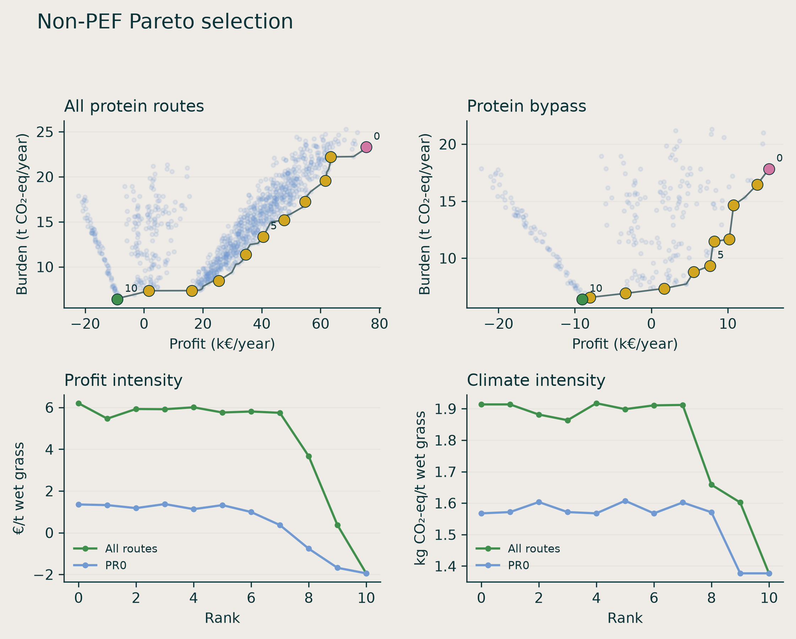

*Figure: 07 optimization/non pef pareto dashboard.png*

## 2. Scope and model architecture

The physical system begins with wet roadside grass, then preparation and mechanical separation into liquid, fibre cake and rejects. The liquid pathway can recover protein, pass through anaerobic digestion, condition or upgrade gas, and recover nitrogen, phosphorus and other nutrient-rich solids from digestate. Press cake leaves this modeled liquid-valorization boundary; downstream panel production is outside the process. The application forms one connected BioSTEAM flowsheet and applies TEA and LCA services after simulation [D1, D7-D11].

This edition fixes feed preparation at F1, excluding PEF before Pareto selection. The reference route is F1 PR3 AD1 BG2 NR4 A at 1,000 kg wet grass/hour and 8,760 hours/year. All 33 selected candidates use F1. The package also contains the earlier F2 manuscript and its data as historical documentation [H1]; it must not be used as the current baseline.

The current model is structural. It conserves material and estimates utilities and some equipment sizes, but selected yield, kinetic, transfer, product-quality and cost assumptions lack project validation. A numerical balance pass is not proof of industrial performance [D2, D3].

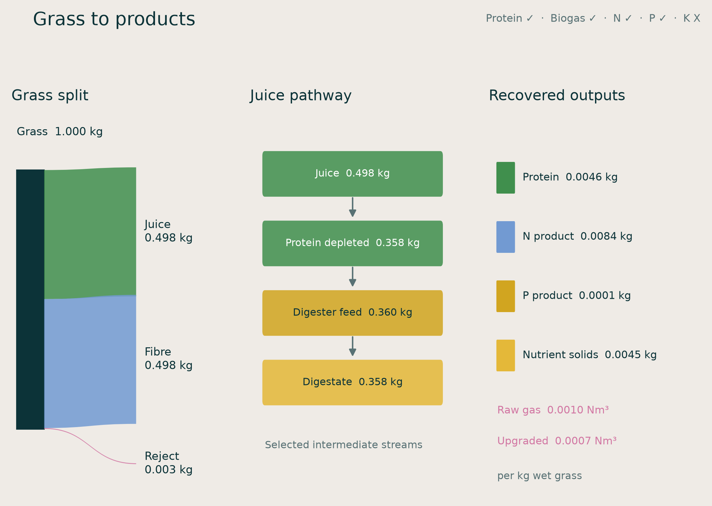

*Figure: 01 baseline/combined/01 grass to products.png*

## 3. Sources, functional units and calculations

Every figure is indexed in portable_figure_index.csv with its scenario, units, source and interpretation notes. The process functional unit for the flow maps is 1 kg wet grass at the plant inlet. First-stage grass = liquid fraction + fibre cake + preparation rejects closes exactly. Later columns show selected intermediate and product stream masses and cannot be summed into a closed Sankey without omitted water, reagents, evaporation and side streams [D6].

Steady rates are annualized using the explicit 8,760-hour schedule. Dry gas in the dense figures is converted from saved component masses to Nm3 at 273.15 K and 101,325 Pa. The older group comparison uses a TEA gas sales quantity at 293.15 K, so those m3 figures require temperature conversion before comparing with Nm3. Raw BG0 export and upgraded gas are distinct streams. Solid nutrient-product amounts are stream masses, not pure elemental N, P or K [D6].

The 20-year financial projection repeats the saved nominal annual operating account and subtracts subsidy-adjusted partial direct capital at year zero. NPV discounts that same cash account at the report's 8% rate. It omits financing, replacement, working capital, inflation, terminal value and uncaptured cost lines. Electricity-only climate burden equals modeled purchased kWh multiplied by the screening factor 0.20 kg CO2-eq/kWh. Heat and other environmental inventory remain separate and uncharacterized [D4, D6].

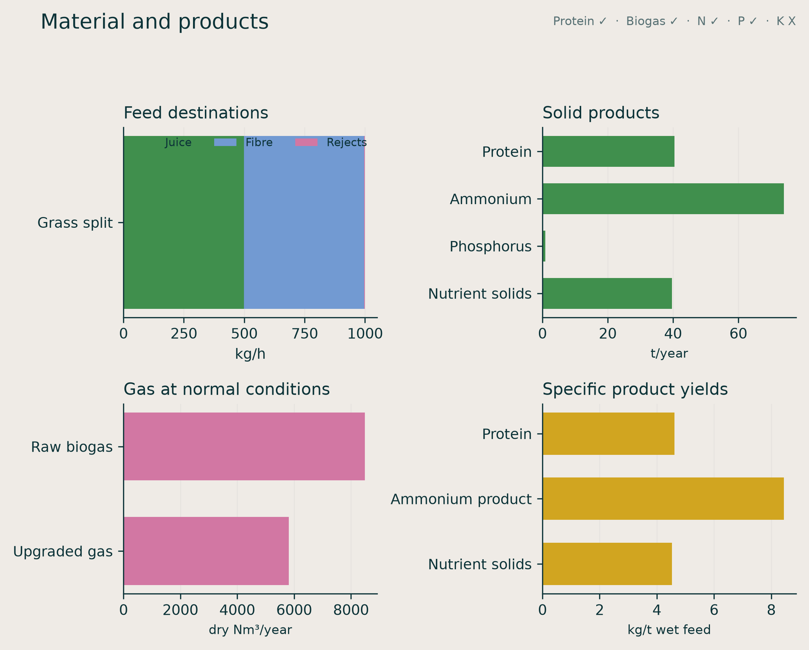

*Figure: 01 baseline/combined/02 material and products.png*

## 4. F1 baseline performance

The F1 reference processes 8,760 t/year at 1,000 kg/hour. The saved simulation produces 40.39 t/year dry protein stream, 73.99 t/year ammonium stream, and 0.829 t/year phosphorus product stream. Electricity is 85.43 MWh/year and positive heating duty is 335.01 MWh/year.

For an explicit benchmark-price screen with no candidate savings or subsidy, the baseline records EUR 78,156/year revenue, EUR 17,009/year included OPEX and EUR 50,000 partial net capital. Its electricity-only climate screen is 17.09 t CO2-eq/year. These accounts do not complete the model's full TEA or LCA.

The baseline process route contains protein recovery, mesophilic digestion, water scrubbing and combined P/N recovery. Several recovered streams are small relative to wet grass because water remains in the inlet and because some material exits as fibre cake or residual liquid. Stream recovery should be interpreted against measured product composition and quality before sale or land application [D2, D3].

| Indicator | F1 baseline | Unit |
| --- | --- | --- |
| Wet grass processed | 8,760 | t/year |
| Protein stream | 40.39 | t/year |
| Ammonium product stream | 73.99 | t/year |
| Phosphorus product stream | 0.829 | t/year |
| Electricity | 85.43 | MWh/year |
| Heating | 335.01 | MWh/year |
| Screening revenue | 78.16 | EUR thousand/year |
| Included OPEX | 17.01 | EUR thousand/year |
| Electricity burden | 17.09 | t CO2-eq/year |

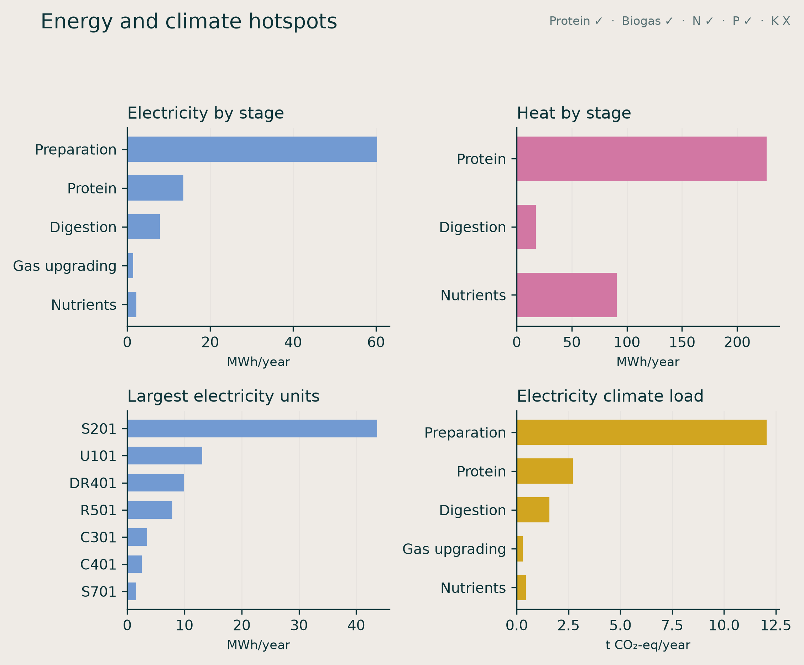

*Figure: 01 baseline/combined/03 energy and climate.png*

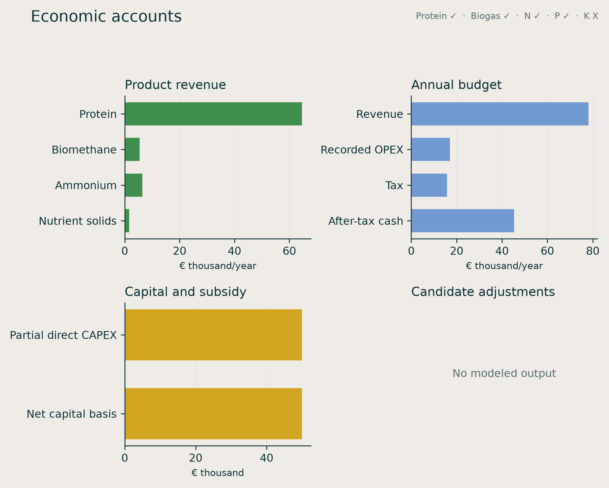

*Figure: 01 baseline/combined/04 economic accounts.png*

## 5. Technical pathways and hotspots

The six-page set for every candidate pairs feed split, product amounts, utility consumption, partial financial accounts, cash projection and model evidence. Cross-route technical panels normalize solid and gas production, electricity and heat to wet grass throughput. This avoids attributing differences caused solely by sampled plant size to technology selection.

The modeled preparation stage is a prominent electricity hotspot in the selected F1 cases. Protein and nutrient operations can add substantial thermal duty. Individual equipment power is shown in the candidate energy page. Reagent mass is intentionally absent from the hotspot plots because a reliable cross-route cost and environmental characterization has not been assembled [D3, D6].

No selected candidate contains a calibrated time trajectory. The digestion documentation explicitly uses steady-state fate fractions where kinetic and time-course evidence is missing. Consequently, this report does not infer VFA or microbial growth curves [D9].

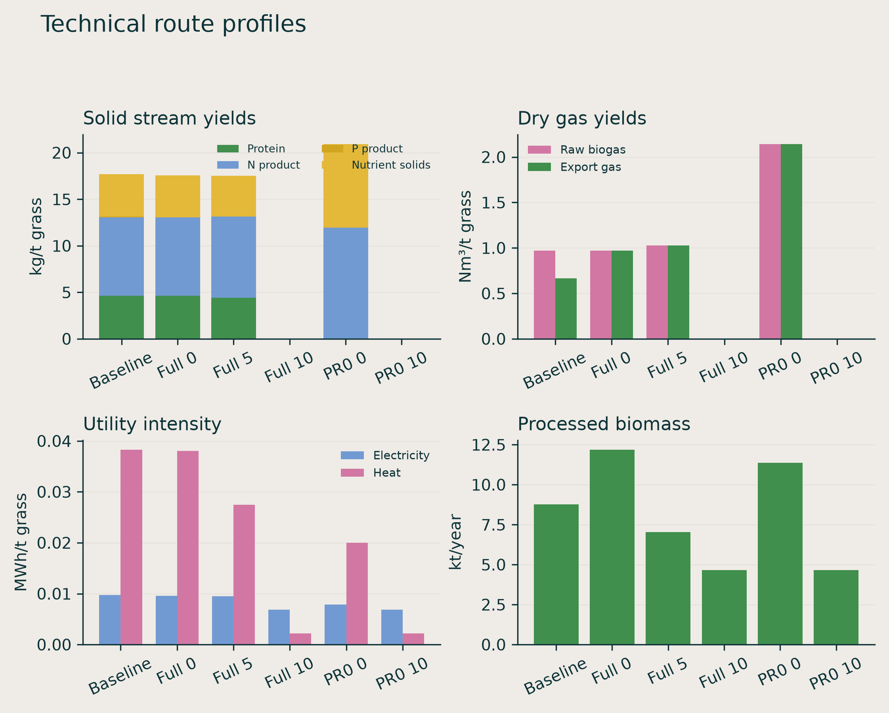

*Figure: 02 technical/non pef route profiles.png*

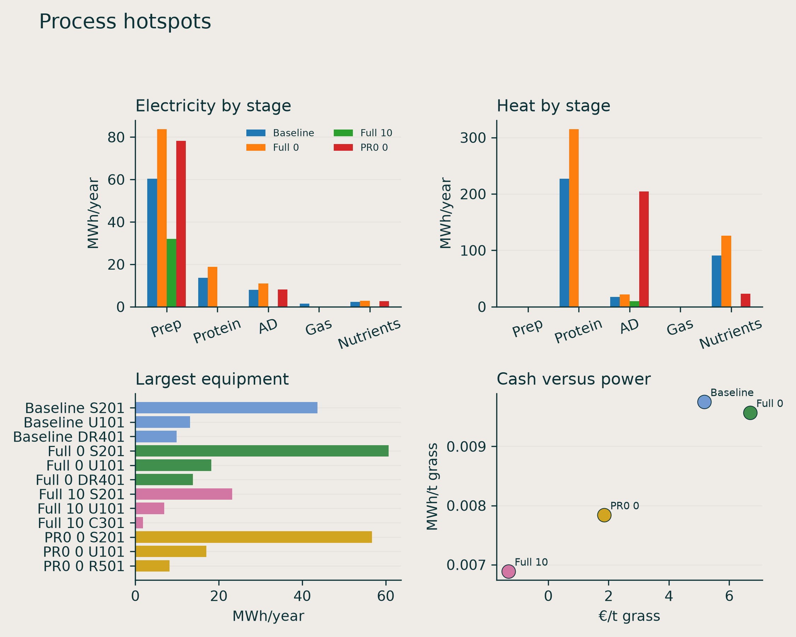

*Figure: 05 hotspots/non pef utility cost hotspots.png*

## 6. Techno-economic screening

Across the full F1 frontier, rank 0 has EUR 129,335/year modeled benchmark revenue, EUR 19,399/year recorded OPEX, EUR 59,514 subsidy-adjusted partial capital and a repeated-account NPV of EUR 741,382. Rank 10 has no priced recovered product and a negative screening profit. These numbers are incomplete accounts, not bankable returns.

Product-level revenue is shown where a saved price line exists. Shared equipment cost is not allocated artificially to individual products. Paired protein-bypass simulations estimate incremental pathway effects with throughput and sampled economics held fixed. The economic sensitivity chart varies price, included OPEX and capital by +/-10%, and discount from 6% to 10%; these are hypothetical arithmetic changes, not new process simulations [D6].

A specific price-to-quality problem affects BG0: its raw gas export is stored under the product ID biomethane and can receive the biomethane benchmark price in the saved TEA. Figures now label the stream Raw gas export but retain recorded revenue. No sale, injection qualification or raw-gas market price is demonstrated. Economic rankings involving BG0 must be revisited after the product and pricing boundary is corrected.

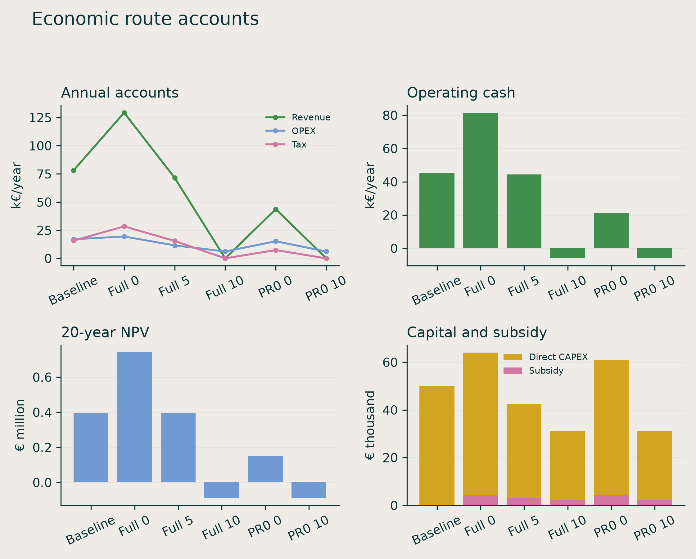

*Figure: 03 tea/non pef economic accounts.png*

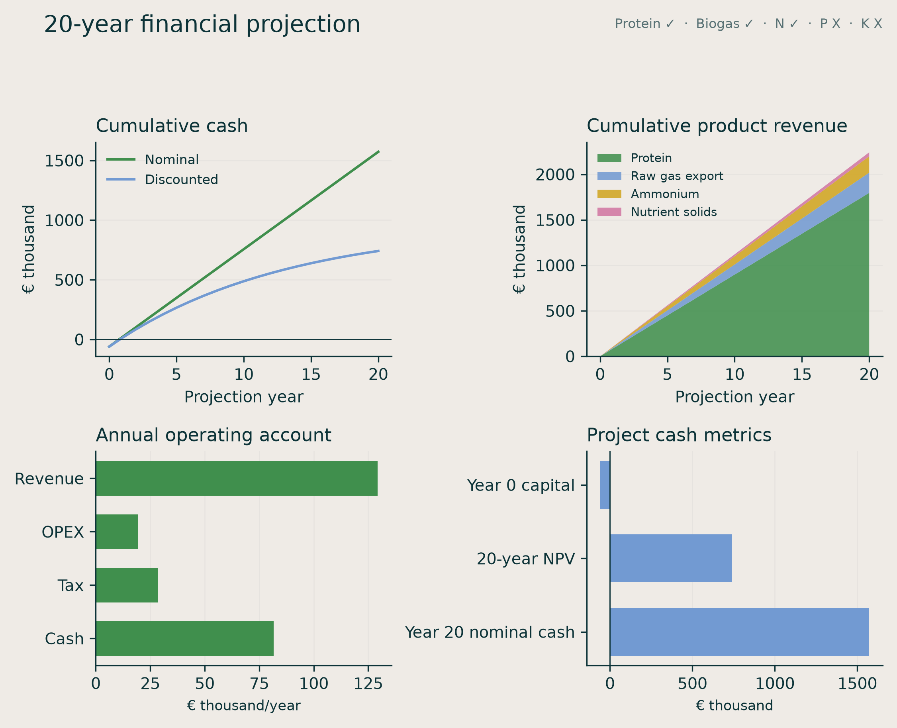

*Figure: 08 candidate comparison/biosteam/all/rank 00/combined/05 cashflow and product revenue.png*

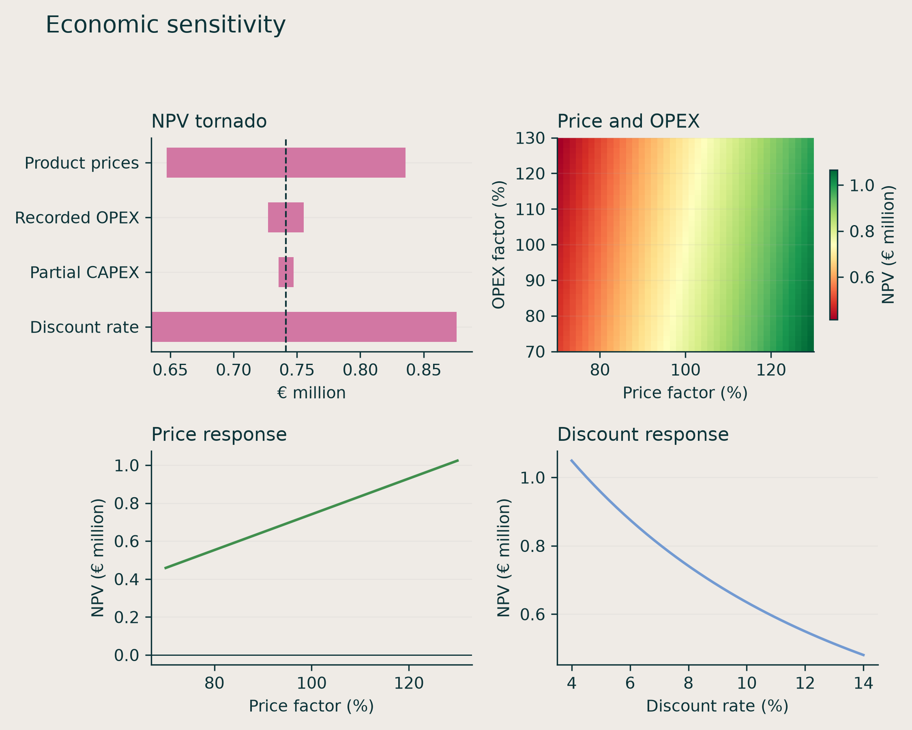

*Figure: 09 uncertainty/non pef economic tornado.png*

## 7. Attributional climate and LCA boundary

The displayed climate numbers characterize modeled purchased electricity only at 0.20 kg CO2-eq/kWh. This is an attributional burden, never a product displacement credit or climate offset. The saved LCA inventory also records heat and other flows, but factors, fate and boundary evidence remain incomplete. The report therefore keeps heat in MWh and counts missing factor records instead of inventing CO2-equivalent totals [D4, D6].

Full-front rank 0 has 23.29 t CO2-eq/year annual electricity burden at 12,173 t/year feed. Rank 10 has 6.41 t CO2-eq/year at 4,652 t/year. Their feed-normalized burdens are 1.91 and 1.38 kg/t, respectively. The environmental endpoint is a low-activity bypass configuration, not evidence that abandoning product recovery has lower whole-life-cycle impact.

Factor-sensitivity panels vary the electricity factor explicitly. These sweeps show how strongly the partial burden depends on electricity sourcing, but do not fill the missing heat, materials, transport, storage, direct-emission, product-use or substitution inventories. No comparative full-LCA claim is made.

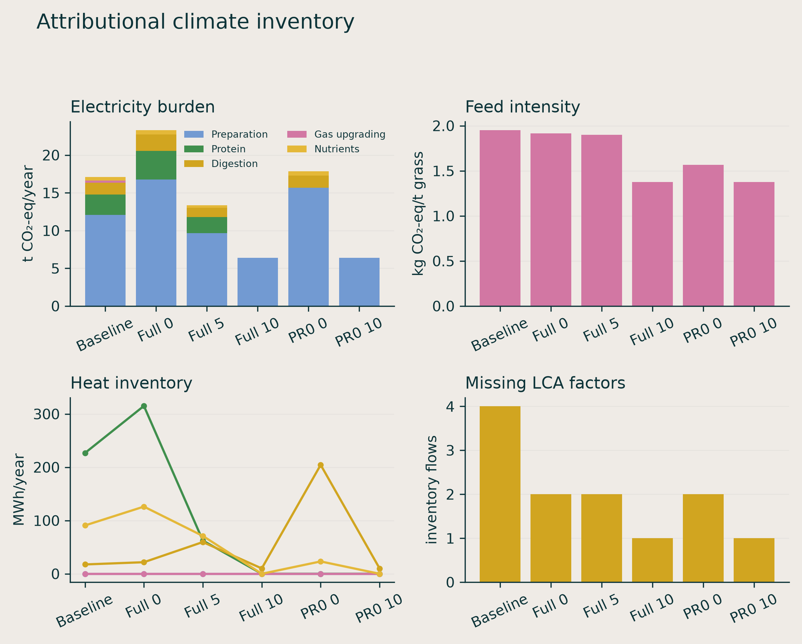

*Figure: 04 lca/non pef attributional burden.png*

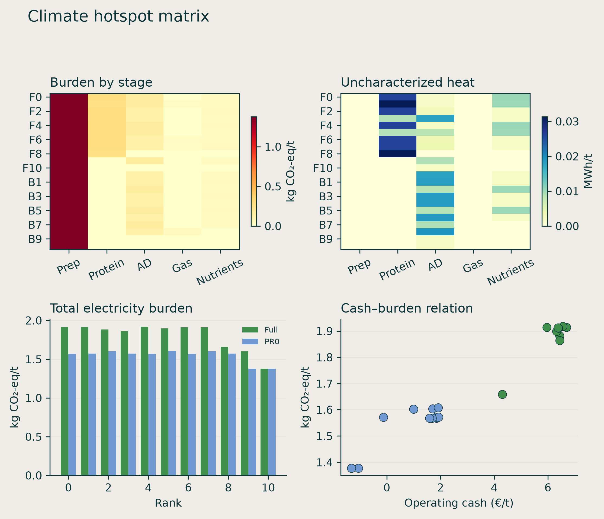

*Figure: 04 lca/non pef climate hotspot matrix.png*

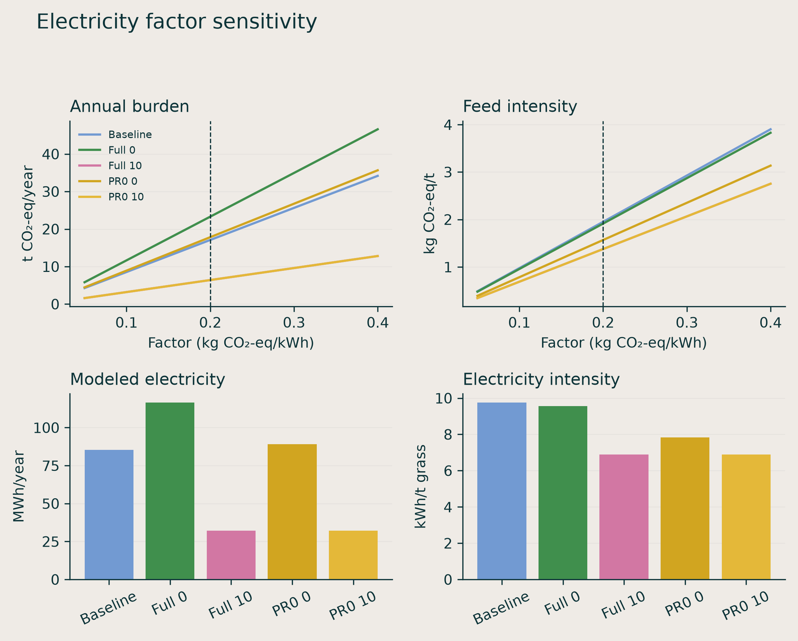

*Figure: 04 lca/non pef electricity factor sensitivity.png*

## 8. Pareto selection and candidate ranking

The completed saved batch contains 2,000 sampled configurations. Filtering to F1 before objective eligibility leaves 1049 eligible full-route cases and 247 eligible PR0 cases. Their two-objective screening fronts contain 42 and 15 points. Eleven points are selected on each front by normalized arc length. Rank 0 is the most economic selected point (rose); rank 10 has the lowest electricity-only burden (green) [D5, D6].

The full-front rank 5 is F1 PR1 AD1 BG0 NR3 A at 7,026 t/year with EUR 40,468/year screening profit and 13.34 t CO2-eq/year electricity burden. It is a useful intermediate trade-off example, not a formally validated MCDA optimum. The independent PR0 front has different throughput and route choices, so matching rank numbers across fronts does not isolate protein effects.

Selected candidate reports carry eligible_for_ranking=false because of unresolved storage blockers even though their screening objectives were finite in the original batch. This distinction is retained. Pareto status expresses non-domination within a partial model and sampled design space; it does not certify engineering feasibility or a complete economic-environmental optimum.

| Set | Eligible F1 designs | Front points | Selected ranks |
| --- | --- | --- | --- |
| Full routes | 1049 | 42 | 0-10 |
| Protein bypass | 247 | 15 | 0-10 |

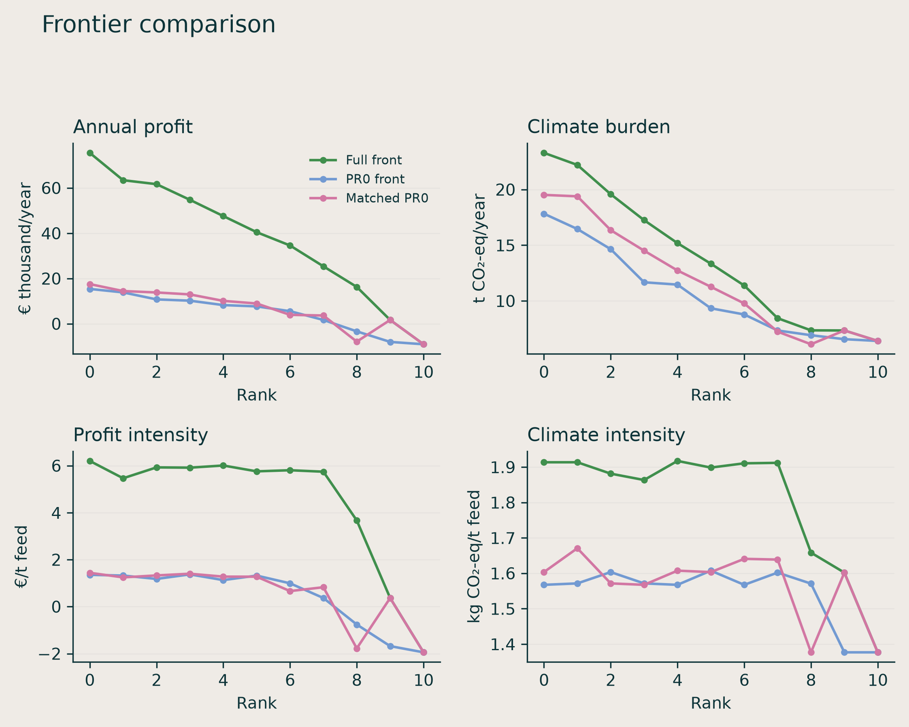

*Figure: 06 scenario comparison/biosteam dense/three series profit climate.png*

## 9. Protein bypass intervention

At the full-front economic endpoint, changing only PR3 to PR0 while retaining throughput and sampled economic assumptions reduces the saved profit objective by EUR 58 thousand/year and lowers electricity-only burden by 3.78 t CO2-eq/year. The matched route is F1 PR0 AD1 BG0 NR3 A. This is an incremental simulation comparison, not a shared-equipment allocation.

The paired differences vary across ranks because the original protein technologies, downstream routes and feed rates differ. Some high ranks already use PR0, producing zero intervention difference. The volcano plot has no statistical significance axis; it maps paired changes in screening profit and burden [D6].

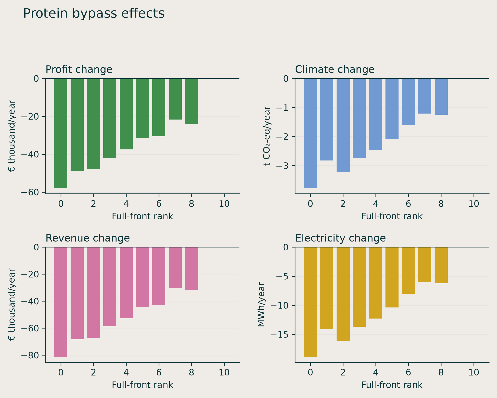

*Figure: 06 scenario comparison/biosteam dense/matched protein bypass effects.png*

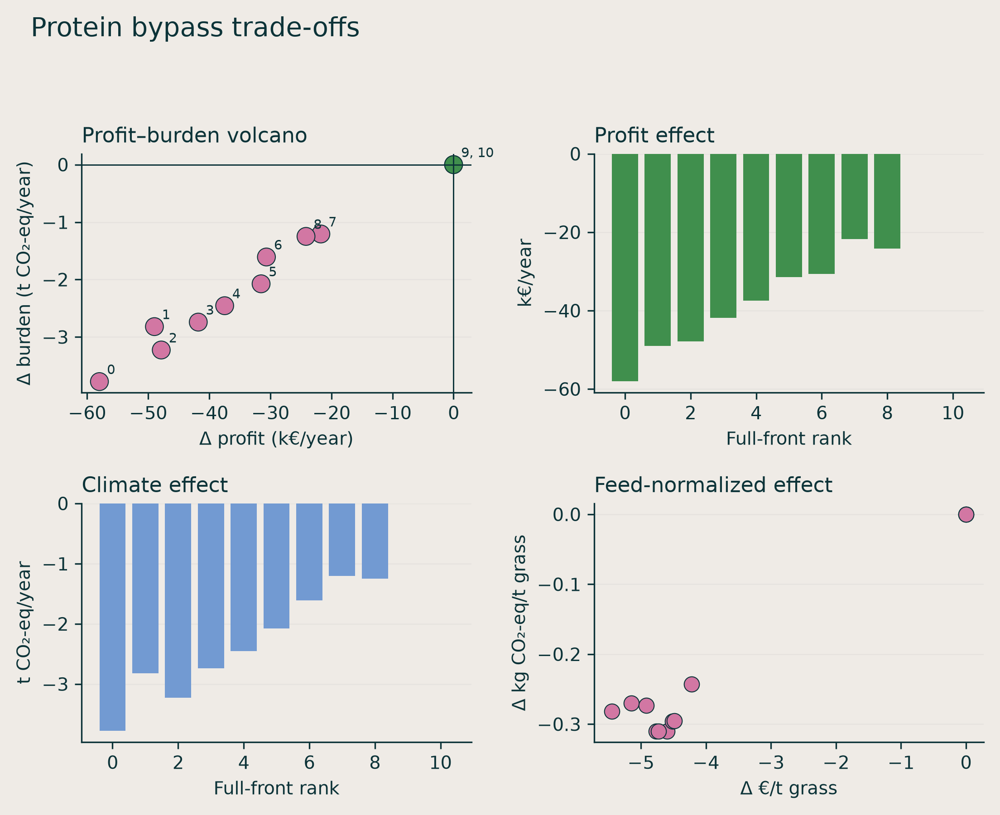

*Figure: 09 uncertainty/non pef protein bypass volcano.png*

## 10. Design sweep, sensitivity and evidence quality

The Monte Carlo panels describe the saved random design sweep: technology options, throughput and independent sampled economic assumptions vary simultaneously. Histogram frequencies are frequencies of sampled designs, not probabilities of future plant outcomes. Parameter scatter plots are descriptive associations and do not isolate causal response. The route violins stratify this design space by protein route, without claiming experimental confidence intervals [D6].

The economic and environmental tornado charts are one-factor arithmetic sweeps around saved outputs. The latter uses a stated electricity factor range, +/-10% purchased power and +/-5% operating hours. No synthetic process-parameter uncertainty, confidence band, candidate kinetic curve or full-LCA distribution is generated.

The model audit records no unit at E5 validated-and-costed maturity. Custom equipment costs, kinetic and separation calibration, product specifications, end-use eligibility, storage fate, full delivered-energy factors and complete inventory remain priority gaps [D2-D4]. Each candidate evidence panel shows balance residuals, evidence records, calculated account lines and warnings. Numerical closure establishes bookkeeping consistency only.

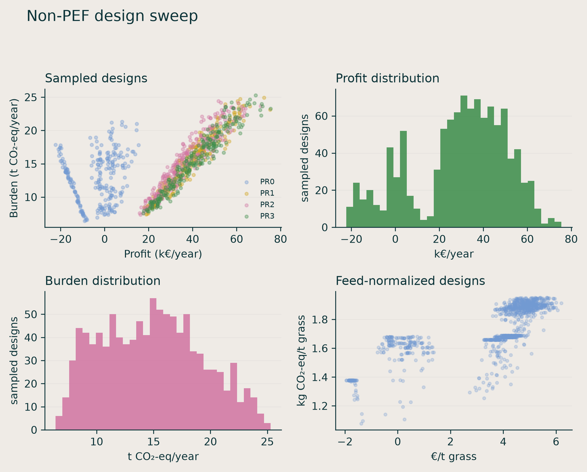

*Figure: 09 uncertainty/non pef monte carlo design sweep.png*

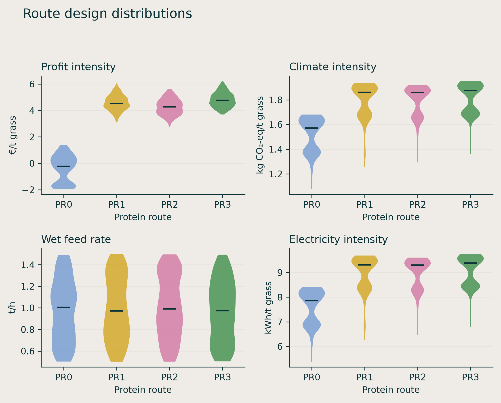

*Figure: 09 uncertainty/non pef route design distributions.png*

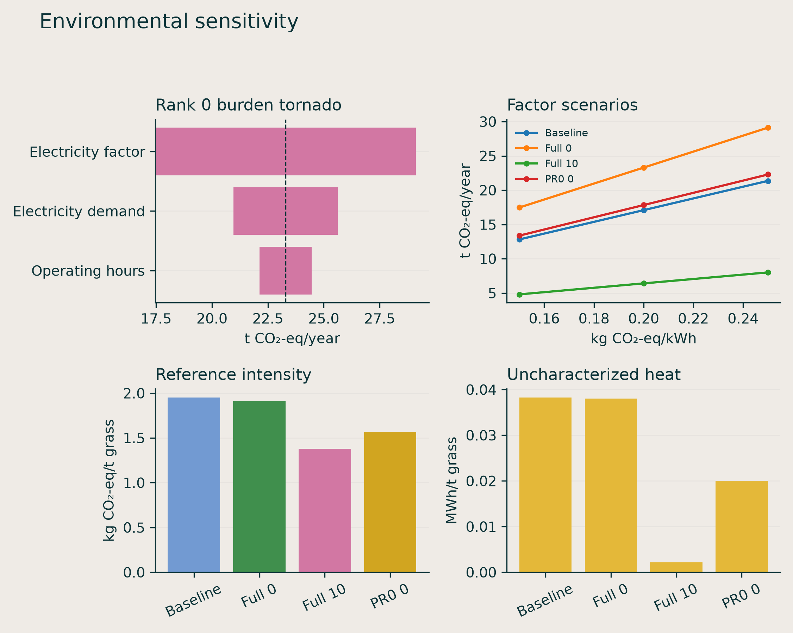

*Figure: 09 uncertainty/non pef environmental tornado.png*

## 11. Decision interpretation and next evidence

For a screening question focused on recorded financial return, full-front rank 0 is the current economic endpoint. For the narrow electricity-only annual burden, rank 10 is the minimum but recovers no protein, biogas or targeted nutrients. A configuration with meaningful recovery and intermediate objectives, such as full-front rank 5, is a process-study candidate. None should be declared the best GreenHub investment or full environmental option from the present evidence.

The next decision gate should reconcile BG0 raw gas identity and sale price; measure feed, protein and digestion yields over seasons; validate storage reactions and emissions; obtain vendor equipment quotations and labor/maintenance estimates; establish product quality and end-use routes; add location/year-matched electricity and heat factors plus transport, materials and direct emissions; then rerun matched-throughput TEA/LCA and multi-objective screening. These needs follow the model documentation and the selected reports [D2-D4].

Historical F2 results remain available in the documentation archive for provenance, but are not merged into the non-PEF candidate ranking. This prevents unlike preparation routes from being presented as one baseline.

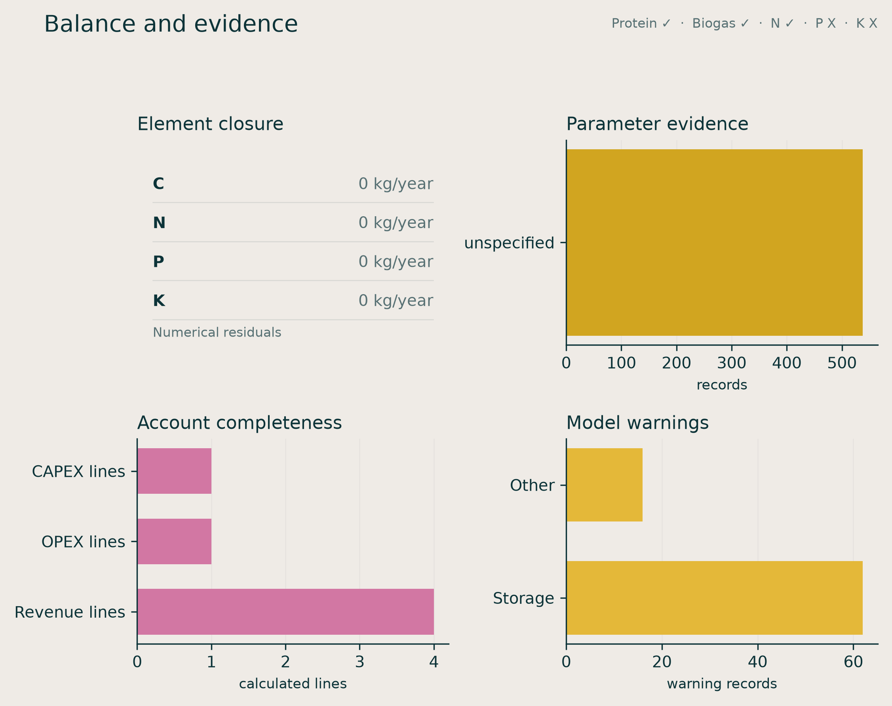

*Figure: 08 candidate comparison/biosteam/all/rank 00/combined/06 balance and evidence.png*

## 12. Complete candidate ledger

The table below lists every selected F1 full-front and protein-bypass point. Profit and NPV use partial, assumption-dependent financial accounts. Climate is electricity-only attributional burden. The independent fronts have different throughput; matched intervention values are supplied in evidence/biosteam_frontiers/matched_protein_bypass_manifest.json and the corresponding candidate pages.

| Set | Rank | Route | Feed t/y | Profit kEUR/y | Burden t/y | kg/t | NPV kEUR |
| --- | --- | --- | --- | --- | --- | --- | --- |
| Full | 0 | F1 PR3 AD1 BG0 NR3 A | 12,173 | 75.5 | 23.3 | 1.91 | 741 |
| Full | 1 | F1 PR2 AD1 BG3 NR3 A | 11,606 | 63.4 | 22.2 | 1.91 | 623 |
| Full | 2 | F1 PR3 AD3 BG0 NR4 A | 10,406 | 61.7 | 19.6 | 1.88 | 606 |
| Full | 3 | F1 PR1 AD3 BG0 NR3 A | 9,257 | 54.8 | 17.2 | 1.86 | 538 |
| Full | 4 | F1 PR3 AD1 BG0 NR4 A | 7,921 | 47.6 | 15.2 | 1.92 | 467 |
| Full | 5 | F1 PR1 AD1 BG0 NR3 A | 7,026 | 40.5 | 13.3 | 1.90 | 397 |
| Full | 6 | F1 PR3 AD3 BG2 NR3 A | 5,956 | 34.6 | 11.4 | 1.91 | 340 |
| Full | 7 | F1 PR3 AD3 BG3 NR4 A | 4,418 | 25.4 | 8.4 | 1.91 | 249 |
| Full | 8 | F1 PR2 AD0 BG0 NR0 A | 4,436 | 16.3 | 7.4 | 1.66 | 160 |
| Full | 9 | F1 PR0 AD1 BG0 NR1 A | 4,585 | 1.7 | 7.3 | 1.60 | 17 |
| Full | 10 | F1 PR0 AD0 BG0 NR0 A | 4,652 | -9.0 | 6.4 | 1.38 | -89 |
| PR0 | 0 | F1 PR0 AD3 BG0 NR3 A | 11,374 | 15.4 | 17.8 | 1.57 | 151 |
| PR0 | 1 | F1 PR0 AD3 BG0 NR4 A | 10,472 | 13.9 | 16.5 | 1.57 | 136 |
| PR0 | 2 | F1 PR0 AD1 BG0 NR3 A | 9,132 | 10.8 | 14.6 | 1.60 | 106 |
| PR0 | 3 | F1 PR0 AD3 BG0 NR4 A | 7,427 | 10.2 | 11.7 | 1.57 | 100 |
| PR0 | 4 | F1 PR0 AD3 BG0 NR3 A | 7,313 | 8.3 | 11.5 | 1.57 | 81 |
| PR0 | 5 | F1 PR0 AD1 BG0 NR4 A | 5,808 | 7.7 | 9.3 | 1.61 | 75 |
| PR0 | 6 | F1 PR0 AD3 BG0 NR3 A | 5,603 | 5.6 | 8.8 | 1.57 | 55 |
| PR0 | 7 | F1 PR0 AD1 BG0 NR1 A | 4,585 | 1.7 | 7.3 | 1.60 | 17 |
| PR0 | 8 | F1 PR0 AD3 BG4 NR0 A | 4,405 | -3.4 | 6.9 | 1.57 | -33 |
| PR0 | 9 | F1 PR0 AD0 BG0 NR0 A | 4,767 | -8.0 | 6.6 | 1.38 | -79 |
| PR0 | 10 | F1 PR0 AD0 BG0 NR0 A | 4,652 | -9.0 | 6.4 | 1.38 | -89 |

## 13. Documentation and reproducibility

The complete PDF appends one full-size page for each of the 266 unchanged PNGs. An offline figure_atlas.html provides category and text filtering, while figure_atlas.md and portable_figure_index.csv record every figure with source, scenario, units and notes. The evidence folder contains the 33 exact candidate reports, the F1 baseline screening report, selected run streams, generator scripts and a compressed copy of the complete 2,000-case batch.

The documentation folder preserves the model docs and audits, phase methodologies, frontend docs, data registers and the earlier scientific report. A SHA-256 manifest records every copied source path, size and hash. The historical F2 manuscript is retained as source history, not as the baseline or a current conclusion. The package README states the reproduction sequence and evidence hierarchy.

The model and figure data are a research screening resource. Full installed costs, project validation, market acceptance, environmental characterization and probabilistic parameter evidence remain unresolved. The archive enables review of each plotted number without silently promoting those gaps into certainty.

| Reference | Document | Packaged path |
| --- | --- | --- |
| D1 | Architecture | documentation/model_docs/architecture.md |
| D2 | Scientific model audit | documentation/model_docs/audit/scientific_model_audit.md |
| D3 | Model limitations | documentation/model_docs/model_limitations.md |
| D4 | LCA inventory method | documentation/model_docs/lca_inventory.md |
| D5 | Backend Pareto jobs | documentation/model_docs/backend_pareto_jobs.md |
| D6 | Figure methodology | documentation/figure_methodology.md |
| D7 | Phase 3 methodology | documentation/model_docs/phase3_methodology.md |
| D8 | Phase 4 methodology | documentation/model_docs/phase4_methodology.md |
| D9 | Phase 5 methodology | documentation/model_docs/phase5_methodology.md |
| D10 | Phase 6 methodology | documentation/model_docs/phase6_methodology.md |
| D11 | Phase 7 methodology | documentation/model_docs/phase7_methodology.md |
| H1 | Earlier F2 scientific report (historical) | documentation/historical_scientific_report/GreenHub_scientific_report.md |
